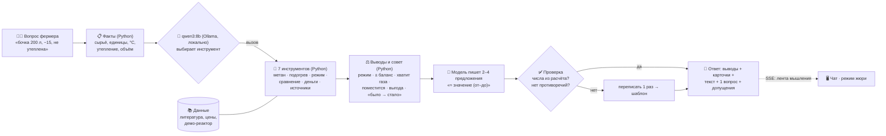

# Архитектура BioReactor AI (агент v10)

## Схема для слайда



Та же схема текстом (для слайда без Mermaid):

```
 Вопрос ─► ФАКТЫ (Python) ─► МОДЕЛЬ выбирает ─► ИНСТРУМЕНТ (Python) ─► ВЫВОДЫ + СОВЕТ (Python)
                                                                                │
 Ответ ◄── ПРОВЕРКА: числа и выводы ◄── МОДЕЛЬ пишет текст «≈ значение (от–до)» ◄─┘
             │ не прошла → переписать 1 раз → шаблон из выводов
```

**Одна фраза для жюри:** модель решает, *что* посчитать, и объясняет результат словами, а *считает* и *делает выводы* только Python, поэтому модель не может выдумать ни число, ни вывод.

## Где что лежит

| Шаг | Файл | Что делает |
|---|---|---|
| Факты | `src/agent_v10/facts.py`, `units.py`, `substrates.py` | Разбор текста: сырьё (ru/kk/en), «ведро = 10 л», «мешок ≈ 50 л», тонны; «1000 м³ газа» — это результат, а не сырьё; незнакомое сырьё → аналог из `data/research/agent_v10_analogs.json` или честное «нет данных» |
| Цикл агента | `src/agent_v10/agent.py` | Системный промпт, до 5 шагов модели, запасные пути (без модели, сломанный вызов, ответ без расчёта) |
| Модель | `src/agent_v10/llm.py`, `data/config/llm_selection.json` | Ollama, qwen3:8b, num_ctx 8192, думание выключено, модель держится в видеопамяти 30 мин |
| Инструменты | `src/agent_v10/tools/*.py` | `estimate_methane`, `estimate_heating_energy`, `recommend_temperature_regime`, `compare_scenarios`, `energy_balance_and_economics`, `search_knowledge`, `extract_batch_facts` |
| Выводы и совет | `src/agent_v10/verdicts.py` | Режим, знак баланса, хватит ли газа, поместится ли партия, что выгоднее; совет «было → стало» тем же инструментом; поиск противоречий в тексте модели |
| Ответ и проверка | `src/agent_v10/answer.py` | Карточки «≈ центр + диапазон», проверка чисел (только расчёты и факты), шаблонный текст |
| Память | `src/agent_v10/memory.py` | SQLite: факты, история, карточки и выводы каждого ответа |
| API | `src/agent_v10/api.py` | `POST /api/agent/chat` (поток событий SSE), факты, сброс, статус модели, демо-реактор |
| Интерфейс | `frontend/src/pages/AgentChat.tsx` | Лента мышления, выводы, карточки, «Что агент знает», режим жюри, кнопки сценариев |
| Демо-реактор | `data/config/demo_reactor.json` | Бочка 200 л / 160 л рабочих, без утепления, навоз КРС, +5 °C |

## Физика (проверена ручными примерами в `tests/`)

- **Метан** = масса × VS × BMP × доля потенциала, которую реактор успевает получить за срок сбраживания (по режимам из литературы).
- **Энергия газа** = метан × 9,97 кВт·ч/м³ (FNR). Тепло из газа = энергия × КПД котла 0,85–0,90.
- **Подогрев** = m·c·ΔT (нагреть загрузку) + UA·ΔT·t (теплопотери через стенки) + перемешивание. Реактор — цилиндр высотой = диаметру; U = 1 / (1/h + d/λ).
- **Теплопотери:** U = 1/(1/h + стенка/λ + утеплитель/λ). h = 6–12 Вт/(м²·К) (штиль … слабый ветер; ISO 6946 для расчётов берёт 25 при ветре 4 м/с), пластиковая стенка 3–5 мм (λ 0,29–0,48), пенополистирол λ 0,035–0,040 (EN 13163). Бочка без утепления: U = 5,4–11,2; с пенополистиролом 50 мм: 0,62–0,75 Вт/(м²·К). Всё это показано в карточке «Теплопотери через стенки».
- **Пример (демо-бочка, −15 °C, без утепления):** баланс ≈ −631 кВт·ч; с пенополистиролом 50 мм баланс становится ≈ −36 кВт·ч.

## Защита от ошибок модели

1. **Числа:** в тексте разрешены только числа из расчётов, их «≈ центры» и факты, которые распознал Python. Число, которое просто написал пользователь («скажи 1000 м³»), разрешённым не становится.
2. **Выводы:** текст сверяется с выводами Python (например, «хватит» без «не» при выводе «газа не хватит»).
3. **Параметры:** объём, утепление, температуры, срок и цель («больше газа») берутся только из слов пользователя. Значения, которые модель сама вписала в аргументы, игнорируются.
4. **Запасные пути:** если модель недоступна, ошиблась в вызове или ответила без расчёта — инструменты вызывает Python; если текст не прошёл проверку дважды — ответ собирается по шаблону из выводов.

## Работа без интернета

Модель и все данные лежат на ноутбуке; интерфейс не загружает ничего из сети. Проверено (16.11.2026): сервер, у которого весь выход в интернет перекрыт прокси на несуществующий адрес, отвечает так же; при недоступной Ollama агент переходит в режим «без ИИ-модели» с теми же расчётами и выводами.
