# Отчёт: полировка дашборда (ветка `dashboard-polish`)

17–18.11.2026. Агент (`src/agent_v10`) и его расчёты не менялись. В `main` не слито — ждёт твоего «да».
Подробный журнал решений — `docs/progress.md` (раздел «Полировка дашборда»), аудит «до» — `docs/polish_audit.md`.

## Коротко

| Что | Было | Стало |
|---|---|---|
| Числа страницы и агента | разный код, разные числа (50 кг КРС: 1.02–1.43 против 0.73–1.29 м³) | **один код**: страница вызывает инструмент агента; тест 20/20 + проверка в браузере с живой моделью — 4.9–8.1 = 4.9–8.1 м³ |
| «Сырьё и смеси» | форма на ~700 px, результат — 9 строк и таблицы «Не определено» | выбрал сырьё → ввёл количество → 4 карточки «≈ … (диапазон)», график вклада, кнопка «Спросить ИИ» |
| Ошибки ввода | `ApiError: [{"type":"less_than_equal"…` на экране | «Введите количество», «больше нуля», «слишком большое число» — у поля |
| Размеры шрифта | 8–11 на раздел, самый мелкий 8 px | 3–7 на раздел, самый мелкий 13 px |
| Подписей мельче 13 px | 11–150 на раздел | 0 |
| Цветов текста | 11–33 на раздел | 4–8 (из 8 токенов), контраст ≥ 5.5:1 |
| «Обзор» | 2 карточки + цены | что умеет система, живой статус, 3 большие кнопки |
| «Реактор» | API-контракт, JSON Schema | «Датчики не подключены» + схема установки; API — в «Для разработчиков» |
| Телефон 390 px | шапка вылезала на 26–79 px | 0 px во всех 8 разделах × 3 языка |

## 1. «Сырьё и смеси»

**До** (полная страница) — **после** (смесь из трёх компонентов):

| До | После |
|---|---|
| 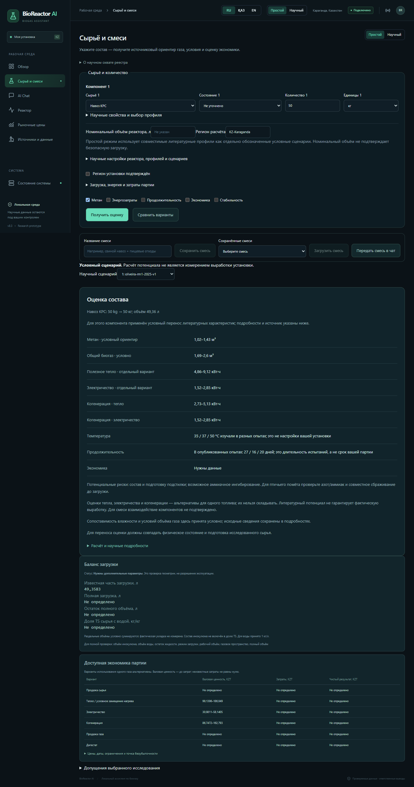 | 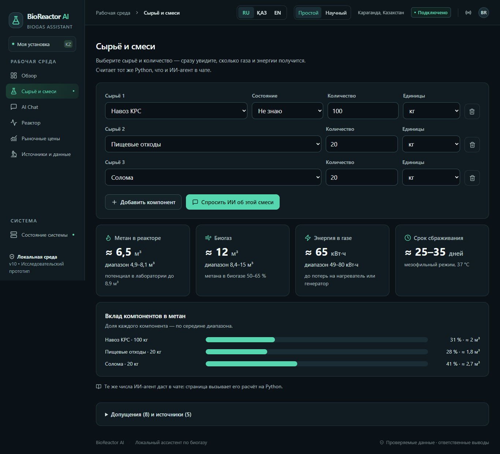 |

- **Одинаковые числа.** Новый адрес `/api/substrates/estimate` вызывает `estimate_methane` агента тем же путём, что и чат.
  Тест `tests/test_substrates_page_same_as_agent.py`: фраза в чат агента и та же партия на странице — все числа равны
  (л / кг / т / м³, смеси, ru / kk / en). Кнопка «Спросить ИИ» строит вопрос из `askAgentTemplates.json`; тот же файл
  читает тест — 7 вопросов дают в чате числа страницы.
- **Карточки** как в чате: метан в реакторе, биогаз, энергия в газе, срок; «≈», диапазон и мелкой строкой «потенциал в
  лаборатории до …».
- **Смесь:** «+ Добавить компонент» есть и в простом режиме; график вклада каждого компонента (доля и м³).
- **Честно, когда данных нет:** в «Научном» видны все 20 видов сырья, у 10 нет проверенных данных — пишем об этом,
  без чисел (так же отвечает агент).
- **Старый расчёт v8** — только в «Научном», свёрнут; считает ту же смесь; экономика — только посчитанные строки
  и одна фраза «Для расчёта прибыли нужны: …».

Ошибка ввода — подсказка у поля, последний верный расчёт остаётся приглушённым:

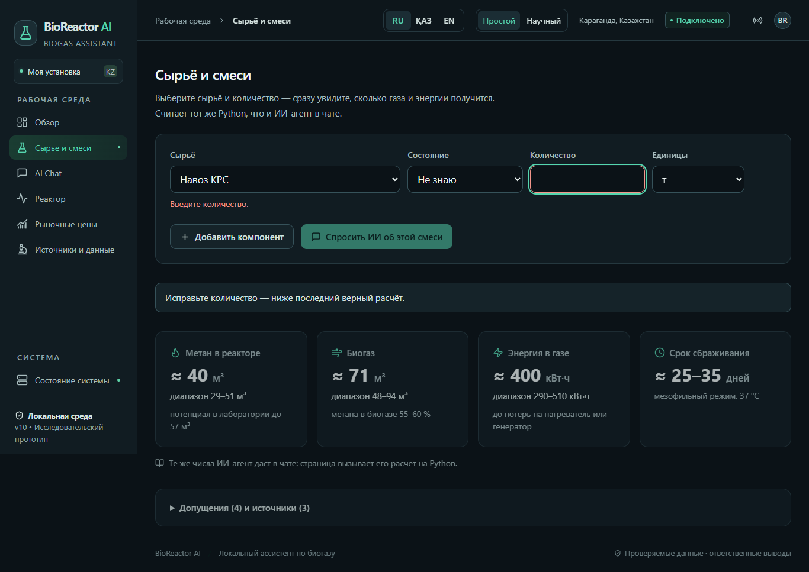

Кнопка «Спросить ИИ об этой смеси» → чат с живой моделью — те же числа (4.9–8.1 м³):

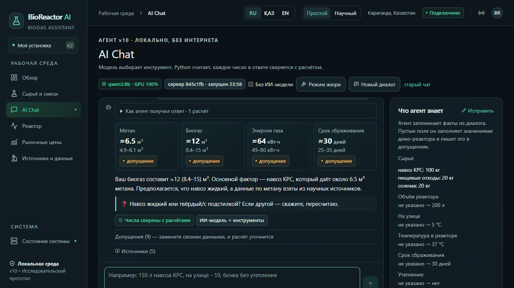

## 2. Главный экран — «Обзор»

| До | После |
|---|---|
| 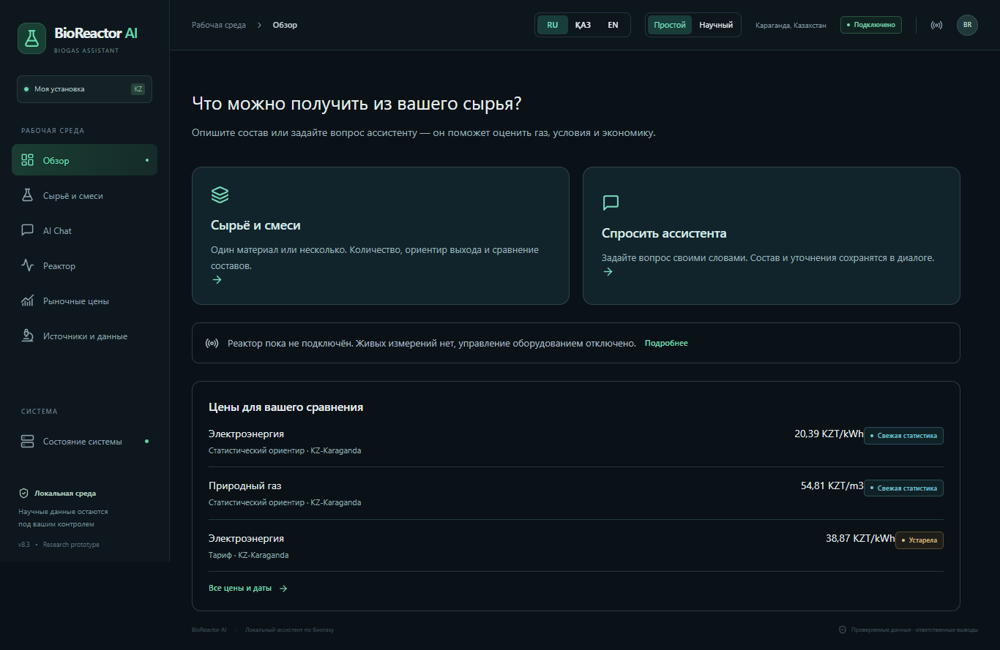 | 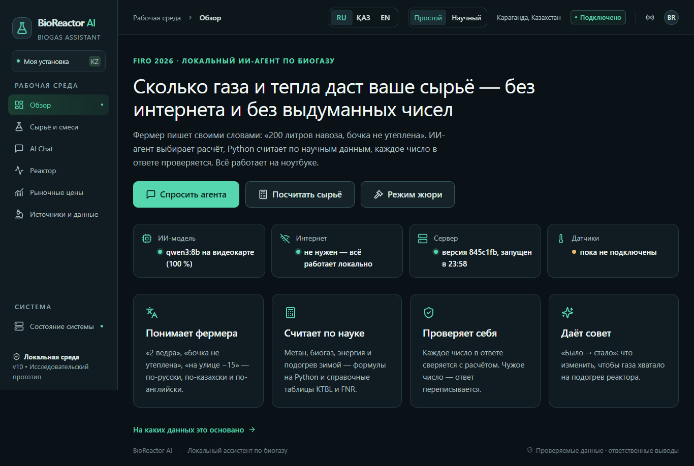 |

Живой статус: модель на видеокарте, интернет не нужен, версия сервера (или «устарел — перезапустите»), датчики.
«Режим жюри» сразу открывает чат в режиме жюри. На проекторе 1280×720, по-казахски:

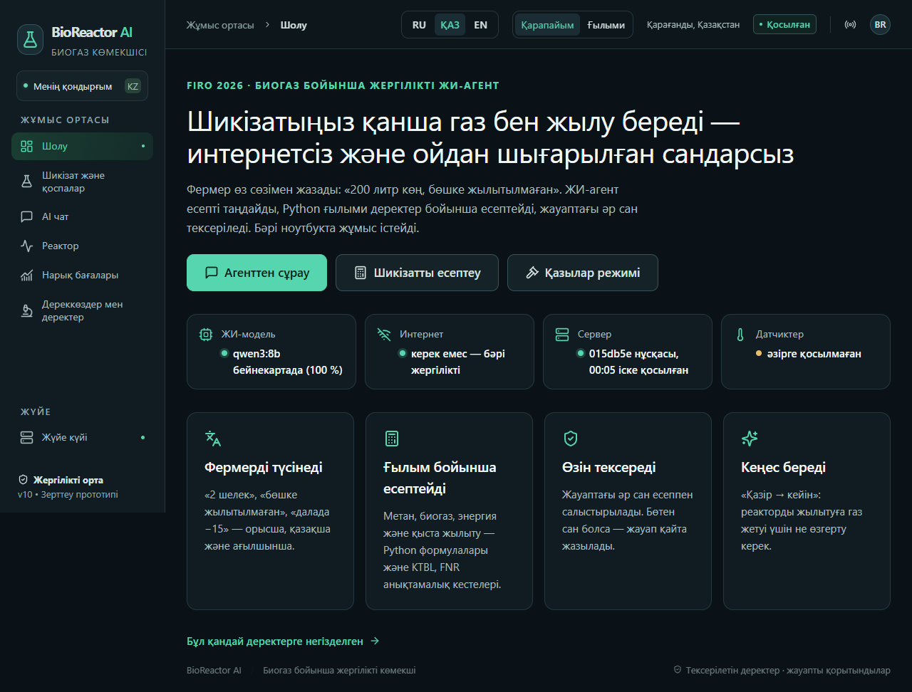

## 3. Остальные разделы

- **Реактор** (завтра — главный раздел с датчиками): «Датчики не подключены», две карточки «ждёт датчик», схема
  «реактор → датчики → плата → ноутбук → дашборд → ИИ-агент». API-контракт, JSON Schema, старая схема — в
  свёрнутом «Для разработчиков».

  | До | После |
  |---|---|
  | 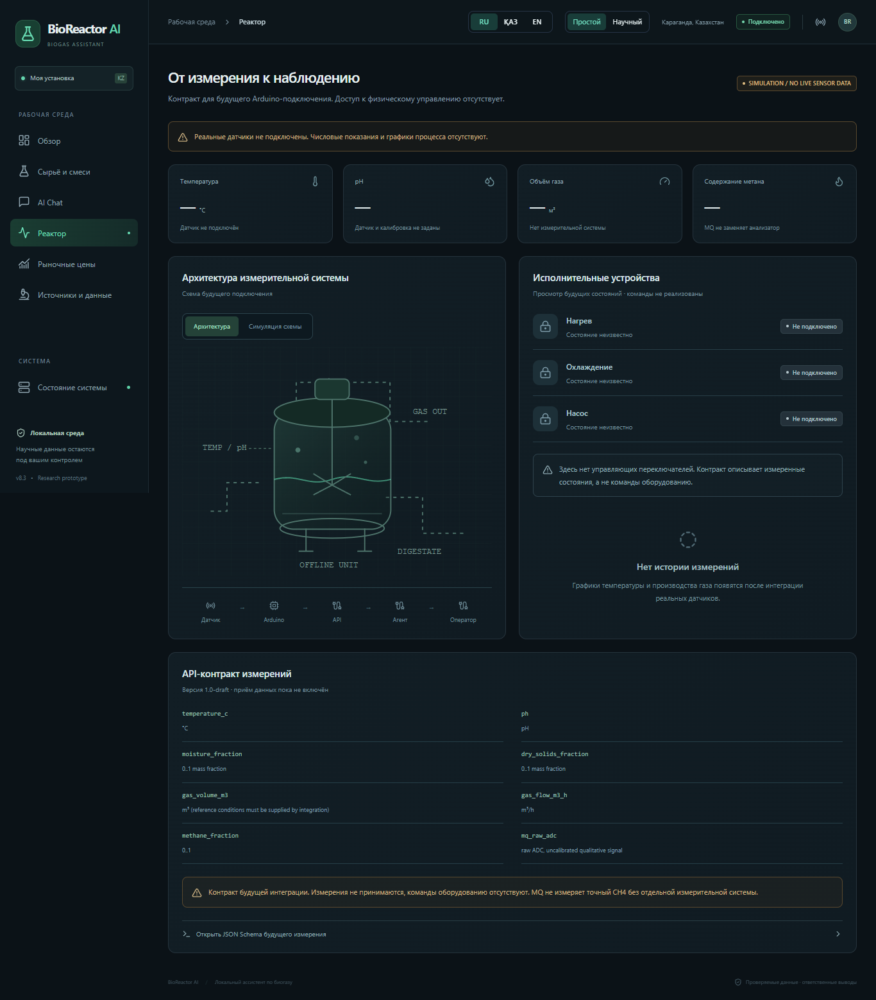 | 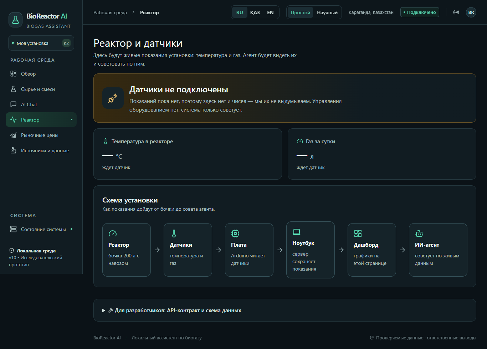 |
- **Источники и данные:** сверху «Коротко и простыми словами»: главный источник — таблицы KTBL/FNR; ML-модель
  ошибается в среднем на ±54 мл/г (≈ 10–20 %), на отложенном тесте ±80 мл/г и R² 17 %, поэтому в расчётах для
  фермера не используется. Под метриками — что значит «±54». Графики — в тёмной теме. Служебные тексты и
  ограничения на английском — только в «Научном».
- **Состояние системы:** скелетон из 6 карточек вместо «Получаем данные…».
- **Рынок:** «население · с НДС · тариф» вместо `household_tier1… · VAT_included · tariff`.
- **Меню:** v10 вместо v8.3; помещается в 1366×768 и 1280×720; длинные казахские пункты переносятся.
- **Чат на проекторе** открывается с начала страницы (раньше прокручивался вниз и прятал верх):

  | До | После |
  |---|---|
  | 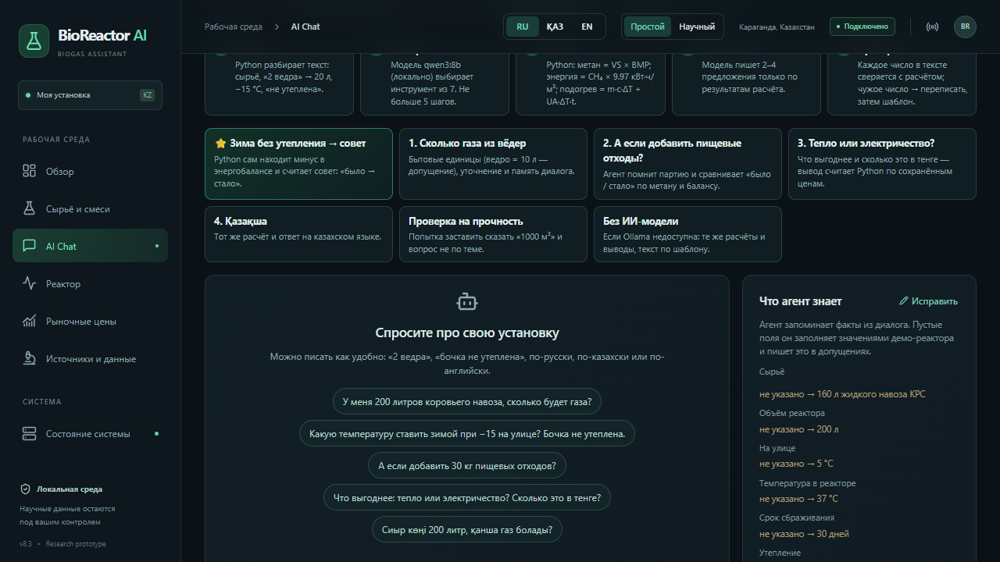 | 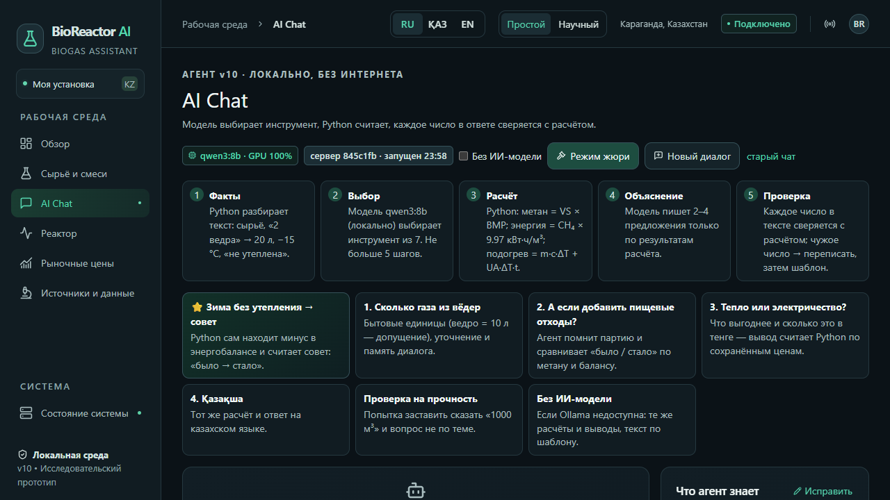 |

## 4. Дизайн-система

`frontend/src/design.css`: 4 поверхности, 4 цвета текста, акцент / предупреждение / ошибка / инфо; 8 размеров шрифта
(13–40 px); отступы по сетке 4 px; 4 скругления; общие карточки, кнопки, уведомления, свёрнутые блоки, статусы,
скелетон. Старый CSS переведён на эти токены скриптом `scripts/apply-design-tokens.mjs`. Анимации: карточки и шаги
появляются по очереди за 0.2–0.3 с; при «уменьшить движение» в системе — без анимации.

## 5. Проверки

| Проверка | Результат |
|---|---|
| pytest (полный) | 1231 passed, 0 failed (13 skipped — старые пометки на тестах v9 и старого агента) |
| Новый тест «страница = агент» | 20 / 20 |
| vitest | 101 / 101 (+9 новых) |
| tsc, сборка | без ошибок |
| Переводы (`i18n-check`) | 0 проблем |
| Переводы в браузере (`i18n-browser.mjs`) | ALL OK |
| Smoke всех 8 разделов | OK, без ошибок |
| Аудит «после»: 96 скриншотов + 27 сценариев | 0 ошибок JS / HTTP |
| «Спросить ИИ» → чат с живой моделью | числа совпали |
| Eval агента через HTTP API | смысл **87 / 87**, язык 106 / 106, числа 105 / 106, инструмент 105 / 106; медиана 3.4 с (106 сообщений, 39 диалогов, сервер 015db5e, пауза 5 с) |

Скриншоты «до» и «после» всех разделов на 3 языках и 3 экранах: `frontend/reports/polish/before|after/`
(папка в .gitignore; повторить — `cd frontend; node tests/polish-audit.mjs after`).

## Что заметил, но не трогал

0. **Eval: два сообщения не идеальны, оба — поведение модели, агент не менялся** (`git diff main -- src/agent_v10` пуст).
   Диалог 25 «банановые кожурки»: модель написала «около 7 м³ биогаза» — это середина 1.9–12 (≈ 6.95), по смыслу
   верно, но проверка eval считает «7» чужим числом. Диалог 39 по-казахски: модель снова не вызвала инструмент,
   считал запасной путь Python — то же, что в прошлом отчёте; числа и объём реактора верные.

1. **Текст модели в чате** (агент, не дашборд): для смеси модель написала «навоз КРС, который даёт около 6.5 м³
   метана», а 6.5 — метан всей смеси (навоз ≈ 31 %, ≈ 2 м³). Проверка чисел это пропускает: число настоящее, но
   приписано не тому. Агента по правилам не трогал. Предлагаю: правило «число итога нельзя приписывать одному
   компоненту», как с «≈398 после утепления».
2. Для твёрдого свиного навоза у агента нет данных (в таблице KTBL только жидкий) — страница и чат честно говорят
   «нет данных».

## Что дальше

1. Посмотреть страницы самому; если всё нравится — сказать «да», и я солью `dashboard-polish` в `main`.
2. Завтра датчики: раздел «Реактор» готов принять две карточки с живыми числами и график.
