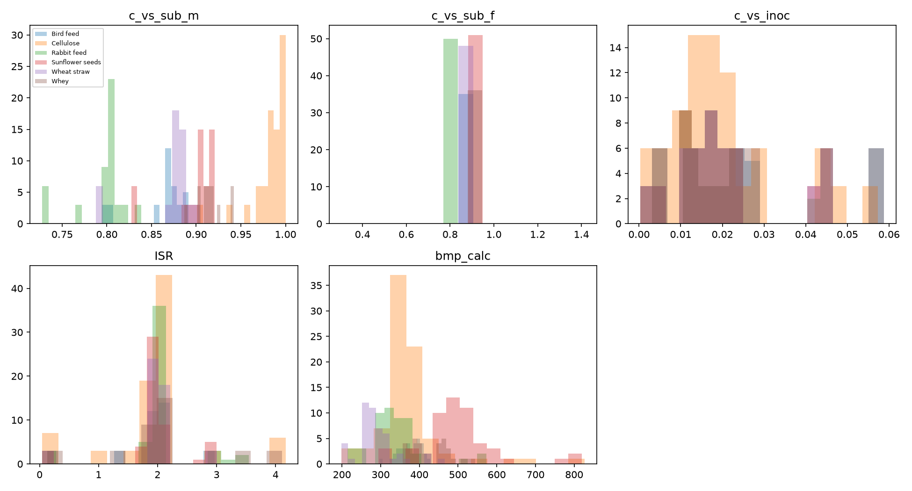
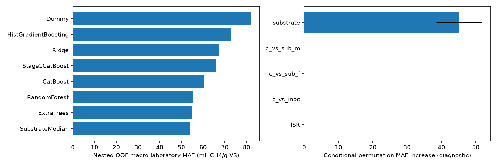
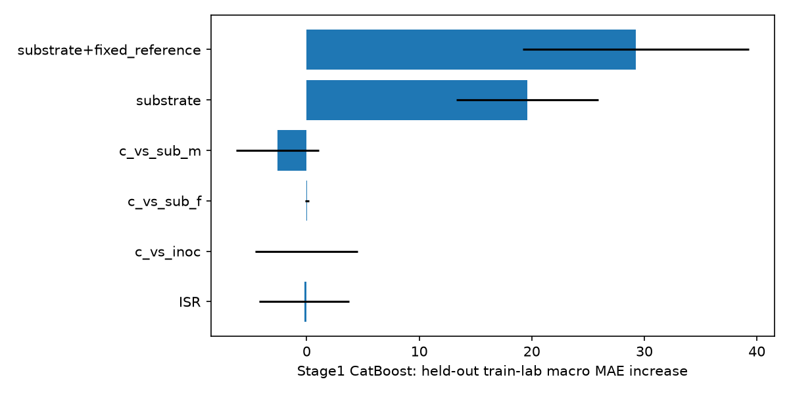
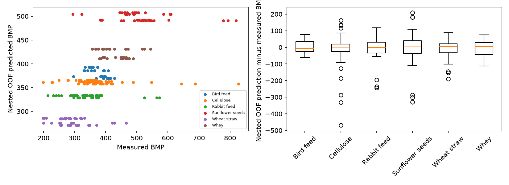
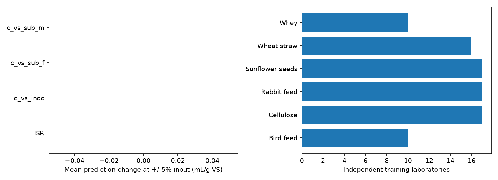

# Этап 1.5 — научный аудит и улучшение BMP-модели

Дата: 28.10.2026. Данные и результаты этапа 1 сохранены побайтово; проверка:
[preservation_check.json](stage1_5/preservation_check.json).

## 1. Текущая модель и протокол

Этап 1: CatBoost; test MAE 80.38, RMSE 131.99 мл CH4/г VS, R² 0.173.
Test (109 бутылок / 5 лабораторий) уже просмотрен ранее. Поэтому новая независимая
финальная оценка здесь невозможна. Test повторно не прогнозируется, не используется
для выбора признаков, настройки или сравнения новых кандидатов. Старые метрики не
сравниваются напрямую с новой CV как доказательство улучшения.

Исходные train 304 бутылки / 17 лабораторий сохранены. Внешний GroupKFold(4),
внутренний GroupKFold(3) в каждом внешнем train выбирает конфигурацию по MAE с
равным весом лабораторий. Скейлинг, кодирование и импутация обучаются внутри fold.
HistGradientBoosting: early_stopping=False, чтобы не создавать случайный bottle-level
validation внутри обучения. Конфигурации и списки лабораторий сохранены в
[search_space.json](stage1_5/search_space.json) и [cv_labs.json](stage1_5/cv_labs.json).

Выбор семейства по внешней CV сам создаёт оптимизм оценки победителя. CV честно
проверяет настройку внутри каждого семейства, но не является независимой оценкой
процедуры выбора семейства. Малое число лабораторий и один набор fold добавляют
неопределённость; стандартное отклонение fold не является доверительным интервалом.
Validation уже использовался на этапе 1; здесь он только описательная проверка после
фиксации выбора, без замены победителя по результату validation.

## 2. Аудит признаков и исходников

Входы: substrate, c_vs_sub_m (измеренная VS субстрата), c_vs_sub_f (эталонная VS),
c_vs_inoc (VS инокулята), ISR (отношение масс VS). Концентрации — г/г, ISR — г/г VS.
619 исходных бутылок, 613 очищенных; 6 строк с VS >1 исключены на этапе 1, не добавляются
обратно ради метрик. Повторы бутылок одной лаборатории не разделяются между fold.

Инженерия полностью из входов: относительное/абсолютное расхождение измеренной и
эталонной VS, log ISR и log VS инокулята. Проверена абляция без c_vs_sub_f.
Никаких искусственных обучающих наблюдений. Возмущения входов и перестановки используются
только для диагностики, не для обучения и не выдаются за эксперименты.

У c_vs_sub_f в train одна величина на субстрат (Cellulose — две), то есть признак
в основном кодирует категорию. Он доступен только для эталонных общих субстратов
исследования; вне этой постановки его нельзя назначать произвольно. Измеренная VS
также входит в нормировку BMP: математическая связь не означает причинного эффекта.
ISR и свойства инокулята могут отражать лабораторную методику и общий сдвиг измерения.

Прямая утечка: bmp_calc, bmp_rep, smp, cvCH4/cvBg, fv_inoc и аналоги цели,
коэффициенты биоразлагаемости, рассчитанные через измеренный BMP. Исключены также
lab_id/file_id/bottle_id/test/set как предикторы. Они используются только для групп
и аудита. Близкие результаты повторов не считаются независимыми лабораториями.

Отсутствуют в текущей входной таблице: химический состав (липиды, белок, углеводы,
лигнин/целлюлоза, C/N), предобработка, возраст/адаптация инокулята, температура,
рабочий pH, длительность и критерий окончания BMP, стандартизация газа и blank,
качество/калибровка приборов. В полном локальном источнике есть inoc_prop.csv, включая
pH инокулята; это не рабочий pH реактора. Эти поля в данном этапе не добавлялись:
нужны проверка единиц, полноты и момента измерения. Массы setup не добавлены без
подтверждения единиц; газовые временные ряды доступны после начала опыта.

Различия лабораторий, нормировки, эталонная природа сырья и отсутствующие условия
правдоподобно объясняют слабый перенос; причинность этими данными не установлена.

## 3. Поддержка категорий

| substrate | rows | labs |
| --- | --- | --- |
| Bird feed | 35 | 10 |
| Cellulose | 84 | 17 |
| Rabbit feed | 50 | 17 |
| Sunflower seeds | 51 | 17 |
| Wheat straw | 48 | 16 |
| Whey | 36 | 10 |

Заранее заданная относительная редкость: <12 лабораторий ИЛИ <40 train-строк.
Выделены Bird feed, Whey. Это эвристика, а не научная граница
достаточности. Даже 17 лабораторий не дают разнообразия происхождения сырья: это
общие субстраты одного исследования. Навоз, почва, food_waste и смеси не представлены.
Ошибки редких категорий: [rare_substrates.csv](stage1_5/rare_substrates.csv).

## 4. Реальные результаты CV и выбор

| family | macro_lab_MAE | MAE | RMSE | R2 |
| --- | --- | --- | --- | --- |
| SubstrateMedian | 53.917 | 46.058 | 74.031 | 0.434 |
| ExtraTrees | 54.916 | 46.268 | 76.329 | 0.399 |
| RandomForest | 55.524 | 46.811 | 76.416 | 0.397 |
| CatBoost | 60.322 | 51.443 | 80.048 | 0.339 |
| Stage1CatBoost | 66.158 | 56.561 | 85.582 | 0.244 |
| Ridge | 67.505 | 57.780 | 86.823 | 0.222 |
| HistGradientBoosting | 72.954 | 62.374 | 93.051 | 0.106 |
| Dummy | 81.897 | 70.996 | 100.829 | -0.050 |

Все MAE/RMSE — мл CH4/г VS. macro_lab_MAE даёт каждой лаборатории равный вес;
обычный MAE даёт вес каждой бутылке. Разброс между внешними fold:

| family | min | max | std |
| --- | --- | --- | --- |
| CatBoost | 31.430 | 92.783 | 26.259 |
| Dummy | 60.495 | 114.268 | 24.484 |
| ExtraTrees | 27.969 | 89.125 | 28.942 |
| HistGradientBoosting | 34.933 | 106.873 | 31.426 |
| RandomForest | 29.827 | 91.464 | 29.448 |
| Ridge | 43.289 | 92.632 | 22.231 |
| Stage1CatBoost | 31.414 | 92.978 | 25.499 |
| SubstrateMedian | 28.434 | 85.016 | 26.976 |

Выбрано **SubstrateMedian**: минимальный nested OOF macro_lab_MAE.
Финальная конфигурация выбрана внутренней GroupKFold на всём исходном train.
Модель обучена только на train; validation/calibration не включены в fit.
Если выбран SubstrateMedian, это обучаемый статистический baseline: прогноз
использует только substrate. Числовые входы обязательны для совместимости контракта
и проверки области применимости; они не влияют на BMP этой модели. Нулевая
чувствительность такой модели к VS/ISR не доказывает физическую независимость BMP.
Сильный baseline — медиана по субстрату, рассчитанная строго на train каждого fold;
её необходимо учитывать прежде, чем приписывать выигрыш сложной ML-модели.

После фиксации выбора validation: новая модель MAE 21.989,
macro_lab_MAE 22.316, RMSE 29.279,
R² 0.836; исходная сохранённая модель: MAE
23.835, macro_lab_MAE 23.600.
Это описательное сравнение на ранее просмотренном validation, не доказательство
улучшения на новом независимом исследовании. По его результату выбор не пересматривался.

## 5. Важность, ошибки, устойчивость и область применимости

Среднее увеличение macro MAE при перестановке raw-признаков на внешних holdout:

| feature | MAE_increase |
| --- | --- |
| substrate | 45.175 |
| ISR | 0.000 |
| c_vs_inoc | 0.000 |
| c_vs_sub_f | 0.000 |
| c_vs_sub_m | 0.000 |

Для числовых признаков перестановки внутри субстрата; для substrate — по всему fold.
Зависимость повторов и корреляции признаков остаются: это описательная диагностика,
не p-value и не причинная важность. Перестановка категории при неизменной эталонной
VS может создавать нереалистичные комбинации; признаки с малой условной вариацией
могут получить нулевую важность, даже если они информативны совместно.

Для фиксированной конфигурации исходного CatBoost отдельная диагностика на тех же
внешних обучающих holdout (переобучение конфигурации без подбора, не test):

| feature | MAE_increase |
| --- | --- |
| substrate+fixed_reference | 29.242 |
| substrate | 19.581 |
| c_vs_sub_f | 0.040 |
| c_vs_inoc | -0.025 |
| ISR | -0.225 |
| c_vs_sub_m | -2.581 |

Совместная перестановка substrate+fixed_reference показывает их общую информацию;
она также не гарантирует физически правдоподобные сочетания с остальными признаками.

Ошибки сохранены по [сырью](stage1_5/nested_oof_errors_by_substrate.csv) и
[лабораториям](stage1_5/nested_oof_errors_by_lab_id.csv), отдельно для validation.
Общий R² необходимо сопоставлять с R² внутри каждой категории: он может отражать
в основном различия между категориями. В данном запуске R² внутри всех шести
субстратов отрицателен: baseline не объясняет вариацию отдельных бутылок
относительно среднего субстрата в оценочной выборке. Более низкий MAE не доказывает
способность прогнозировать новую партию сырья. Разброс fold у лидирующих моделей
велик; малые различия CV не доказывают статистически значимого превосходства.
Устойчивость: числовые входы внешнего holdout меняются на ±5%, с ограничением VS
диапазоном [0,1]. Фиксируются средний/максимальный сдвиг прогноза и доля OOD.
Это не измеренная погрешность приборов и не интервал неопределённости.

Новый детектор обучается только на train: ближайший сосед того же субстрата в
пространстве числовых признаков, масштабированном train IQR. Порог — 95-й процентиль
расстояний train при исключении всей лаборатории точки; дополнительно проверяются
категориальные диапазоны и ограниченная поддержка. Порог эвристический; нормальные
диапазоны не доказывают применимость. Значения за глобальными train-границами CLI
отклоняет; необычные комбинации внутри границ помечает предупреждением.

## 6. Групповая калибровка

Четыре calibration-лаборатории сохранены отдельно. Score — максимальная абсолютная
ошибка всех бутылок лаборатории. Rank = ceil((G+1)*(1-alpha)). При G=4 и alpha=.1
rank=5>4: конечный 90% диапазон недоступен (null); минимум 9 calibration-групп нужен
только для конечности, а не для надёжной эмпирической проверки.

Экспериментальная полоса при alpha=.2: радиус 164.000.
На пяти ранее просмотренных validation-лабораториях покрыты целиком
5/5;
покрытие бутылок 1.000.
Она называется экспериментальной полосой, не проверенным 80% или 90% предсказательным
интервалом. Пять групп не подтверждают покрытие популяции; обменность лабораторий,
размеры групп и состав субстратов могут нарушаться. Численный результат и метод:
[uncertainty.json](stage1_5/uncertainty.json).

## 7. Графики

## 8. Дополнительные данные и научные ограничения

Нужны независимые публикации/лаборатории и разные партии одного вида сырья;
измеренный состав, предобработка, условия BMP, blank, нормировка газа и контроль
приборов. pH инокулята следует отделять от рабочего pH. Для практического реактора
нужны собственные измерения массы VS и газа, времени, температур, pH, OLR/HRT и событий.
Протокол следующего исследования следует зафиксировать до получения новых исходов.
Межлабораторные повторы одного исследования не заменяют независимые исследования.

Этап 1.5 улучшает проверяемость процедуры, но не гарантирует улучшение реальной
обобщающей способности. Шесть общих субстратов недостаточны для универсального BMP.
Подбор ограничен небольшой заранее записанной сеткой; это не исчерпывающая оптимизация.
Сложная модель и feature engineering не должны приниматься только за высокий R².
Новая модель хранится отдельно в models/stage1_5; исходная остаётся CLI по умолчанию.

## Источники

- [Исходный README и словарь Hafner](https://github.com/AU-BCE-EE/Hafner-2026-IL-BMP).
- [Group CV и nested CV, scikit-learn](https://scikit-learn.org/stable/modules/cross_validation.html).
- [Lee, Barber, Willett: Distribution-free inference with hierarchical data](https://arxiv.org/abs/2306.06342).

Проверки исполнения и совместимости записываются отдельно в stage1_5/verification.json.
