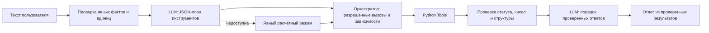

# BioReactor AI Agent v2 — выполненный этап 2

Дата проверки: 28.10.2026. Работа выполнена внутри существующего BioReactor_AI.
Исходные модели, данные и отчёты этапов 1 и 1.5 не переобучались и не заменялись.
57 прежних файлов защищены SHA-256: [проверка сохранности](stage2/preservation_check.json).

## Что работает

- Интерактивный `chat`, разовый вопрос, память текущей партии и сброс `/reset`.
- Реальная локальная LLM Ollama `qwen2.5:1.5b`: генерация плана и порядка ответов
  проверена фактическими POST-запросами, не только наличием процесса или модели.
- Восемь Python-инструментов; вызовы и результаты доступны через `--json`.
- Обе сохранённые BMP-модели действительно загружены и вызваны в этой проверке.
- Источники и рекомендации из отдельной проверяемой JSON-базы, расчёт потенциального
  метана и экономических сценариев по явно заданным величинам.
- Отклонение неизвестного сырья и комбинаций вне обучающего распределения;
  запрос отсутствующих измерений, проверка единиц и чисел.
- Расчётный режим при отсутствии LLM; он прямо обозначается как ограниченный
  детерминированный режим и не выдаётся за языковую модель.

## Архитектура



`src/agent/providers.py` подключает Ollama `/api/chat` с JSON Schema и совместимый
онлайн Chat Completions endpoint с JSON mode. Это планирование через проверяемый
JSON, а не вызов `eval` или исполнение произвольного текста модели. Это также не
SDK-native function calling: оркестратор сам отображает разрешённые имена в Python.

LLM выбирает имена инструментов, но не задаёт числовые аргументы, цены или научные
значения. Инструменты получают только явные пользовательские факты и подтверждённые
результаты предыдущих инструментов текущего хода. Для финансового расчёта добавляются
необходимые зависимости. Ответ с JSON-признаками продолжает предыдущий запрос;
посторонние инструменты из плана маленькой LLM отбрасываются. Смена сырья сбрасывает
характеристики и цены партии, сохраняя выбор модели. `/reset` очищает партию.

После расчётов LLM может выбрать порядок подтверждённых сообщений, но не подменить
их содержание. Свободный научный/численный пересказ LLM не выводится как проверенный
ответ. Фактический исходный план и итоговый план политики сохранены отдельно в trace.
Это намеренно ограниченный научный агент, не универсальный свободный чат.

## Инструменты

| Имя | Реальная функция и ограничения |
| --- | --- |
| analyze_substrate | Определяет категорию, источники и применимость; неизвестные характеристики остаются null |
| predict_bmp | Вызывает сохранённую модель после проверки категории, признаков и OOD |
| calculate_methane | BMP × масса VS / 1000 в м³; без массы VS не использует влажную массу |
| recommend_conditions | Отдельные литературные сведения с областью применимости; не ML-режим |
| calculate_profitability | Продажа, извлекаемая доля метана, выручка, затраты, чистый результат и разница |
| get_model_info | Версия, входы и реальные метрики из существующих метаданных |
| get_reactor_status | Только mock: connected=false, readings=null, measured_at=null |
| search_scientific_sources | Поиск по проверенному локальному каталогу, не свежий веб-поиск |

## Реально подключённые модели

| Артефакт | Алгоритм | Проверенная характеристика |
| --- | --- | --- |
| models/bmp.joblib | CatBoost этапа 1 | Test MAE 80.38, RMSE 131.99, R² 0.173; лаборатории одного исследования |
| models/stage1_5/bmp.joblib | SubstrateMedian | Nested training CV macro laboratory MAE 53.92; не независимая проверка улучшения |

В агенте по умолчанию выбран stage1_5. `--model stage1` включает исходный CatBoost.
Для обеих моделей применяется сохранённый stage1_5 DomainDetector. Это более строгий
контракт агента: OOD-комбинация приводит к отказу от числа, хотя старый `predict`
может вернуть число с предупреждением. Результат остаётся лабораторным BMP, не
обещанием выработки конкретного реактора. Для SubstrateMedian число зависит от
категории; числовые признаки дополнительно проверяют применимость, но не меняют BMP.

Чернозём, навоз, food_waste и произвольные смеси не входят в обучение. Для чернозёма
не выдаётся BMP или режим переработки. Общий навоз без вида животного не объявляется
навозом КРС. Для расчёта из литров нужна пользовательская плотность или взвешенная
масса. Номинальный объём реактора не определяет безопасную загрузку.

## Экономика и единицы

Все расходы задаются для одной партии в одной валюте. Обязательны:
`mass_kg`, `sale_price_per_kg`, `potential_methane_m3`, `recovery_fraction`,
`methane_price_per_m3`, `preparation_cost`, `heating_cost`, `operating_cost`,
`currency`, `price_date`, `gas_volume_basis`, `price_gas_volume_basis`.
Отсутствующие цены или затраты не заменяются нулями. Нулевые затраты задаются явно.
Дата цен — YYYY-MM-DD. Значения цен не загружаются из непроверенных внешних источников.

Продажа = масса × цена сырья. Метановая выручка = потенциальный объём × доля извлечения
× цена метана. Чистый результат переработки = выручка − подготовка − нагрев − эксплуатация.
Разница = результат переработки − продажа. Прогноз фактической извлекаемой доли не
обучался: это явно заданное сценарное предположение. Цена метана не считается ценой
сырого биогаза. Капитальные, налоговые и транспортные затраты учтены только если
пользователь включил их в расходы; это не инвестиционная оценка.

Условия приведения объёма и тарифа должны совпадать строковыми метками. Автоматической
конверсии температуры/давления нет. Для BMP-моделей используется метка условий исходного
BMP с явным предупреждением, что нормировка независимо не проверена. Пользовательская
метка STP не присваивается такому объёму автоматически. Собственный измеренный BMP
задаётся с `bmp_unit="mL CH4/g VS"` и `gas_volume_basis`. Несогласованные единицы
и основания объёма отклоняются. Финансовые числа в unit-тестах — математические
fixtures с валютой TEST, не рыночные цены и не данные биореактора.

## Гибридный режим и подтверждённая доступность

- `offline`: локальный Ollama; фактическая генерация подтверждена. Первый холодный
  запрос превысил исходный таймаут 15 с; после прогрева и таймаута 45 с полный диалог
  и проверка структурированного плана прошли. Локальный endpoint ограничен loopback.
- `online`: HTTP-адаптер реализован и проверен подменёнными ответами API в тестах.
  Реальная генерация онлайн **не проверена**: ключ и модель не настроены.
- `auto`: сначала настроенный онлайн-провайдер; при отсутствии, ошибке или неверной
  схеме пробуется Ollama. При недоступности обоих доступны Python-инструменты.

Ключ читается из BIOREACTOR_LLM_KEY или OPENAI_API_KEY и не печатается. Для онлайн
нужна BIOREACTOR_LLM_MODEL. BIOREACTOR_LLM_URL задаёт полный совместимый endpoint;
по умолчанию https://api.openai.com/v1/chat/completions. Поддержка конкретной модели
в этом endpoint должна быть проверена отдельно. Онлайн-режим отправляет вопрос,
контекст текущей партии и результаты инструментов выбранному API. В логах не сохраняются
ключи; локальные traces с пользовательскими данными появляются в проверочном скрипте.
Для онлайн требуется HTTPS, HTTP допускается только на loopback; redirects запрещены.

## Проверки исполнения

47 автоматических тестов прошли. Они проверяют обе ML-модели, настоящие вызовы
инструментов, арифметику, исходы при отсутствии цен и измерений, чернозём, неизвестное
сырьё, смесь, неопределённый вид навоза, недопустимые объёмы/единицы, OOD, ошибку
загрузки модели, отсутствие сети и Ollama, переход online → offline, неверный план
LLM, сохранение контекста, изменение партии и отсутствие управления исполнительными
устройствами. Подменённые API-ответы отделены от реальных запросов.

Полный проверочный запуск:

```powershell
python BioReactor_AI/verify_stage2.py
```

Свидетельства: [verification.json](stage2/verification.json),
[журнал тестов](stage2/tests.log), [реальные запросы провайдеров](stage2/provider_probe.json),
[CLI](stage2/cli_checks.json), [диалоги с trace](stage2/actual_dialogues.json),
[читаемые диалоги](stage2/actual_dialogues.md).

## Запуск

Из родительской рабочей папки:

```powershell
python BioReactor_AI/main.py providers --mode auto
python BioReactor_AI/main.py chat
python BioReactor_AI/main.py chat --mode offline
python BioReactor_AI/main.py chat --mode auto --context BioReactor_AI/examples/stage1_5_measured.json --message "Оцени BMP" --json
python BioReactor_AI/main.py chat --no-llm
python BioReactor_AI/main.py tool get_reactor_status
python BioReactor_AI/main.py tool search_scientific_sources --query "BMP VS Hafner"
```

В интерактивном режиме вводятся обычные вопросы; точные измерения — JSON или
`c_vs_sub_m=0.9041 c_vs_sub_f=0.872 c_vs_inoc=0.02213 ISR=1.915` после выбора сырья.
Эти конкретные признаки взяты у исходной train-бутылки 902 (E02), не у вашей партии.
Новые значения нельзя брать из примера вместо измерений. `/exit` завершает диалог.

Для онлайн задайте переменные через безопасное окружение/менеджер секретов:
BIOREACTOR_LLM_KEY, BIOREACTOR_LLM_MODEL и при необходимости BIOREACTOR_LLM_URL.
Не сохраняйте секрет в репозитории или отчёте. Модель должна поддерживать Chat
Completions с JSON mode. Для локального режима нужен установленный Ollama с моделью
qwen2.5:1.5b либо именем в OLLAMA_MODEL. Дополнительных Python-зависимостей этап 2
не добавляет. Установка прежних зависимостей описана в README; в текущей песочнице
чтение локального CatBoost требует разрешённого запуска вне песочницы.

## Научные источники

Каждая запись содержит ссылку, заголовок, область применимости и дату проверки.
База: `data/knowledge/biogas.json`; неизвестные TS/VS оставлены null.

- [Hafner, оригинальный репозиторий и словарь](https://github.com/AU-BCE-EE/Hafner-2026-IL-BMP).
- [FAO: Environmental factors](https://www.fao.org/4/t0541e/T0541E06.htm).
- [FAO: Plant design and control](https://www.fao.org/4/t0541e/T0541E09.htm).
- [EBMUD / EPA: Anaerobic Digestion of Food Waste (2008)](https://www.epa.gov/system/files/documents/2024-08/ebmud-final-report-anaerobic-digestion-of-food-waste-2008-03.pdf).
- [FAO Global Soil Partnership (2017), Annex I](https://www.fao.org/fileadmin/user_upload/GSP/Fifth_plenary/en/GSPPA_V_2017_3.pdf).

API-документация: [Ollama chat](https://docs.ollama.com/api/chat) и
[официальная документация OpenAI Chat Completions](https://developers.openai.com/api/reference/resources/chat/subresources/completions/methods/create).

## Оставшиеся ограничения

Небольшая curated-база не заменяет обзор литературы. Поиск работает по каталогу,
а не по всему интернету. Произвольные числовые формулировки в прозе распознаются
ограниченно: для научных и финансовых полей используйте явные имена/JSON. Строгое
распознавание объёмов и кг не устанавливает происхождение измерения; оно задаётся
пользователем. Сценарные цены, доли извлечения и нормировку газа следует проверять.
Отрицательные цены и экономические модели субсидий/утилизационных платежей не реализованы.

Модель BMP охватывает шесть общих субстратов одного исследования; независимого
подтверждения улучшения этапа 1.5 нет. Корректный конечный 90% интервал недоступен.
Рекомендации — источниковые ориентиры, не безопасные уставки конкретной установки.
Датчики и исполнительные устройства не подключены. Будущее управление потребует
отдельного модуля, аппаратной аварийной остановки, ограничений и подтверждения оператора.
