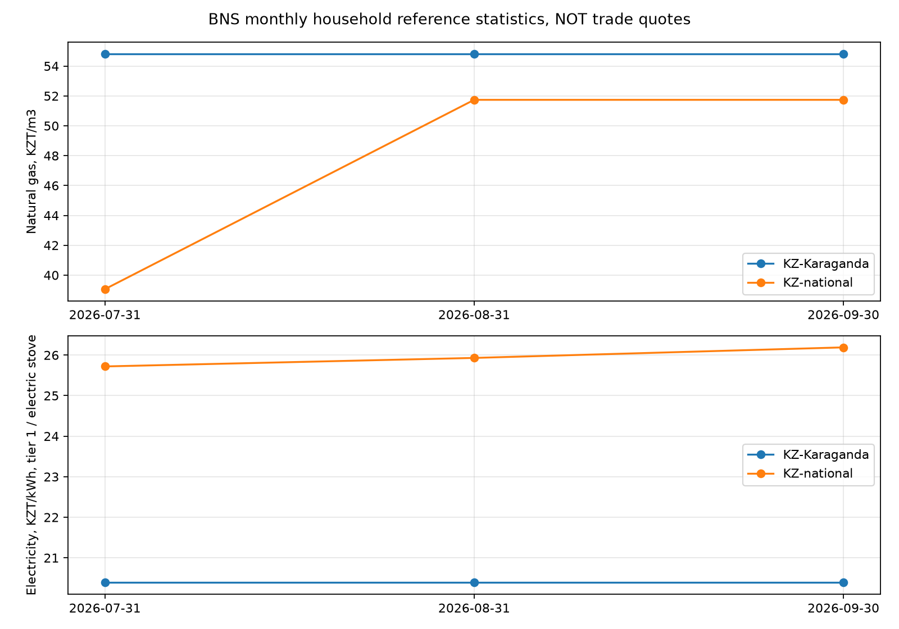

# BioReactor AI 3.5 — реальные рыночные источники

Проверено 28.10.2026, календарь Asia/Qyzylorda (UTC+05). Работа выполнена внутри
существующего проекта. BMP-модели не переобучались. Сохранены 79 прежних файлов
моделей, научных данных и отчётов, а также все поля двух прежних наблюдений цен.
Контроль: [verification.json](stage3_5/verification.json),
[исходные хеши](stage3_5/preserved_hashes.json),
[снимок прежних наблюдений](stage3_5/legacy_observations.json).

## Полученные реальные данные

Рабочая SQLite: `data/market/market.sqlite3`. **28 наблюдений**, включая два
прежних; тестовых цен **0**. Автоматически добавлено 26 наблюдений: 12 месячных
статистик БНС, 2 городских тарифа, 10 районных тарифов и 2 наблюдения Алматы/области.
Последние повторно подтверждают уже известный тариф Алматы с новым происхождением;
это не новое изменение его значения. Полная выгрузка с источниками, датами,
доказательствами и статусами: [JSON](stage3_5/real_observations.json),
[CSV](stage3_5/real_observations.csv).

| Источник / товар | Значение | Регион и профиль | Дата в источнике | Статус на проверку |
|---|---:|---|---|---|
| [БНС, газ](https://stat.gov.kz/api/iblock/element/353619/file/ru/) | 54,81 ₸/м³ | Караганда, бытовая месячная статистика | Сентябрь 2026; опубликовано 09.10.2026 | VERIFIED_CURRENT, **reference** |
| [БНС, электричество](https://stat.gov.kz/api/iblock/element/353619/file/ru/) | 20,39 ₸/кВт·ч | Караганда, население, электроплиты, первый уровень | Сентябрь 2026; опубликовано 09.10.2026 | VERIFIED_CURRENT, **reference** |
| [БНС, газ](https://stat.gov.kz/api/iblock/element/353619/file/ru/) | 51,74 ₸/м³ | Республика Казахстан, бытовая статистика | Сентябрь 2026; опубликовано 09.10.2026 | VERIFIED_CURRENT, **reference**, национальная география |
| [БНС, электричество](https://stat.gov.kz/api/iblock/element/353619/file/ru/) | 26,19 ₸/кВт·ч | Республика Казахстан, тот же бытовой профиль | Сентябрь 2026; опубликовано 09.10.2026 | VERIFIED_CURRENT, **reference** |
| [КРЭК](https://krec.kz/price) | 45,47 с НДС / 39,20 без НДС, ₸/кВт·ч | Небытовые потребители пяти районов области | Действует с 15.10.2026; [уведомление](https://krec.kz/notices) 09.10.2026 | VERIFIED_CURRENT, tariff |
| [Қарағанды Жарық](https://www.k-zharyk.kz/ru/node/329) | 38,87 с НДС / 33,51 без НДС, ₸/кВт·ч | Город Караганда, небытовые потребители | Заголовок «с 1 сентября 2025 года»; публикация не установлена | STALE, tariff |
| [Энергосбыт Алматы](https://www.esalmaty.kz/ru/business-tariffs) | 50,03 ₸/кВт·ч с НДС | Алматы / Алматинская область, небытовая группа 2 | С 12.09.2026; публикация не установлена | STALE, tariff |

БНС публикует цену электроэнергии **за 100 кВт·ч**: Караганда 2039 / 100 = 20,39,
страна 2619 / 100 = 26,19. Исходная единица и цена сохранены вместе с нормализованными.
Газ взят из строки природного сетевого газа, а не соседней строки СУГ.
Условия температуры/давления объёма газа в таблице не определены; это явно записано.
НДС статистических цен не реконструируется, `tax_basis=statistics_as_published`.

VERIFIED_CURRENT у БНС означает свежесть проверенного статистического наблюдения.
**Это не закупочная цена отходов, не предложение о продаже газа и не тариф для бизнеса.**
Записи reference исключены из окончательного экономического выбора. При отсутствии
местных данных агент может показать национальный reference с географическим
предупреждением; калькулятор местную цену им не заменяет.

Районный тариф КРЭК относится только к Абайскому, Бухар-Жыраускому, Нуринскому,
Осакаровскому и Каркаралинскому районам. Созданы отдельные region ID
`KZ-Karaganda-{Abay,Bukhar-Zhyrau,Nura,Osakarov,Karkaraly}-district`.
Город `KZ-Karaganda` и область целиком не получают этот тариф. Ставка передачи
электричества и первая показанная предельная ставка также не подменяют розничный
небытовой тариф. Обслуживание конкретного объекта и профиль договора нужно подтвердить.

Городская страница одновременно содержит заголовок 2025 года и колонку НДС 16%.
Приложение сохраняет написанное источником, не исправляет дату по предположению
и не объявляет тариф актуальным. Требуется подтверждение действующего договора.

## TLS: диагноз и исправление

Python 3.13.13, OpenSSL 3.0.19, certifi 2026.2.25; часы UTC соответствовали дате
клиентской среды. Переменные прокси/CA и urllib proxy settings отсутствовали,
WinHTTP сообщил прямой доступ. Диагностика:
[tls_diagnostics.json](stage3_5/tls_diagnostics.json).

Стандартный SSL-контекст при запросе esalmaty возвращал
`CERTIFICATE_VERIFY_FAILED: Missing Authority Key Identifier`.
Контекст certifi — `unable to get local issuer certificate`.
В реально предъявленном сертификате ряда сайтов issuer:
`USIAG Intermediate October / State Technical Service / Astana / KZ`.
Системная проверка Windows доверяла этой цепочке; bundle certifi — нет.
БНС предъявлял другую публичную цепочку. Это наблюдение о текущей сетевой среде,
не доказательство ошибки сертификатов всех казахстанских сайтов.

Установлен truststore 0.10.5. `src/market/tls.py` создаёт **явный** нативный контекст
Windows, используемый HTTPSHandler только для рыночных запросов. Сохранены
`CERT_REQUIRED` и `check_hostname=True`; нет небезопасного резервного режима,
глобального monkey patch SSL или ручной установки новых CA. Обычный Windows
механизм построения цепочки может сам получать недостающие доверенные сертификаты.
В других ОС используется системный `ssl.create_default_context()`.

Можно задать `BIOREACTOR_MARKET_CA_BUNDLE` с доверенным PEM, полученным законным
путём. Неверный bundle приводит к явному отказу. В этой проверке bundle не задавался.
Нативные реальные запросы к БНС, КРЭК, Қарағанды Жарық и Алматы прошли HTTP 200.
Исходные ошибки стандартного SSL воспроизводились отдельно от рабочего транспорта.

## Доступность и ограничения источников

| Источник | Фактическая проверка | Интеграция |
|---|---|---|
| [БНС, каталог XLSX](https://stat.gov.kz/ru/industries/economy/prices/spreadsheets/?name=19087) | HTTPS и загрузка трёх оригинальных файлов: июль, август, сентябрь 2026 | Два настроенных потока: газ и электричество; автоматические reference |
| [КРЭК](https://krec.kz/price), [объявления](https://krec.kz/notices) | Обе страницы загружены; дата публикации подтверждена time + ссылкой уведомления для той же даты введения | Автоматически, 5 районов × 2 основания НДС |
| [Қарағанды Жарық](https://www.k-zharyk.kz/ru/node/329) | HTTPS, точный городской блок разобран | Автоматически, но найденная цена устарела |
| [Алматы](https://www.esalmaty.kz/ru/business-tariffs) | Первый рыночный запрос: read timeout; повтор после паузы успешен | Автоматически; сохранена неизвестность даты публикации |
| [QazaqGaz Aimaq](https://www.aimaq.kz/ru/тарифы-и-цены/tarify-i-czeny-2026/) | Каталог загружен по проверенному HTTPS, 160286 байт | Числовой адаптер Word-расписаний не реализован; нужен ручной выбор региона/профиля. Вместо выдуманного тарифа — reference БНС |
| [Открытые данные Казахстана](https://data.egov.kz/) | Главная страница загружена, 1176122 байта | Каталог не равен интеграции цен. Для выбранного API нужны ключ и проверенная схема/набор; они не настроены |
| [КОСАГРО, PDF](https://kosagro.kz/f/price-list.pdf) | Реальный PDF 405773 байта загружен; дата в документе 21.07.2026 | Источник зарегистрирован как manual; автоматическое сопоставление строк/колонок PDF не заявляется |
| Органические удобрения | Найдены публичные объявления, включая биогумус около Караганды; свежесть/наличие не подтверждены | Только ручная проверка договора/прайса; живого потока цен не заявлено |
| Органическое сырьё/отходы | Найдены объявления о продаже отрубей другого региона; это не предложение покупки пищевых отходов | Только ручной импорт подтверждённой цены нужного сырья и направления сделки |

Среди кандидатов исследованы объявления
[биогумуса](https://agrosearch.kz/kk/offers/organiceskie-udobreniya/prodaem-biogumus-5749)
и [отрубей](https://agrosearch.kz/offers/otrubi/prodam-otrubi-9986).
Повторное открытие браузерным инструментом дало Cache miss/timeout; эти страницы
не считаются работающими адаптерами и их значения не внесены в рабочую базу.
Цена биогумуса не переносится на дигестат; отруби не заменяют пищевые отходы.
Поисковый сниппет КОСАГРО показывал старую дату, отличную от загруженного PDF:
сниппеты не использованы как числовые доказательства.

Фактические внешние сетевые результаты отделены от mock-тестов:
[первое обновление](stage3_5/live_update.json),
[повтор Алматы](stage3_5/live_retry.json),
[каталог QazaqGaz](stage3_5/qazaqgaz_probe.json),
[исследование документов](stage3_5/inspection/results.json).
Успешных автоматических потоков 5, типов адаптеров 4, поставщиков/публикаторов 4.

## Проверка, хранение и обновления

Миграция SQLite только добавляет поля acquisition_method, period_start/period_end
и таблицу source_state. Старые строки не переписываются. Наблюдения и сценарии
защищены SQL-триггерами от UPDATE/DELETE. Повтор той же цены в эквивалентных единицах
не создаёт новое наблюдение; изменение только времени получения, evidence или метода
тоже не создаёт дубликат. Новая версия проверки provenance может сохраняться отдельно;
возраст от этого не обнуляется.

Проверяются товар, конечное неотрицательное значение, поддерживаемая валюта, размерность
единицы, формат дат, публикация не в будущем, страна региона, тип цены, условия
приведения газа, период статистики и соответствие категории источника товару.
Неверная строка отклоняет весь импорт. Для XLSX ограничены размер загрузки,
распаковка ZIP, число строк/колонок; неожиданная схема или сноска вместо числа
вызывает ошибку, а не угадывание. Автоматический адаптер привязан к проверенной
странице. Сохраняются оригинальные payload/архивы, URL, SHA-256 и координаты ячеек.

Статусы вычисляются при чтении, поэтому старение видно без перезаписи базы:

| Статус | Условие |
|---|---|
| UNVERIFIED | Не подтверждено, тестовая запись или цена ещё не вступила в действие |
| UNAVAILABLE | Последняя попытка получения источника завершилась ошибкой; кеш сохранён |
| VERIFIED_HISTORICAL | Наблюдение заменено новым в той же серии либо дата публикации неизвестна при ещё небольшом возрасте |
| STALE | Старше допустимого возраста или закончился срок действия; известный старый тариф также остаётся старым при получении сегодня |
| VERIFIED_CURRENT | Проверенное, датированное, не заменённое и не просроченное наблюдение без последней ошибки источника |

Приоритет: неподтверждённость → недоступность → будущая цена → заменённая версия →
просрочка → неизвестная публикация → проверенная свежая цена. Например,
VERIFIED_HISTORICAL может одновременно иметь флаг is_stale. Сохраняются причины,
возраст от **более ранней** из даты публикации/начала действия и возраст получения.
Для месячной статистики effective_from — конец периода наблюдения, а не придуманная
дата правового введения тарифа. Это раскрывают period_start/period_end и price_type.
По умолчанию предел возраста 30 дней; юридический срок тарифа из этого не выводится.

Планировщик по-прежнему работает внутри локального FastAPI-процесса. После успеха
следующая попытка через 86400 секунд; после последовательных ошибок через 5, 10,
20 минут, затем не чаще раза в сутки. Внутренний тик до минуты проверяет только
наступившие сроки. CLI/API используют те же сроки. Категория защищена SQLite lease,
продлеваемой heartbeat; два процесса не обновляют её одновременно.
Ошибки записываются в updates/source_state, не останавливают другие категории.
Ручные источники получают needs_configuration раз в настроенный период, а не каждую
минуту. При выключенном ноутбуке сбор не работает; после запуска проверка возобновляется.

## Экономика, агент и аналитика

Сохранён существующий calculate_profitability и сверка денежного результата
сценария C с ним. Отбор рыночной цены требует совпадения товара, региона, валюты,
основания НДС, профиля потребителя, единиц и условий приведения газа. Финальный
выбор использует VERIFIED_CURRENT и допустимый торговый тип цены. Reference,
UNVERIFIED, UNAVAILABLE и неизвестная публикация не становятся окончательными ценами.
Явно разрешённые устаревшие данные дают только условный результат;
`final_recommendation=null`. Тестовый режим тоже не выдаёт финальную рекомендацию.

Реальный селектор экономического модуля выбрал **45,47 KZT/kWh** для Абайского
района, non_household/VAT_included:
[economic_quote_selection.json](stage3_5/economic_quote_selection.json).
Численная прибыль на реальном сырье не заявляется: измерений VS, эффективности,
затрат и актуальной закупочной цены сырья не предоставлено. Тариф экономит покупку
энергии при собственном потреблении; он не означает цену продажи в сеть.
Природный газ не оценивает сырой биогаз. B/C/D — альтернативы, их доходы не суммируются.
Реальная техническая/юридическая возможность продажи газа и качество дигестата
подтверждаются отдельно, значения по умолчанию не выдумываются.

Четыре рыночных инструмента агента сохранены; добавлено распознавание Караганды
и пяти районов. Агент показывает название/URL источника, цену/единицу, регион,
публикацию, профиль, НДС, возраст и статус. Реальный запрос к локальной
Ollama qwen2.5:1.5b дал план инструментов; дополнительная попытка LLM упорядочить
ответ вернула HTTP 400, после чего сработал существующий детерминированный порядок.
Проверенные числовые карточки получены от Python, не от LLM.
Для вопроса о 20 кг пищевых отходов в Караганде агент показал реальные справочные
цены и отказался придумывать BMP/прибыль: эта категория не обучена в Hafner и
не заданы параметры партии/издержки.
[Текст диалога](stage3_5/actual_agent_dialogue.md),
[полный trace и статус провайдеров](stage3_5/actual_agent_dialogue.json).

История БНС содержит три месячных точки по каждому региону/товару. В Караганде
во всех трёх периодах получены 54,81 для газа и 20,39 для электричества.
Это наблюдаемое постоянство трёх публикаций, а не прогноз стабильности рынка.



`GET /analytics/price-change` возвращает сопоставимые серии и windows_days 7/30/90.
Для окон нужны наблюдения точно на обе даты. На 28.10.2026 таких конечных точек
нет: возвращаются insufficient_history и null. На as_of=2026-09-30 для окна
30 дней есть 31.08 и 30.09, изменение 0%; для 7/90 дней точек недостаточно.
Месячные данные не разворачиваются в фиктивные дневные наблюдения.

`GET /scenarios/{id}/price-impact` пересчитывает старый сценарий с теми же
физическими величинами/затратами по новым ценам **тех же источников и профилей**,
показывает старые/новые price ID, изменения прибыли и итогового выбора.
Старый snapshot не меняется, GET не создаёт новый сценарий. При недоступной новой
цене результат становится неполным. Чувствительность ±20% одной цены и точка
безубыточности сохранены в compare; это условный анализ, не прогноз будущих цен.

## Ручной импорт и запуск

Команды из родительской рабочей папки:

```powershell
python -m pip install -r BioReactor_AI/requirements-market.txt
python BioReactor_AI/main.py market update
python BioReactor_AI/main.py market status
python BioReactor_AI/main.py market serve
```

HTTP слушает только `127.0.0.1:8765`, OpenAPI — `/docs`. Полезные ручки:

```powershell
Invoke-RestMethod 'http://127.0.0.1:8765/prices/current?region=KZ-Karaganda'
Invoke-RestMethod 'http://127.0.0.1:8765/prices/history?commodity=natural_gas&region=KZ-Karaganda'
Invoke-RestMethod 'http://127.0.0.1:8765/analytics/price-change?commodity=natural_gas&region=KZ-Karaganda&as_of=2026-09-30'
Invoke-RestMethod 'http://127.0.0.1:8765/sources/status'
python BioReactor_AI/main.py market import-csv --input C:/path/verified_quotes.csv
python BioReactor_AI/main.py market update --category electricity
```

CSV-заголовок: `examples/market_prices_template.csv`. Заполняйте только проверенные
данные документа: source_id зарегистрированного ручного источника, конкретный
commodity/region/country, value/currency/unit, published_at/effective_from,
price_type, reliability, consumer_class/tax_basis, source_url/evidence.
Для газа обязателен gas_volume_basis. Неизвестные даты не угадывайте: published_at
может быть пустым, но такая запись не даёт окончательной рекомендации.
Новые optional поля: acquisition_method, period_start, period_end.
Для PDF допускается manual_pdf. CSV/API не могут заявить автоматический метод
или verified_official: ввод понижается до manual/verified_manual.
verified_manual означает ответственность оператора за сверку, не независимую
сертификацию продавца приложением. Непроверенные объявления сохраняйте unverified.

Ручки `POST /prices`, `POST /prices/import-csv` и `POST /sources` описаны в `/docs`.
Для реальных закупочных предложений нужны точный товар, направление сделки,
дата, склад/доставка, НДС, партия, профиль и сведения о продавце. Стоимость перевозки
из другого региона задаётся отдельно. Создание рыночного источника не даёт ему
автоматически статус проверенного. Валюты автоматически не конвертируются.

## Проверки и границы результата

**96 тестов прошли: 73 прежних + 23 новых.**
Лог: [tests.log](stage3_5/tests.log). Новые тесты включают проверку TLS/hostname и
отсутствия небезопасного fallback, отказ на неверный CA, ошибки XLSX/HTML, выбор
города/районов, единицы за 100 кВт·ч, все пять статусов, сохранение кеша после
отсутствия интернета, ограничение повторов, дедупликацию, ручную provenance,
отсутствующую историю, региональный reference и вызовы рыночных инструментов агента.
На **фиктивных, явно обозначенных данных только временной тестовой базы** проверено,
что обновление проверенной цены меняет рекомендацию B→A, а неподтверждённое
обновление не выдаёт окончательную рекомендацию. Это тест логики, не рыночный кейс.

**30 реальных TCP HTTP-проверок** через временный Uvicorn выполнены успешно:
источники, состояния, актуальные/исторические цены нескольких регионов, аналитика,
неполный сценарий и его price-impact, отклонение плохих дат/единиц/входных данных.
Использовалась резервная копия настоящей базы без фиктивных цен; сервер остановлен.
[HTTP-протокол](stage3_5/http_checks.json), [лог сервера](stage3_5/http_server.log).
Реальная HTTPS-загрузка зафиксирована отдельно от этих локальных запросов и mock.

CLI market status и predict с обоими сохранёнными моделями проходят:
[cli_checks.json](stage3_5/cli_checks.json). Повторный разбор архивных оригиналов
текущим парсером дал только дубликаты, без новых строк:
[archived_reparse.json](stage3_5/archived_reparse.json).

```powershell
python BioReactor_AI/diagnose_market_tls.py
python BioReactor_AI/verify_stage3_5.py --update
```

`--update` соблюдает сроки; rate_limited не означает сбой. Без флага повторная
проверка использует сохранённые реальные данные. Старые verify_stage2/verify_stage3
не запускались повторно, чтобы не перезаписать их исторические отчёты.
Последняя повторная проверка HTTP/CLI после исправления закрытия временной SQLite
использовала уже успешный лог 96 тестов (`--skip-tests`); код приложения после
этого тестового прогона не менялся.

Покрытие офлайн/сбоев проверено изолированными тестами. Фактическое отключение
интернета ноутбука не выполнялось. Полной подтверждённой цепочки коммерческих цен
сырьё→биогаз→дигестат в Караганде пока нет; автоматический экономический совет на
реальных данных поэтому остаётся ограниченным доступностью входов. Накопление
трёх месячных точек не обосновывает прогноз цены. Научные ограничения BMP предыдущих
этапов сохраняются без изменений.
