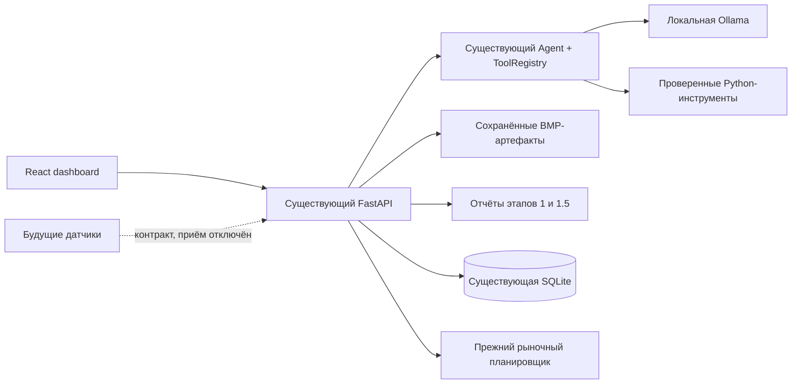
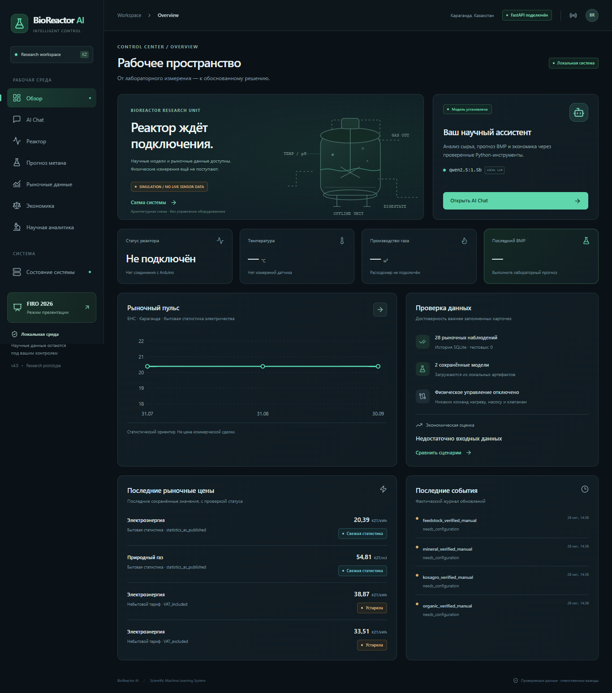
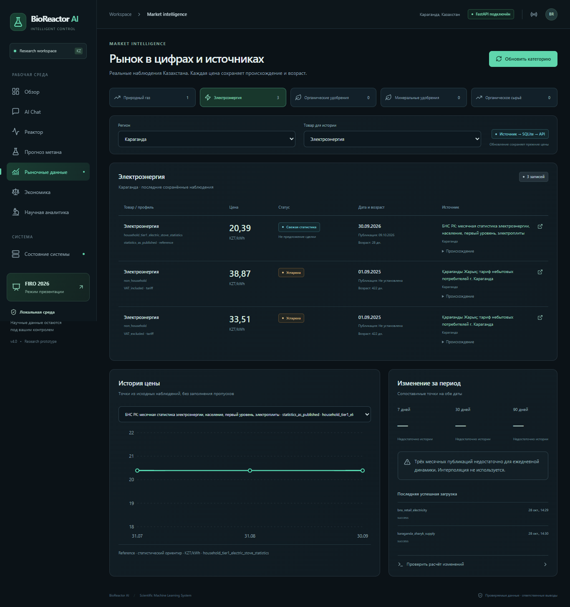
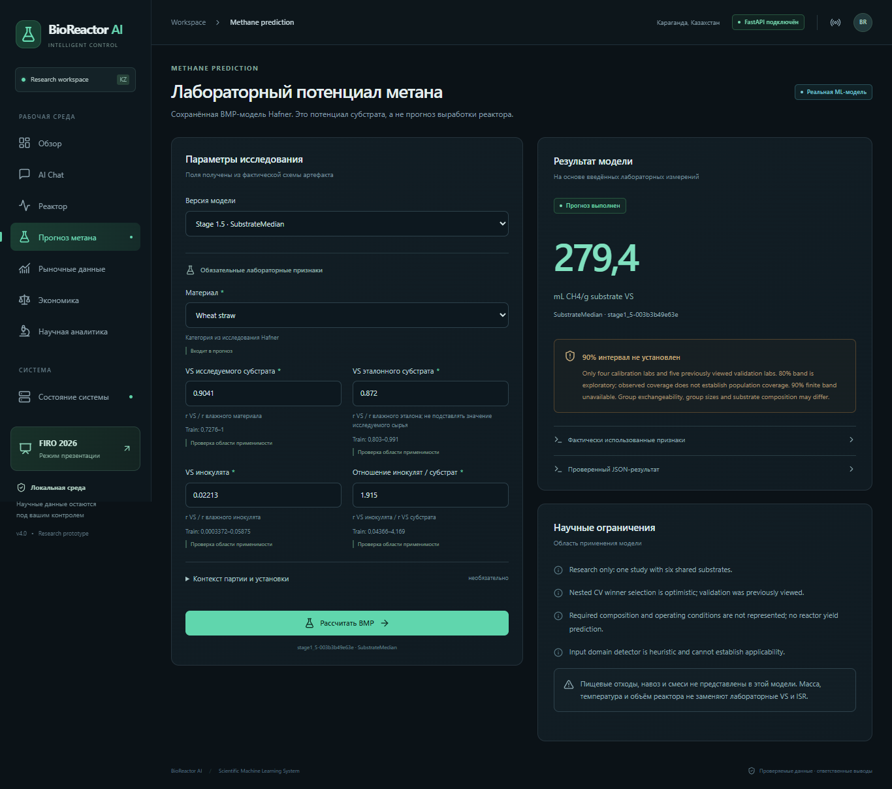

# BioReactor AI v4 — Intelligent Control Dashboard

Проверено 28.10.2026 на Windows, Python 3.13.13 / Node.js 24.19.0.
Создан локальный dashboard внутри существующего проекта. Существующие модели,
вычислители, агент и рыночный backend продолжают выполнять свои функции.
Панель не содержит собственной ML-модели или экономического калькулятора.

## Результат

Готовы девять разделов: Overview, AI Chat, Reactor Monitoring, Methane Prediction,
Market Intelligence, Economic Comparison, Scientific Analytics, System Status и
демонстрационный маршрут FIRO. Тёмная графитовая тема, изумрудные/бирюзовые акценты,
адаптивная навигация, локальные шрифты, Motion с учётом reduced-motion.
Проверены реальные размеры 1366×768, 1920×1080 и дополнительный мобильный 390×844.

**117 backend-тестов, 13 frontend-тестов, TypeScript и production build прошли.**
Реальный Chrome выполнил **38 браузерных проверок / 64 HTTP-запроса**.
Отдельно выполнены **20 прямых HTTP-запросов** к временному локальному серверу.
Это отдельные наборы проверок, их количество не названо количеством unit-тестов.
Сводка: [verification.json](stage4/verification.json).

Сохранены **112 прежних файлов** с проверкой SHA-256 и все поля **28 прежних
рыночных наблюдений**. В рабочей базе по-прежнему 28 наблюдений, тестовых 0.
BMP-модели не переобучались, результаты научных этапов не переписывались.
[Исходные хеши](stage4/preserved_hashes.json),
[снимок наблюдений](stage4/legacy_observations.json).

## Архитектура и структура



Основные файлы:

| Путь | Назначение |
|---|---|
| `frontend/src/App.tsx` | Навигация, общий каркас, диагностика подключения |
| `frontend/src/api.ts`, `types.ts`, `hooks.ts` | Типизированный клиент, таймауты, безопасные GET-повторы, состояние загрузки |
| `frontend/src/pages/` | Девять разделов dashboard |
| `frontend/src/ui.tsx`, `MarketChart.tsx` | Общие компоненты, фактические tool traces, графики |
| `frontend/src/styles.css` | Tailwind и локальная система оформления |
| `frontend/tests/` | Vitest/Testing Library и реальный Chrome через Playwright Core |
| `frontend/dist/` | Готовая production-сборка, обслуживаемая FastAPI |
| `src/dashboard/api.py` | Дополнительные маршруты, история чата, идемпотентные сообщения |
| `src/dashboard/service.py` | Чтение существующих моделей/отчётов, диагностика, схемы форм |
| `src/dashboard/schemas.py` | Валидация ввода и будущий контракт измерений |
| `src/dashboard/launcher.py` | Одна команда запуска, открытие браузера, проверка порта |
| `tests/test_dashboard.py` | 21 новый backend integration test |
| `verify_stage4.py` | Воспроизводимая проверка без записи фиктивных цен в рабочую базу |

Изменения существующего backend ограничены подключением нового router/static
mount в `create_app` и добавлением CLI-команды dashboard. Старые URL рынка
сохранены. Новые таблицы добавляются в ту же SQLite: dashboard_sessions,
dashboard_turns, dashboard_predictions. Таблицы прежних цен не переписываются.

## Новые API endpoints

Префикс `/api/dashboard`; схема доступна в прежнем `/docs`.

| Метод и путь | Содержание |
|---|---|
| `GET /overview` | Проверенное состояние компонентов, последний прогноз/сценарий, цены, реальные события |
| `GET /status` | FastAPI, SELECT SQLite, фактическая загрузка двух ML-артефактов, локальная Ollama, рынок, датчики |
| `GET /models/{model}/schema` | Поля из metadata, категории, единицы, train bounds и роль каждого признака |
| `POST /predict` | Вызов прежнего predict_tool; модель stage1/stage1_5 и явный context |
| `GET /economics/schema` | Поля действующего ScenarioInput, типы, группы и ограничения |
| `GET /reactor` | Существующий статус датчиков, readings=null, пустая история, отсутствие команд |
| `GET /reactor/contract` | JSON Schema будущего измерения; ingestion_enabled=false |
| `GET /scientific` | Оригинальные метаданные, аудит, сравнение nested CV и внешние folds |
| `GET /scientific/figures/{id}` | Только allowlist сохранённых PNG из отчётов |
| `GET /demo` | Прежний лабораторный пример и явно помеченная архивная запись |
| `POST /chat/sessions` | Новая локальная сессия offline/no_llm |
| `GET /chat/sessions/{id}` | Сохранённый контекст и последние 50 ходов диалога |
| `POST /chat/sessions/{id}/messages` | Явный вопрос + request_id, фактический Agent.ask и его результаты |

Рынок и экономика используют прежние `/catalog`, `/prices/current`,
`/prices/history`, `/analytics/price-change`, `/sources/status`, `/updates`,
`/scenarios/compare`, `/scenarios/{id}/price-impact`. Frontend не обращается к SQLite.

POST-сообщение проверяет длину/формат, сохраняет request_id и блокирует параллельный
запрос той же сессии через SQLite lease. Повтор идентичного завершённого request_id
возвращает прежний результат без повторного вызова инструментов. Повтор того же ID
с другим вопросом отклоняется. Все SQL-параметры связаны параметризованно.
Браузер не получает ключи LLM и не исполняет HTML из ответов агента.

Клиент повторяет только безопасный GET, максимум один раз. POST автоматически не
повторяется после таймаута: интерфейс предлагает проверить историю. Есть AbortController,
таймауты, ошибки HTTP/валидации, отключение кнопок и защита от двойной отправки.
Ответ предыдущего региона не подставляется при переключении ключа запроса.
Диагностика Overview обновляется раз в минуту и после расчётов/рыночных обновлений.

## Поведение разделов

**Overview.** Показывает отсутствие подключённого реактора/датчиков, последний
пользовательский прогноз и экономический результат, если он существует, реальную
историю бытовой статистики электричества БНС, последние сохранённые цены и события
рыночного журнала. Если расчёта нет, значения остаются пустыми. Схема резервуара
иллюстративная и подписана как архитектура, не как live-процесс.

**AI Chat.** История хранится в существующей SQLite, session ID — в localStorage.
Поддерживаются русский текст, явные JSON-измерения, индикатор ожидания, раскрываемые
результаты каждого инструмента, источники и недостающие поля. Пользователь может
создать новый диалог или выбрать Python без LLM. Dashboard использует только
локальную Ollama либо детерминированный режим. Внешний LLM-коннектор прежнего CLI
сохранён, но dashboard-контекст туда автоматически не отправляется.

Реальная цепочка для вопроса «5 кг пищевых отходов, реактор 90 л, сколько метана
и выгодно ли?»:

```text
analyze_substrate → predict_bmp → calculate_methane → get_market_prices
→ compare_market_scenarios → explain_market_recommendation
```

Именно эти вызовы вернул существующий агент. calculate_profitability не добавлен
в trace искусственно: без его обязательных ручных входов агент использует прежнее
рыночное сравнение, которое раскрывает недостающие параметры. Food waste не обучен
в Hafner; модель не была вызвана, BMP/прибыль не выдуманы. Полный реальный ответ:
[browser_checks.json, actual_agent](stage4/browser_checks.json),
[отдельный HTTP-диалог без LLM](stage4/actual_http_dialogue.json).

Ollama qwen2.5:1.5b действительно сгенерировала план инструментов. Дополнительный
прежний запрос LLM на упорядочивание большого набора результатов вернул HTTP 400;
сработал существующий детерминированный порядок карточек. Это видно в provider_status
и интерфейсе. Успешная генерация плана не заявляется как успешность всех запросов LLM.
Недоступная Ollama отдельно проверена через mock интеграционного теста; реальный
пользовательский сервис не выключался ради проверки.

**Methane Prediction.** Схема пяти признаков берётся из артефакта. Выбор material,
VS субстрата/эталона/инокулята и ISR; масса, масса VS, объём и температура идут как
явно отделённый контекст. Для SubstrateMedian прогноз использует только substrate,
остальные признаки выполняют диагностику области применимости. Температура и объём
реактора не объявлены обученными признаками. В браузере на прежнем лабораторном
примере получено **279,4 мл CH4/г VS**, версия `stage1_5-003b3b49e63e`.
Это результат на примере, не оценка партии пользователя. При неизвестной массе VS
объём метана не создаётся. 90% интервал остаётся null с объяснением.

**Market Intelligence.** Пять категорий, конкретный регион, таблицы цены/единицы/
профиля/НДС/даты/источника/статуса, история сопоставимой серии, 7/30/90-дневные окна,
обновление выбранной категории и состояния источников. Свежая статистика подписана
отдельно от торговой цены. Пустые категории удобрений/сырья показывают отсутствие
подтверждённых наблюдений. Фильтр Абайского района реально показал 45,47 KZT/kWh;
он не подставляется в город Караганду. В браузере обновлена ручная категория удобрений:
прежний scheduler отработал, фиктивных цен не появилось.

**Economic Comparison.** Форма генерируется по действующей схеме backend: физические
величины, все затраты, подтверждения газа/дигестата, профиль цен. Нули не подставляются.
Можно явно выбрать существующие price ID, но backend продолжает проверять пригодность.
Для достаточного ввода показываются выручка/экономия, расходы, чистый результат,
безубыточность, чувствительность ±20%, выбранные цены и их происхождение.
Неполный реальный ввод вернул четыре списка недостающих параметров и
final_recommendation=null. Численные экономические формулы проверены прежними
тестами на явно тестовых данных во временной базе, без смешения с реальным рынком.

**Reactor Monitoring.** `SIMULATION / NO LIVE SENSOR DATA`, нет случайных температур,
фиктивных объёмов и фальшивых графиков. Отдельная симуляция подсвечивает путь сигнала
Датчик → Arduino → API → Агент → Оператор, не создавая измерений. Нагрев, охлаждение
и насос показаны как неизвестные состояния без управляющих кнопок. Контракт включает
температуру, pH, влажность/сухие вещества, объём/расход газа, CH4, raw MQ ADC,
состояния устройств, время с timezone, прибор, калибровку и условия приведения газа.
MQ raw не допускается как источник количественного CH4/объёма. Для доли CH4 нужен
калиброванный анализатор. Приём измерений пока не реализован.

**Scientific Analytics.** Оригинальные 619/613 записей, 31 лаборатория, шесть
субстратов, train/validation/calibration/test, восемь алгоритмов nested CV, folds,
оригинальные PNG ошибок/важности/устойчивости. CatBoost final-test MAE 80,38,
RMSE 131,99 и R² 0,173 показаны отдельно от Stage 1.5 macro-lab MAE 53,92 на nested
GroupKFold только train. Последнее не названо проверкой на независимых исследованиях.

**System Status.** Реальные проверки FastAPI, SELECT SQLite, загрузка обеих моделей,
Ollama tags/model presence, статусы рынка и отсутствующих датчиков. Tags-проверка не
названа генерацией; генерация проверяется реальным чатом. Интернет намеренно не
проверяется внешним ping: статус local описывает режим приложения, не состояние Wi-Fi.

**FIRO Demo.** Шесть переходов по рабочим страницам: модель, вопрос агенту, источники,
сценарии, научные результаты, диагностика/ограничения. Лабораторный пример подписан
LAB EXAMPLE. Старый диалог открывается отдельно под RECORDED DEMO и не обновляет
live-результаты текущей сессии. Его архивные цены не выдаются за текущие.

## Запуск на Windows

Из родительского workspace:

```powershell
python BioReactor_AI/main.py dashboard
```

Открывается `http://127.0.0.1:8765/dashboard/`. Один foreground Python-процесс
обслуживает API и готовые assets. Ctrl+C завершает сервер и его штатный scheduler.
Дочерний Vite-сервер не нужен. Неверный/занятый порт отклоняется до открытия браузера.

```powershell
python BioReactor_AI/main.py dashboard --port 8767
python BioReactor_AI/main.py dashboard --no-browser --no-scheduler
```

При чистой установке нужны прежние Python-зависимости:

```powershell
python -m pip install -r BioReactor_AI/requirements-market.txt
```

Runtime-панель использует готовый `frontend/dist`: Node и интернет при обычном
запуске не требуются. Установленные веса Ollama нужны только для LLM-режима.
Офлайн сохраняются Python-инструменты, модели, история чата/рынка и научные отчёты.
Внешнее обновление цен без сети сохраняет прежнее поведение кеша/ошибок этапа 3.5.

Разработка и сборка:

```powershell
Set-Location BioReactor_AI/frontend
npm.cmd ci
npm.cmd run typecheck
npm.cmd run test
npm.cmd run build
```

`npm.cmd run dev` запускает Vite на локальном адресе; API проксируется на
127.0.0.1:8765, где отдельно работает `main.py market serve`.
Выбран `npm.cmd`, поскольку стандартный npm.ps1 блокировался действующей политикой
PowerShell; системная execution policy не менялась. Установка и сборка в рабочей
среде Codex выполнялись с разрешённым доступом к сети/служебным каталогам Node.

Использованы React 19, TypeScript, Vite 7.3.7, Tailwind 4, Recharts 3, Motion 12 и
Lucide React; фактические точные зависимости фиксирует `frontend/package-lock.json`.
Сборка разделена на application / React / charts / animation. Общий размер готовых
assets около 873 КБ без gzip; загрузка полностью локальная.
Настройка опирается на [Vite](https://vite.dev/guide/),
[Tailwind Vite plugin](https://tailwindcss.com/docs/installation/using-vite),
[Motion React](https://motion.dev/docs/react) и
[Recharts](https://recharts.github.io/en-US/guide/).

## Фактические проверки

| Проверка | Результат / доказательство |
|---|---|
| Прежние и новые backend tests | **117 passed**: 96 прежних + 21 новый; [лог](stage4/backend_tests.log) |
| Frontend tests | **13 passed**, 3 файла; [лог](stage4/frontend_tests.log) |
| TypeScript | Пройден; [лог](stage4/frontend_typecheck.log) |
| Production build | Реально собран; [файлы, размеры и SHA-256](stage4/build_artifacts.json) |
| Прямой HTTP | **20 успешных запросов**; [протокол](stage4/http_checks.json) |
| Реальный Chrome | **38 проверок, 64 HTTP-запроса**, Chrome 156.0.8078.48; [полный результат](stage4/browser_checks.json) |
| Browser JS / сеть | 0 неперехваченных pageerror, 0 failed requests; внешние браузерные запросы блокировались |
| Прежний CLI | market status, predict stage1/stage1_5, chat без LLM, dashboard help; [команды](stage4/cli_checks.json) |
| Сохранность | 112 файлов без изменений; 28 рыночных строк сохранены целиком; [сводка](stage4/verification.json) |
| Завершение | Временный QA-сервер остановлен, порт освобождён |

Браузер действительно запущен через Playwright Core с установленным Chrome,
не через mock DOM. Проверены навигация, обе требуемые ширины и мобильная ширина,
реальный прогноз модели, реальные рыночные точки, отсутствие цен в пустой категории,
районный фильтр, обновление категории, неполная экономика, локальный агент,
предотвращение повторной отправки, сохранение диалога после reload, научные метрики
и загрузка исходного PNG, маркировка симуляции и RECORDED DEMO. Горизонтальный
overflow страницы не обнаружен; широкие таблицы имеют собственный scroll.

Vitest проверяет безопасные GET-повторы/POST без повторов, таймаут/отмену,
невозможность подмешать ответ другого региона, честный fallback, статусы цен и
отсутствие выдуманных точек. Новые Python-тесты проверяют модели/схемы, чат и его
идемпотентность, API/старые маршруты, научные метрики, отказ на MQ-количественные
значения и недоступную Ollama. Тестовые числовые fixtures находятся только в тестах.

Полная повторная проверка:

```powershell
python BioReactor_AI/verify_stage4.py
```

Скрипт использует временную SQLite-копию настоящих цен, свободный порт и скрытый
вспомогательный процесс; свой сервер останавливает в finally. `CHROME_PATH` задаёт
путь к другому установленному Chrome. `--skip-browser` явно фиксирует отсутствие
браузерной проверки. При последнем прогоне использован `--reuse-build`: ранее
успешная сборка повторно не пересобиралась, TypeScript и остальные проверки выполнены.
Прежние проверочные скрипты не запускались для перезаписи старых отчётов.

Офлайн-проверка браузера блокировала все внешние URL и позволяла только loopback:
UI, assets, отчёты, модели, история рынка и чат отработали. Фактическое отключение
сетевого адаптера Windows не выполнялось. Первичная установка зависимостей/весов
требует их предварительного получения.

## Скриншоты настоящего интерфейса







Остальные: [1920×1080](stage4/overview_1920.png), [AI Chat](stage4/chat_1366.png),
[экономика](stage4/economics_1366.png), [наука](stage4/science_1366.png),
[реактор](stage4/reactor_1366.png), [диагностика](stage4/system_1366.png),
[FIRO](stage4/firo_1366.png), [мобильный вид](stage4/overview_mobile.png).
Скриншоты full-page: фактическая ширина заданного viewport, высота включает прокрутку.

## Ограничения и следующие технические задачи

1. Нет физически подключённых датчиков и приёма телеметрии. Следующий этап —
   реальный transport Arduino, идентификация устройства, калибровка, качество и
   хранение измерений, измерительная система газа. Аппаратное управление требует
   отдельной разработки с межблокировками и ручным подтверждением оператора.
2. Модель остаётся ограниченной одним межлабораторным исследованием. Нужны
   независимые измерения целевых субстратов и установки; UI не расширяет область
   применимости и не исправляет перенос между лабораториями.
3. Для полного коммерческого сравнения нужны подтверждённые закупочные/сбытовые
   цены нужного региона, качество дигестата, VS, эффективность и все затраты.
   Панель показывает недостаток входов, а не готовую подтверждённую прибыль.
4. У прежнего малогабаритного LLM остаётся HTTP 400 при отдельном упорядочивании
   большого результата. Следующая задача — отдельная проверка длины контекста и
   компактного протокола ранжирования; существующий fallback уже виден пользователю.
5. Исходные научные предупреждения частично на английском из метаданных. Можно
   добавить проверенный перевод, сохранив оригинал. Список старых chat-сессий и
   управление сроками хранения пока не вынесены в UI; текущая сессия восстанавливается.
6. Приложение рассчитано на loopback одного пользователя. Сетевая многопользовательская
   публикация, авторизация, TLS сервера, Windows-служба и installer не реализованы.
   Сервер работает, пока запущена команда. Прогноз будущих рыночных цен не обучался.
