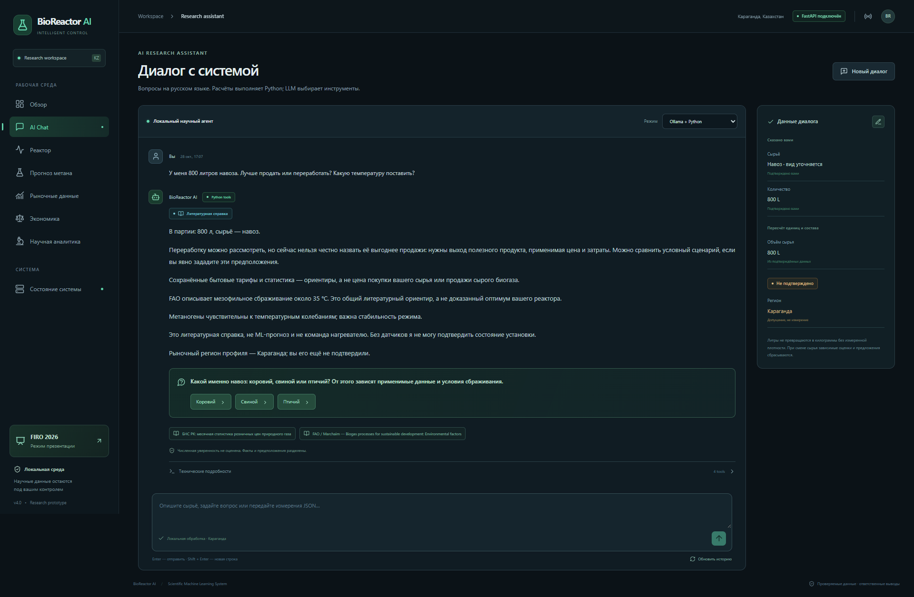
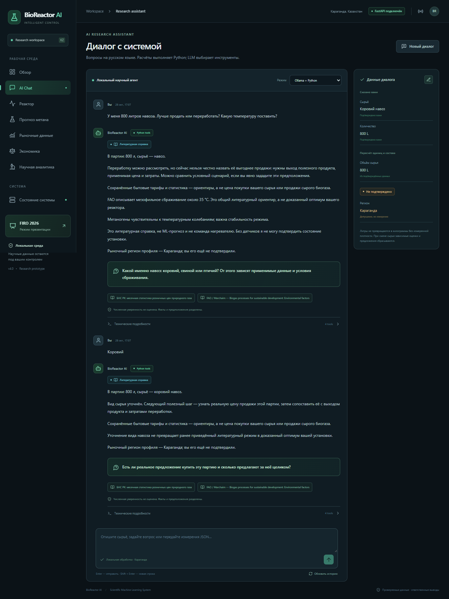
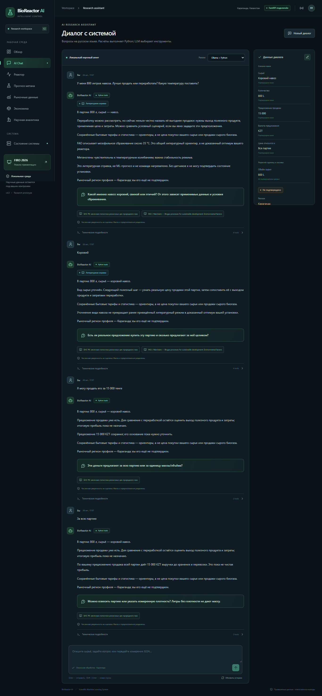
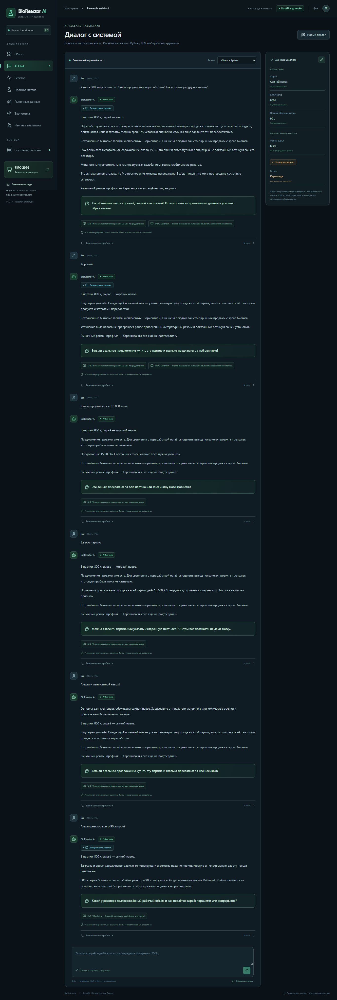

# BioReactor AI v5.6 — Conversational Intelligence Upgrade

Дата проверки: 28 октября 2026. Изменён существующий проект `BioReactor_AI`, без переобучения BMP-моделей. Реализованы структурированное понимание сообщений, постоянная память, уточнения, литературные ответы, выбор инструментов и обновление существующего React Chat.

## 1. Причины прежних ошибок

До изменений сохранён прогон прежнего агента на тех же 18 сообщениях: [исходные результаты](stage5_6/baseline_dialogues.json). Старая реализация недостаточно извлекала параметры из обычной речи: общее слово «навоз» не сопоставлялось с научной справкой, короткое «Коровий» не уточняло материал партии. План инструментов включал расчёты без необходимых входов, затем пользователь видел объединённые отказы и внутренние имена полей.

В первом примере фактически было **10 вызовов инструментов**. Новая версия выполняет четыре: анализ сырья, поиск рыночных цен, поиск источников, литературные рекомендации. Многошаговое продолжение сохраняет 800 L. На вопрос о температуре не вызываются рыночные инструменты; при нехватке данных не выполняется расчёт метана или прибыли.

Отдельно воспроизведён HTTP 400 от Ollama: **5711 входных токенов при доступном контексте 4096**. Явное указание тех же 4096 проблему не устраняло. Причина — передача объёмных результатов инструментов в последующее планирование. [Фактическая диагностика](stage5_6/ollama_error_diagnosis.json).

## 2. Новая архитектура и совместимость

Путь нового сообщения: типизированное извлечение → проверка предложений LLM → обновление памяти → выбор применимых инструментов → выполненные Python-расчёты/поиск → краткий ответ → одно приоритетное уточнение → сохранение в SQLite.

Основные компоненты:

| Файл | Ответственность |
| --- | --- |
| `src/agent/dialogue_types.py` | Pydantic-схемы сущностей, фактов, вопросов, состояния и предложения LLM |
| `src/agent/nlu.py` | Извлечение RU/EN/KK, единицы, роли величин, намерения и исправления |
| `src/agent/dialogue_memory.py` | Происхождение данных, пересчёт единиц, инвалидирование зависимостей |
| `src/agent/clarifications.py` | Один наиболее полезный вопрос, без повторного запроса известных значений |
| `src/agent/dialogue_tools.py` | Проверка предпосылок и план фактических вызовов |
| `src/agent/dialogue_response.py` | Понятный ответ и отдельная диагностика |
| `src/agent/conversation.py` | Объединение слоёв нового диалога |
| `src/recommendations/retrieval.py` | Проверяемые научные утверждения и импорт публикаций |
| `frontend/src/ConversationReply.tsx`, `ConversationFacts.tsx` | Читаемый ответ, уточнения, данные партии и исправления |

Существующий библиотечный `Agent` из `orchestrator.py` сохранён. Новая версия используется интерфейсом и CLI. Для старых REST-клиентов создание сессии без `conversation_version` оставляет протокол v4; новый клиент явно передаёт `5.6`. Сохранённый диалог интерфейса обновляется отдельным endpoint `/upgrade`, без удаления прежних сообщений. Проверены старая история и её продолжение.

Прежние расчётные функции, проверка применимости BMP и рыночные ограничения продолжают работать. Новая обёртка выбирает, когда их вызывать. Автоматического управления нагревателем, насосом, клапанами, давлением и газовой системой нет. Рекомендации не подтверждают исправность установки без датчиков.

## 3. Память и происхождение данных

Использована та же SQLite `data/market/market.sqlite3`. Миграция добавляет столбцы к `dashboard_sessions` и `dashboard_turns`: версию и состояние диалога, извлечённые сущности, подтверждённые параметры, ожидаемый вопрос и результаты инструментов. Сохраняются идентификатор, пользовательское сообщение, ответ и время. CLI использует те же таблицы; `--conversation` продолжает сохранённую сессию. Блокировка сессии и идемпотентность HTTP сохранены.

| Статус | Значение |
| --- | --- |
| `USER_CONFIRMED` | Сообщено пользователем; это не независимая проверка измерения |
| `SOURCE_VERIFIED` | Утверждение из локально проверенного источника с областью применимости |
| `MODEL_ESTIMATED` | Оценка модели с её ограничениями |
| `ASSUMED_FOR_SCENARIO` | Явное допущение, отдельно от фактов |
| `UNKNOWN` | Значение отсутствует или пользователь сообщил, что не знает его |
| `CALCULATED_FROM_CONFIRMED` | Дополнительный статус: арифметический пересчёт подтверждённых величин |

«Коровий» после общего навоза уточняет текущую партию и сохраняет её количество. Исправление на свиной навоз отменяет зависимые состав, плотность, BMP, оценки, предложение продажи и экономический сценарий. Независимые сведения о реакторе сохраняются. Изменение температуры отменяет прежние зависимые затраты на нагрев и сценарий. Регион профиля остаётся видимым неподтверждённым допущением, пока пользователь его не подтвердит; существующий регион профиля не заменяется произвольно на Караганду.

Литры не превращаются в килограммы без подтверждённой плотности. Тонны/граммы пересчитываются арифметически; для VS требуется основание процента — от влажной массы или от TS. Различаются объём сырья, общий и рабочий объёмы реактора, объём биогаза и метана. При 800 L сырья и реакторе 90 L агент объясняет ограничение одновременной загрузки и уточняет рабочий объём/режим; число партий не назначается.

## 4. NLU, уточнения и вызовы инструментов

Обычные фразы на русском, английском и казахском разбираются в строгие схемы. Поддерживаются L, m³, kg, t, g, TS/VS, температура, плотность, регион и цена с основанием. «15 000 тенге» сохраняется как предложение с неизвестным основанием; агент спрашивает, относится ли сумма ко всей партии. После «За всю партию» можно назвать **валовую выручку 15 000 KZT до расходов**, но не чистую прибыль.

LLM предлагает структурированные сущности. Для принятия каждой нужен фрагмент исходного текста и независимая проверка грамматикой. Самовольное уточнение общего навоза до коровьего или превращение литров в массу не принимается. Pydantic проверяет допустимые единицы, диапазоны и типы. Слова «допустим», «например», `assume`, `мысалы` переводят значения в сценарные допущения.

Уточняется один приоритетный пробел, максимум два тесно связанных параметра. Сначала вид навоза, затем основание цены; для ограничения загрузки — рабочий объём и режим. Ответ «не знаю» не становится численным фактом и не вызывает бесконечного повторения того же вопроса. Последняя цель сохраняется для кратких продолжений.

| Запрос | Выбор инструментов |
| --- | --- |
| Температура | Анализ сырья, поиск источников, литературные условия |
| Метан | Анализ сырья, проверка применимости/прогноз BMP; расчёт метана только при достаточных данных |
| Экономика | Анализ сырья, реальные сохранённые цены; сравнение только при вычислимости хотя бы одного сценария |
| Чернозём | Объяснение ограничения и поиск, без необоснованного BMP и расчёта выхода |

Сценарии A/B/C/D сохраняют прежние проверки затрат, выхода, единиц, даты, региона и возможности продажи. Отсутствие предложения для A не блокирует независимо вычислимый B; отсутствие тарифа электроэнергии не блокирует допустимый C/D при явно нулевом соответствующем потреблении. Цена природного газа не подставляется как цена сырого биогаза. Предложение пользователя не импортируется как независимая рыночная котировка. Гипотетический расчёт через существующий `calculate_profitability` допускается только с явно заданными предположениями; окончательная рекомендация о реальной выгоде при этом отсутствует.

## 5. Научный поиск и границы рекомендаций

Обновлён `search_scientific_sources`: фильтры по материалу, категории, теме температуры/pH/BMP, процессу и условиям. Новый каталог `data/knowledge/claims_v5_6.json` связывает каждое численное утверждение с источником, единицами и областью применимости. Исходный каталог этапов сохранён.

Проверенные первичные источники:

- FAO / Uri Marchaim, **1992**, [Environmental factors](https://www.fao.org/4/t0541e/T0541E06.htm): общий мезофильный ориентир около **35 °C**, температурная стабильность и факторы процесса. Это не доказанный оптимум коровьего навоза в конкретном реакторе.
- FAO / Marchaim, **1992**, [Biogas plant design](https://www.fao.org/4/t0541e/T0541E09.htm): различия режимов загрузки и связь проектирования с процессом. Число партий и режим конкретного оборудования из этого источника автоматически не назначаются.
- US EPA / EBMUD, **2008**, [Anaerobic Digestion of Food Waste](https://www.epa.gov/system/files/documents/2024-08/ebmud-final-report-anaerobic-digestion-of-food-waste-2008-03.pdf): сведения о подготовленной пищевой пульпе, включая pH **7–7,5** с указанием этой области. Они не выдаются за универсальное требование к любым отходам.

DOI не придумывались: при отсутствии подтверждённого DOI хранится `null`. URL, год, проверивший источник, дата проверки и расположение утверждения сохраняются. Численные значения BMP, TS и VS для неопределённого навоза не добавлялись.

`python BioReactor_AI/main.py knowledge list` показывает каталог. `knowledge import --input ...` принимает структурированный JSON с публикациями и научными таблицами; схема — [scientific_document.schema.json](../examples/scientific_document.schema.json). Нужны URL, год, проверивший и дата проверки, единицы, область утверждения. Числа в тексте должны быть явно структурированы; повторный идентичный импорт определяется по SHA, прежние ID не перезаписываются. Это проверка структуры и заявление оператора о рецензировании; она не доказывает истинность импортированного текста. Произвольные PDF автоматически не объявляются проверенными публикациями.

ML-ответ отдельно содержит модель, единицы, применимость и ограничения неопределённости. Литературный ответ не заполняет недостающий ML-BMP. Покрытие 90% не доказано; такие интервалы не называются проверенными предсказательными или доверительными. Независимой научной валидации новых ML-оценок в этом этапе не проводилось.

## 6. Ollama: аудит и реальные измерения

Использована уже установленная **qwen2.5:1.5b**: файл весов около 1,12 GB, метаданные модели указывают около 1,8B параметров. На ноутбуке около 16 GB RAM. Новые многогигабайтные модели не скачивались. Более сильная модель не тестировалась: в данном этапе основной воспроизведённый сбой вызван контекстом и оркестрацией.

Новый запрос содержит компактную память и схему NLU; свободный ответ LLM не используется как источник чисел. Обычный текст собирается из проверенных фактов, результатов инструментов и локализованных формулировок. Это обеспечивает управляемость, но ограничивает разнообразие речи и объяснений. Для старого адаптера планирования сокращены карточки инструментов вместо передачи полных результатов.

Запрашиваются `num_ctx=4096`, `num_predict=300`. Сохраняются фактические `prompt_eval_count`, `eval_count` и длительности Ollama. При невалидном JSON/схеме разрешена одна повторная генерация; при сетевой ошибке/ошибке авторизации бессмысленные повторные генерации не выполняются. Детерминированный режим сохраняет полезный ответ и показывает причину fallback в технической диагностике. Проверено по [официальному API](https://docs.ollama.com/api/chat) и [structured outputs](https://docs.ollama.com/capabilities/structured-outputs).

Сравнение одинаковых 18 предписанных сообщений: [comparison.json](stage5_6/comparison.json).

| Показатель | До | После, реальная Ollama |
| --- | ---: | ---: |
| Среднее число инструментов на сообщение | 4,39 | 2,72 |
| Запросы к Ollama | 36 | 18 |
| Ошибки запросов Ollama | 5 | 0 |
| Медиана задержки сообщения | 0,409 с | 0,638 с |
| Средняя задержка | 0,540 с | 0,666 с |
| Наибольший вход прежнего адаптера | 15 516 символов | — |
| Максимальный фактический `prompt_eval_count` нового NLU | Не записывался | 273 токена |

Ускорение **не продемонстрировано**: медиана нового ответа выше. Прежний быстрый отказ не эквивалентен полезному ответу. Нельзя смешивать символы прежнего payload и токены новой модели. Это небольшой локальный прогон в один день, без контроля кеша, нагрузки и фоновых процессов; он не является аппаратным бенчмарком. Измеряемый прогон выполнен последовательно после браузерных генераций.

Все 18 новых JSON-ответов прошли валидацию без fallback. На семи сообщениях с отдельной эталонной меткой намерения сама LLM совпала **6/7**, весь конвейер с проверкой/грамматикой — **7/7**. Таким образом, результат не доказывает безошибочность маленькой модели. Более ранние прогоны сохранены в `stage5_6/runs/`; финальные числа не получены удалением неудобных случаев.

## 7. Реальные диалоги и формат ответа

[Полные 18 ответов с Ollama](stage5_6/actual_dialogues.md) · [До/после, дословно](stage5_6/before_after.md) · [HTTP-диалог](stage5_6/actual_http_dialogue.json).

Проверена цепочка:

1. «800 литров навоза…» → 800 L, общий навоз, литературная справка с источником, вопрос о виде.
2. «Коровий» → та же партия 800 L, вопрос о виде больше не задаётся.
3. «Могу продать за 15 000 тенге» → уточнение основания цены.
4. «За всю партию» → валовая выручка 15 000 KZT, расходы и реальная прибыль остаются неизвестными.
5. Смена на свиной навоз → отмена старых зависимых оценок и предложения.
6. Реактор 90 L → предупреждение о невозможности одновременной загрузки 800 L, без вымышленного числа партий.

Отдельно проверены пищевые отходы 5 kg, чернозём, температура коровьего навоза, изменение до 37 °C, RU/EN/KK, тонны, проценты TS/VS и исправления.

Публичный ответ содержит вывод, основание, один вопрос и источники. `technical_metadata` отдельно содержит фактические вызовы, версию модели, происхождение, отсутствующие поля, ошибки валидации и fallback. Численная уверенность не выдумывается. В React техническая часть свёрнута; справка, ML и гипотетический сценарий различаются визуально. В боковой панели показаны факты, пересчёты и неподтверждённые допущения; исправление материала/количества продолжает ту же сессию.

## 8. Проверки проекта

[Итоговый verification.json](stage5_6/verification.json), запуск `python BioReactor_AI/verify_stage5_6.py --reuse-build`:

| Проверка | Фактический результат |
| --- | --- |
| Backend unittest | **160 прошли**, включая все прежние 117 без изменения их тестов |
| Frontend Vitest | **20 прошли**, включая прежние 13 |
| TypeScript | Прошёл; production build предварительно собран, повторно использован в итоговом прогоне |
| Детерминированные диалоги | **18/18** |
| Диалоги с реальной Ollama | **18/18** |
| Проверенные поля сущностей | **54/54** |
| Сохранение отдельно проверенных полей контекста | **17/17** |
| Уточнения с явной эталонной меткой | **3/3** |
| Правила выбора инструментов | **18/18** |
| Прямые HTTP-запросы к локальному серверу | **15**, успешны |
| CLI | **6** проверок: рынок, обе сохранённые BMP-модели, научный каталог, новый диалог и продолжение |
| Реальный Chrome | **27** проверок, **9** генераций Ollama, 0 ошибок консоли и 0 неудачных запросов |

Браузер проверяет полный диалог, исправление, перезагрузку, обновление старой сессии без потери истории, английский/казахский ответы и размеры 1366×768, 1920×1080, 390×844. Использован установленный Chrome, внешние запросы страницы блокировались. Старый v4 verify-скрипт не запускался, чтобы не перезаписывать его исторические отчёты.

Автоматический аудит не нашёл неподкреплённых чисел в этих ответах. Максимум основного текста — 114 слов без вопроса и источников. **Это проверка согласованности с данными и простой показатель длины**, не независимая экспертиза научной истинности и не оценка читабельности людьми.

По SHA-256 сохранены **142 прежних файла** моделей, данных и отчётов. Все **28** прежних наблюдений цен и прежние сообщения сохранены; тестовых котировок в рабочей базе **0**. Проверки браузера/экономических фикстур работают с отдельной копией базы, не добавляя демонстрационные цены в рабочую историю. Искусственные данные для улучшения ML-метрик не создавались, модели не переобучались.

После проверки перезапущен прежний локальный сервер с той же рабочей базой и ежедневным планировщиком. Чат открыт в отдельном окне Chrome по адресу `http://127.0.0.1:8765/dashboard/#/chat`. Проверены HTTP 200, загрузка нового JS и успешное обновление существующей сессии до 5.6. Повторная проверка после запуска подтвердила сохранность прежних файлов, всех цен и исходных сообщений: [post_activation.json](stage5_6/post_activation.json). Неверный адрес без hash-маршрута `/dashboard/chat` возвращает 404; для чата используется указанный выше адрес. Рабочая база не заменялась тестовой.

## 9. Скриншоты

[Исправление партии](stage5_6/chat_correction.png) · [English](stage5_6/chat_english.png) · [Қазақша](stage5_6/chat_kazakh.png) · [Мобильный размер](stage5_6/chat_mobile.png).

## 10. Ограничения и следующий этап

Это ограниченный научный консультант, а не универсальное понимание свободной речи. Регрессионный набор из 18 заданных сообщений использован при разработке; независимого многоязычного пользовательского бенчмарка нет. Нужны новые слепые диалоги, отрицания/смешанные языки, независимая разметка сущностей и проверка полезности ответов специалистом.

Научный каталог мал и вручную курируется. Часть выводов относится к общему процессу, а не к конкретному навозу. Для точных BMP и экономики нужны лабораторные TS/VS/BMP, условия приведения газа, измеренная плотность или масса, эффективность установки, энергозатраты, расходы и применимые предложения покупателей. Бытовая статистика не заменяет договорную цену. Новые внешние рыночные адаптеры в этом этапе не добавлялись: работоспособность источников и ограничения остаются зафиксированы в [отчёте 3.5](stage3_5_market_sources.md).

Сама LLM ошиблась в одном из семи размеченных намерений; грамматические проверки важны и не покрывают все будущие формулировки. Шаблонная локализация повышает контролируемость, но не доказывает свободное владение тремя языками. Следующий полезный этап — расширить проверенный каталог публикаций/таблиц, провести независимое испытание диалогов, получить реальные характеристики сырья и договорные цены, затем оценить более сильную локальную модель на тех же новых случаях. Управление оборудованием требует отдельного проекта измерений, ограничений и аппаратных защит.
