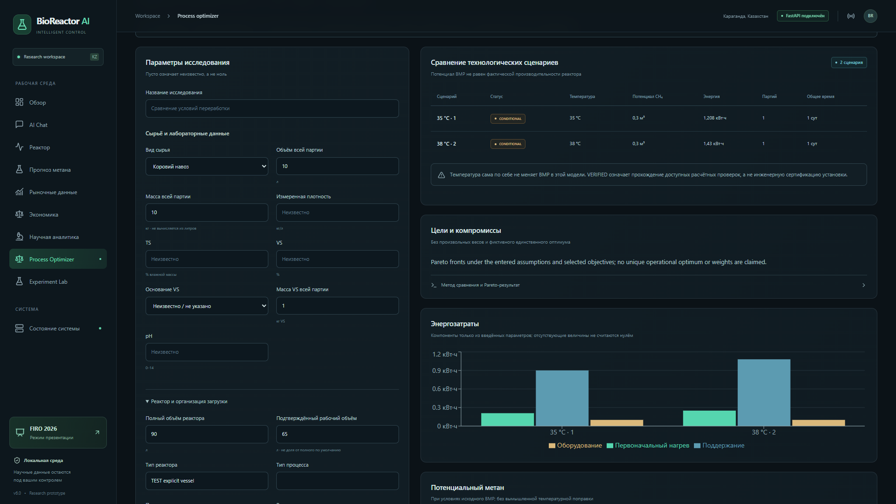
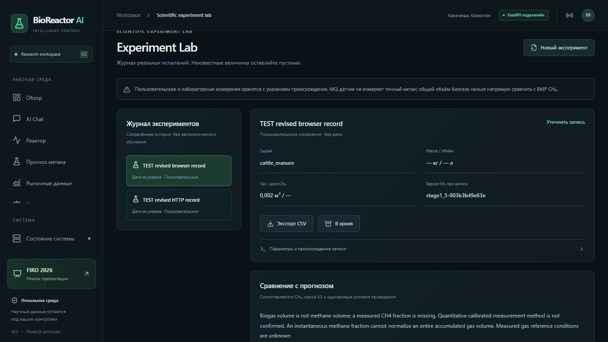

# BioReactor AI v6 — Process Optimizer & Scientific Experiment Lab

Дата: 28 октября 2026, Asia/Qyzylorda. Работа выполнена в существующем `BioReactor_AI`. Модели BMP не переобучались. Оптимизатор является рекомендательной расчётной системой; независимой научной валидации кинетики реактора этот этап не добавляет.

## 1. Архитектура

В `src/optimizer/` добавлены типизированные входы, проверка ограничений, подбор применимой справки, генератор явных альтернатив, оценка метана, тепловая модель, адаптер экономики, Pareto-сравнение, чувствительность, объяснения и журнал экспериментов. `service.optimize(store, request)` объединяет эти компоненты. Новый router подключён к существующему FastAPI, а таблицы добавлены в ту же SQLite.

Использованы существующие сервисы:

- `src.agent.tools.predict_tool` — прежняя проверка категории, лабораторных признаков и выхода за область обучения перед обращением к сохранённой BMP-модели.
- `src.economics.calculator.calculate_methane` — прежняя размерностно согласованная арифметика BMP/VS.
- `src.market.scenarios.compare(..., persist=False)` — прежние отдельные денежные журналы A–D и проверки цен.
- `src.recommendations.retrieval.retrieve` — ранее проверенный каталог научных утверждений с областью применимости.
- Разговорная память и SQLite-сессии v5.6 — сохранение партии и исправлений.

Не создан отдельный проект, облачный сервис или новый обучающий набор. Публичный протокол чата v5.6 сохранён; сведения о движке v6 находятся в результатах инструментов и технических метаданных. Старые клиенты API и библиотечный агент сохраняют прежний путь работы.

## 2. Алгоритмы и ограничения оптимизации

Это **перебор явно заданных кандидатов с проверками и Pareto-анализом**, а не обученная модель оптимального технологического режима. Кандидат может изменять температуру, рабочий объём, режим, HRT, состав смеси, предобработку и другие разрешённые поля. Для каждого изменения нужны явное значение и основание; оно записывается как допущение кандидата. Максимум — 12 кандидатов и 12 диапазонов чувствительности на запрос.

При отсутствии выбранной температуры допускается отдельное литературное исследование около 35 °C, если каталог содержит применимый общий источник. Это значение остаётся допущением сценария и не становится измеренной температурой в памяти пользователя. При отсутствии соответствующего источника режим не создаётся произвольно.

Изменение материала, смеси или предобработки не переносит прежний измеренный BMP и лабораторные признаки автоматически. Для другого материала также удаляются прежние VS/TS и плотность, если кандидат не предоставил новые сведения. Для смеси не предполагаются синергия или аддитивность BMP. Температурная поправка к BMP не моделируется.

## 3. Научные и инженерные ограничения

Поддержаны `HARD_CONSTRAINT`, `EVIDENCE_BASED_RANGE`, `USER_DEFINED_LIMIT`, `SCENARIO_ASSUMPTION`, `UNKNOWN`.

Проверяются, в частности:

- Рабочий объём не больше полного; объявленные рабочая жидкость и газовое пространство должны помещаться в сосуд.
- Одновременная жидкая загрузка не превышает рабочий объём.
- Инокулят, вода и остаточная жидкость занимают часть рабочего объёма.
- Положительный спрос на нагрев не совместим с явно недоступным источником тепла.
- Для непрерывного режима проверяется согласованность HRT и OLR с расходом и массой VS.
- Явные ограничения пользователя по температуре, энергии, длительности и стоимости проверяются там, где нужный показатель вычислим.
- Отсутствующие pH, TS/VS, конструкция, характеристики инокулята и газового хранения обозначаются неизвестными, без универсальной подстановки.

Статусы `VERIFIED`, `CONDITIONAL`, `INSUFFICIENT_DATA`, `INFEASIBLE` предусмотрены контрактом и интерфейсом. Технологические сценарии этого этапа не получают статус научно верифицированной эксплуатации: даже согласованный расчёт остаётся условным. `INFEASIBLE` означает нарушение заявленных ограничений, а не математическое доказательство невозможности всех способов обработки. Партия 800 L при сосуде 90 L требует планирования; это не означает, что поэтапная обработка невозможна вообще.

Оптимизатор не формирует команды нагревателю, насосу, клапанам, давлению или газовой системе. Условия газовой защиты, вентиляции, контроля давления и инженерной безопасности должны быть предусмотрены отдельно. Отсутствие датчиков не трактуется как нормальное состояние установки.

## 4. Объёмы, загрузка и формулы времени

Разделены полный и рабочий объёмы, headspace, объём сырья, одновременной жидкости, инокулята, воды, остаточной жидкости и газохранилища. Газовое пространство сосуда не считается доступным газовым хранилищем. Рабочий объём не назначается процентом от полного.

Для одного периодического реактора при явно заданной одинаковой схеме каждой загрузки:

```text
V_сырья_на_загрузку = V_рабочий − V_инокулят − V_вода − V_остаток
N = ceil(V_всей_партии / V_сырья_на_загрузку)
t_общее = N × t_цикл + (N − 1) × t_между_загрузками
```

Без рабочего объёма, режима, конструкции и распределения жидкости число загрузок не выдаётся. При известной геометрии, но неизвестном времени возможен частичный объёмный план без обещания длительности. Первоначальная подготовка и финальная очистка в формулу времени не включены, если пользователь не учёл их в своих значениях.

**Проверка арифметики, только TEST-условия:** рабочие 65 L, инокулят 10 L, вода 5 L, остаток 0 L дают 50 L сырья за загрузку. Для 800 L это 16 загрузок. Только при дополнительно заданных условных 30 днях цикла и 1 дне между загрузками получается 495 дней. Эти допущения не известны для установки пользователя и не подставляются в обязательный диалог.

Для непрерывного режима:

```text
HRT [сут] = V_рабочий [L] / Q_всей_жидкой_подачи [L/сут]
OLR [кг VS/(м³·сут)] = m_VS_за_сутки [кг/сут] / V_рабочий [м³]
```

Расход должен включать все жидкие потоки. HRT непрерывного процесса не заменяет длительность периодического опыта. Время лабораторного BMP не считается установленным временем переработки.

## 5. Метан и применимость BMP

Сохранена формула:

```text
Потенциал CH₄ [м³] = BMP [мл CH₄/г VS] × масса VS [кг] / 1000
```

Она описывает потенциал при условиях исходного BMP. Если пользователь отдельно предоставил долю извлечения, рассчитывается условный извлекаемый CH₄. Деление на явно заданную долю CH₄ даёт условный объём биогаза. Ни одно из этих значений не объявляется фактически измеренным выходом реактора.

При неизвестном VS точный потенциал не выдаётся. Литры не пересчитываются в массу без плотности; проценты VS требуют основания `TS` или `fresh_mass`. Для пользовательского BMP обязательны единица, происхождение и объяснение измерения/допущения, а для объёма — условия приведения газа. Условия пользователя являются утверждением оператора; автоматической сертификации нормализации газа нет.

Модель Hafner поддерживает шесть прежних категорий: Bird feed, Cellulose, Rabbit feed, Sunflower seeds, Wheat straw, Whey. Коровий/свиной навоз и обычные пищевые отходы не превращены в поддерживаемые категории ради демонстрации. Для них нужны применимые измерения либо явно условный BMP. Проверенная реакция выхода на температуру, pH, HRT, OLR, смешение и предобработку отсутствует. Интервалы с проверенным покрытием не добавлялись.

## 6. Физическая модель энергозатрат

Используются SI и kWh:

```text
Q_первичный [kWh_тепла] = m_нагреваемая [кг] × cp [кДж/(кг·K)] × max(Tц − T0, 0) / 3600
E_первичный [kWh] = Q_первичный / η
E_поддержание [kWh] = UA [Вт/K] × max(Tц − Tсреды, 0) × t [сут] × 24 / 1000 / η
E_вспомогательное [kWh] = P [Вт] × доля_времени × t [сут] × 24 / 1000
E_итого = E_первичный + E_поддержание + E_вспомогательное
```

Вспомогательная энергия может быть введена непосредственно. Если введены и энергия, и мощность/доля/длительность, проверяется их согласованность. Неизвестные UA, КПД, теплоёмкость и потребление не заменяются типовыми коэффициентами или нулём. При частичных данных показываются известные компоненты, но отсутствует полный итог. При необходимости охлаждения полный энергетический баланс не выдаётся: модель холодильной установки отсутствует.

Нагреваемая масса включает только то, что оператор явно указал; воду, инокулят и теплоёмкость корпуса нужно учесть в исходной модели. Постоянная теплоёмкость и установившиеся потери — приближения. Испарение, биологическое тепловыделение, рекуперация и переходные потери не моделируются. Указанный период и область энергобаланса сохраняются: энергия одной загрузки не умножается молча на всю партию и не переносится в её экономику.

**Контрольная физическая таблица — гипотетические TEST-входы, не измерения:** 10 kg, cp 4 kJ/(kg·K), начало/среда 20 °C, η 0,8, UA 2 W/K, 1 сутки, вспомогательные 0,1 kWh. При 35 °C получается 1,208333 kWh, при 38 °C — 1,43 kWh. Разница 0,221667 kWh относится к этому расчётному примеру. При отдельно заданных условных BMP 300 и VS 1 kg потенциал обоих вариантов одинаков — 0,3 m³. Это не оценка выхода для 800 L навоза. Полные входы и результаты: [physical_worksheet.json](stage6/physical_worksheet.json).

## 7. Источники и область доказательств

- FAO / Uri Marchaim, 1992, [Environmental factors](https://www.fao.org/4/t0541e/T0541E06.htm): общие температурные режимы и устойчивость процесса. Около 35 °C — литературный ориентир, не доказанный оптимум конкретного навоза и конструкции.
- FAO / Marchaim, 1992, [Anaerobic processes, plant design and control](https://www.fao.org/4/t0541e/T0541E09.htm): различия режимов и проектных условий. Частные режимы не становятся универсальными ограничениями.
- US DOE, 1992, [Fundamentals Handbook, Thermodynamics, Heat Transfer, and Fluid Flow, Vol. 1](https://www.energy.gov/documents/doe-hdbk-1012-92vol1): основа расчёта чувствительного тепла. Это не источник теплоёмкости конкретного сырья.
- PNNL, [Building Science — Introduction to Heat Flow](https://basc.pnnl.gov/information/building-science-introduction-heat-flow): основа установившегося теплопереноса через ограждение. Этот источник не измеряет UA биореактора; год не назначался без подтверждения.
- Рыночные данные — прежняя SQLite с 28 сохранёнными реальными наблюдениями и их источниками. Новые котировки для красивого сравнения не добавлялись; ограничения адаптеров остаются в [отчёте 3.5](stage3_5_market_sources.md).

Исходный научный каталог и прежние отчёты сохранены. DOI, которого нет в проверенном каталоге, не придумывался. Метки `SOURCE_VERIFIED` означают проверку конкретного источника/утверждения, а не экспериментальную валидацию оптимизатора.

## 8. Экономическая модель

Сценарии A–D используют прежнюю модель и **не суммируются**:

- A: продажа исходного сырья с расходами продажи.
- B: экономия на собственном потреблении энергии, ограниченная подтверждённым спросом.
- C: продажа указанного газового продукта при техническом и юридическом подтверждении.
- D: допустимое использование/продажа дигестата с подтверждённым качеством.

Сохраняются проверки региона, валюты, НДС, профиля потребителя, единиц, даты, возраста, достоверности и назначения цены. Бытовая статистика природного газа не становится ценой покупки сырого биогаза. Неизвестная цена не заменяется нулём. Доступность строки A не доказывает выгодность остальных вариантов.

Энергия подключается к денежному журналу автоматически только при явно заданной области `entire_feedstock`. Если она уже включает нагрев, отдельная ненулевая `heating_cost` блокирует сравнение до согласования. Противоречие между введённой и рассчитанной электроэнергией не разрешается молчаливой подменой.

`feedstock_purchase_cost` — дополнительная явная стоимость приобретения одной и той же партии. Она вычитается один раз из каждой альтернативы. При неизвестной стоимости маржа обозначена как результат без покупки исходного сырья; A представляет альтернативную стоимость собственного сырья. Для сравнения разных технологических сценариев пользователь явно выбирает одинаковый маршрут `market.comparison_route` A/B/C/D; разные валюты, маршруты или регионы не ранжируются вместе.

При заданных капитальных вложениях, числе сопоставимых партий в год и постоянных дополнительных годовых расходах рассчитывается простая условная окупаемость:

```text
ΔCF_год = (чистый_результат_выбранного_маршрута − чистый_результат_A) × партий_в_год − дополнительные_годовые_расходы
Окупаемость [лет] = капитал / ΔCF_год, только если ΔCF_год > 0
```

Это не DCF, не прогноз загрузки установки и не обещание окупаемости. Финансирование, дисконтирование, налоги и замена оборудования не оцениваются без отдельной модели. Число партий в год является входным допущением, которое необходимо согласовать с реальной производительностью. При неполном денежном журнале остаются неизвестные значения и доступные точки безубыточности из прежнего калькулятора.

## 9. Многокритериальное сравнение, неопределённость и чувствительность

Поддержаны цели: потенциальный CH₄, энергия, стоимость, чистый результат, время и неопределённость. Цели выбирает пользователь; веса и скрытый единый балл не назначаются.

Pareto-сортировка выполняется только при одинаковой базе сравнения, отсутствии нарушенных/критически неполных условий и вычислимости всех выбранных показателей. Кандидат доминирует другой, если не хуже по всем выбранным целям и строго лучше хотя бы по одной. Возвращаются фронты, без назначения универсального эксплуатационного оптимума. Разные массы, объёмы, материалы, условия приведения или области энергии требуют согласования. При неполноте показывается таблица компромиссов.

Для неопределённости нет калиброванного численного балла: выбор этой цели не порождает произвольную оценку уверенности и блокирует численное ранжирование. Не устанавливались распределения ошибок и покрытие интервалов. Никакой интервал не называется проверенным 90% доверительным или предсказательным.

Чувствительность — детерминированное изменение одного параметра между двумя явно заданными границами: BMP, VS, температура, UA, вспомогательная энергия, цена электричества/сырья, расходы на обслуживание. Диапазон должен иметь пользовательское основание или ссылку на научный источник. Значения не берутся автоматически ±20% из прежнего демонстрационного рыночного анализа. Выводится размах каждого результата в его единицах и список наиболее сильных воздействий в пределах конкретного показателя. Корреляции и взаимодействия не оцениваются; это не вероятностный прогноз будущего.

## 10. Интеграция с AI Agent

Добавлены шесть инструментов в существующий `ToolRegistry`: `analyze_process_constraints`, `generate_process_scenarios`, `estimate_process_energy`, `optimize_process`, `explain_optimization`, `compare_process_scenarios`.

Разговорный адаптер `src/agent/process_bridge.py` сохраняет подтверждённые параметры в памяти v5.6, отдельные кандидатные температуры — в допущениях, а служебный признак включения оптимизатора не выдаёт за пользовательское измерение. Новые инженерные параметры валидируются до изменения памяти. Доступны отдельные естественные формулировки, явные SI-поля `name=value` и структурированный объект `process_parameters`; универсальное извлечение любых инженерных условий из свободной речи не заявляется.

Простой вопрос о температуре сохраняет прежние три научных инструмента. Запрос только об энергии вызывает энергетический инструмент; запрос о выгоде получает реальные рыночные данные. Все шесть функций не запускаются автоматически на каждое сообщение. Высокоуровневый оптимизатор показывает внутренние расчётные блоки и происхождение в своём результате. Снимки исследований сохраняются без перезаписи.

Изменение температуры пересчитывает зависимые результаты. «Сравни 35 и 38 градусов» не перезаписывает текущую температуру двумя якобы измеренными значениями. Исправление вида сырья удаляет старые зависимые BMP, плотность, состав и тепловые характеристики, сохраняя независимые размеры оборудования.

Реальный последовательный диалог с локальной `qwen2.5:1.5b`: [читаемая запись](stage6/actual_dialogue.md), [полный JSON с вызовами и метаданными](stage6/actual_ollama_dialogue.json). В обязательном примере сохранены 800 L и 90 L; затем рабочие 65 L; сравнение температур не даёт вымышленный метан; экономический ответ не назначает прибыль при отсутствии выхода, применимых предложений и затрат. Новые модели LLM не скачивались.

## 11. Dashboard

В существующий дизайн добавлены **Process Optimizer** и **Experiment Lab**. Сохранены прежние разделы, графитовая палитра, акценты, компоненты и локальная сборка без внешнего CDN.

Оптимизатор содержит параметры партии/реактора, разделение масс и объёмов, явные кандидатные температуры, выбор целей, диапазоны чувствительности, таблицы результатов, ограничения и источники. Графики энергии показывают только вычисленные компоненты; неизвестное не превращается в ноль. График потенциала CH₄ отсутствует без его расчёта. История позволяет открыть снимок или сравнить не менее двух исследований. Основная форма сравнивает температуры; расширенные варианты других параметров доступны через API/структурированный ввод.

Адреса: `http://127.0.0.1:8765/dashboard/#/optimizer` и `http://127.0.0.1:8765/dashboard/#/experiments`. Используется hash-маршрутизация; отдельный путь `/dashboard/optimizer` не является URL страницы.

## 12. Experiment Lab и API

В новой SQLite-схеме: `process_optimizer_runs`, `experiment_records`, `experiment_revisions`, `experiment_measurements`. Сценарии, версии эксперимента и измерения защищены от перезаписи/удаления триггерами. Эксперименты архивируются. Происхождение `user`/`laboratory` фиксируется отдельно и не меняется редактированием; это заявление оператора, а не независимая проверка лаборатории.

Запись допускает неизвестные массу, объём, температуру, pH, TS/VS, длительность, биогаз, долю CH₄, метод и условия приведения. Фиксируются версия и снимок прогноза сохранённой модели, включая честный статус неприменимости. Каждое новое измерение связано с той версией входов и модели, при которой оно внесено. Исправление VS или материала не пересчитывает задним числом старые наблюдения.

Для сравнения нужны измеренные биогаз и доля CH₄, количественный метод, основание доли по объёму, VS и документированная сопоставимость условий газа. Мгновенная доля не нормирует весь накопленный объём, интервальное измерение не считается накопленным. Общий биогаз без CH₄ не сравнивается с BMP метана. MQ не принимается как количественный калиброванный метод. Даже разрешённое сравнение обозначено условным: наблюдаемый выход не обязательно является завершённым стандартным BMP-испытанием.

CSV содержит происхождение, единицы в именах полей, условия газа, время, связанную версию эксперимента и модели. Формульные строки экранируются для табличных редакторов, исходная SQLite не изменяется. Графики показывают введённые измерения; пропуски не заполняются искусственными данными. Автоматического переобучения из журнала нет.

| Endpoint | Назначение |
| --- | --- |
| `POST /api/process/optimize` | Расчёт и сохранение исследования |
| `GET /api/process/scenarios`, `GET /api/process/scenarios/{id}` | История и неизменный результат |
| `POST /api/process/compare` | Сравнение выбранных снимков и целей |
| `GET /api/experiments/schema` | Pydantic-схемы журнала |
| `POST/GET /api/experiments` | Создание и журнал с фильтром происхождения |
| `GET/PATCH /api/experiments/{id}` | Чтение и новая версия записи |
| `POST /api/experiments/{id}/archive` | Архивирование без удаления |
| `GET /api/experiments/{id}/revisions` | История версий |
| `POST/GET /api/experiments/{id}/measurements` | Добавление и история измерений |
| `GET /api/experiments/{id}/comparison` | Проверка сопоставимости с прогнозом |
| `GET /api/experiments/{id}/export.csv` | Экспорт всех наблюдений |

Ошибки схемы/диапазона дают 422, отсутствующий ID — 404. Физически противоречивый, но корректно заданный сценарий возвращается с `INFEASIBLE` и объяснением. Старые рыночные и Dashboard endpoints сохранены.

## 13. Проверка, воспроизведение и сохранность

Полный воспроизводимый запуск:

```powershell
python BioReactor_AI/verify_stage6.py
```

Используются временная копия рабочей SQLite, отдельный сервер на свободном порту, установленный Chrome, настоящая локальная Ollama и фактические HTTP-запросы. Тестовые арифметические записи помечены `TEST` и не переносятся в рабочую базу. Сервер проверки останавливается. `--reuse-build` сохраняет готовую сборку и повторяет TypeScript; `--skip-browser` явно обозначает отсутствие браузерного прогона. Старые verify-скрипты не запускаются с перезаписью прежних отчётов.

Итоговые выполненные проверки и точные количества записываются в [verification.json](stage6/verification.json); полные логи находятся рядом. [HTTP-запросы](stage6/http_checks.json), [CLI](stage6/cli_checks.json), [Chrome](stage6/browser.json). Это регрессионные тесты, не независимая научная валидация. Контрольные численные сценарии проверяют формулы и представление, не качество модели на новых измерениях.

Фактический итог завершённого прогона `verify_stage6.py --reuse-build`:

| Проверка | Результат |
| --- | --- |
| Backend unittest | **212/212**, в том числе все прежние 160 без изменения их тестов |
| Frontend Vitest | **26/26**, в том числе прежние 20 |
| TypeScript | Пройден; production build был собран и использован в HTTP/Chrome |
| Прямые HTTP-проверки | **23** успешные |
| CLI | **5**: рынок, обе сохранённые BMP-модели, новый диалог и продолжение |
| Обязательный диалог с настоящей Ollama | **4/4** последовательных сообщений, без перехода в детерминированный fallback |
| Chrome | **32** успешные проверки, 1366×768, 1920×1080, 390×844 |
| Ошибки консоли / неудачные запросы браузера | **0 / 0** |
| Дополнительный диалог Ollama через интерфейс | **4** реальных генерации в браузерной цепочке |
| Предыдущие защищённые файлы | **196/196**, изменений нет |
| Предыдущие цены / сообщения / экономические сценарии | Сохранены |
| Рабочие котировки | **28**, тестовых **0** |
| Изолированный сервер и база проверки | Сервер остановлен, временная база удалена |

Браузер проверил пустые неизвестные поля, отсутствие вымышленного рабочего объёма и метана, вычисленные графики, условные Pareto-фронты, сравнение сохранённых исследований, ввод/редактирование/перезагрузку журнала, CSV, сохранность измерений, разговорную цепочку и прежнюю страницу реактора. Первые остановки браузерного теста были вызваны неоднозначным селектором текста и неверным ожидаемым заголовком прежней страницы; успешный итог получен после исправления тестового скрипта. Непрошедшие попытки не являются заявленными успешными проверками.





[Пустая форма](stage6/optimizer_empty_1366.png) · [Неполные данные](stage6/optimizer_incomplete_1366.png) · [Мобильный размер](stage6/optimizer_mobile.png) · [Чат](stage6/optimizer_chat_1366.png).

До изменений зафиксированы SHA-256 **196** прежних файлов моделей, отчётов, сырых/обработанных данных и научного каталога, а также рабочие строки SQLite. Проверка требует их сохранности, прежних сообщений и всех **28** ценовых наблюдений; тестовых цен в рабочей базе быть не должно. Модели этапов 1 и 1.5 проверяются через прежний CLI. Создание новых экспериментальных таблиц не означает использования журнала для обучения.

После проверки v6 запущена локально на порту 8765 с прежней рабочей базой и ежедневным рыночным планировщиком. Получены HTTP 200 от Dashboard и новых API, оптимизатор открыт в отдельном окне Chrome. В рабочем журнале и истории v6 нет тестовых записей: обе коллекции пусты до пользовательского ввода. [Повторная проверка после запуска](stage6/post_activation.json) подтвердила сохранность всех 196 защищённых файлов, прежних строк SQLite и 28 цен; ссылки отчёта проверены. Обновлённая сборка обслуживается тем же FastAPI, без необходимости запускать Vite.

## 14. Ограничения и следующие задачи

Оптимизатор не знает кинетику конкретного реактора, измеренные свойства навоза, фактическую эффективность, санитарную допустимость продуктов и контрактные цены, пока оператор не предоставит их. Локальный каталог источников мал. Указанные научные сведения не являются аппаратными ограничениями всех реакторов, а выбранная пользователем температура не доказывает достижение требуемой конверсии.

Тепловая модель приближённая и требует идентификации UA/теплоёмкости, границ периода и массы. План партий не доказывает стабильность микробного сообщества. Годовую загрузку для окупаемости необходимо отдельно согласовать с реальными циклами и простоями. Происхождение и калибровка пользовательских измерений пока подтверждаются оператором; автоматической проверки протокола лаборатории нет. Сравнение условий газа основано на явно документированном совпадении, а не на автоматическом приведении разных T/P/влажности.

Следующие задачи: собрать реальные повторные испытания с количественным измерением CH₄ и VS, зафиксировать протокол нормализации газа, оценить кинетику/теплопотери конкретного реактора, расширить проверенные научные таблицы, получить применимые договорные цены и провести независимую проверку диалогов/ранжирования. Автоматическое управление и обучение на пользовательском журнале в этот этап не входят.
