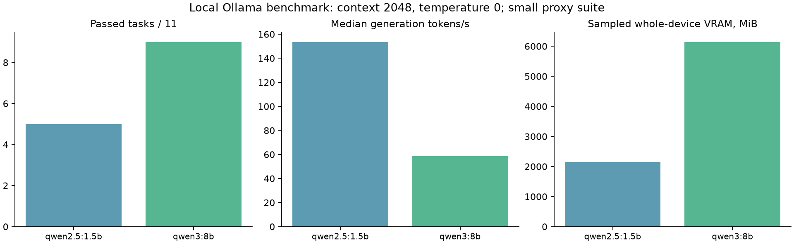
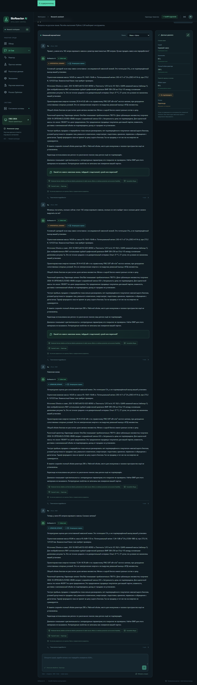

# BioReactor AI v7 — автономное исследование и оценка

Проверено 29 октября 2026 года (Asia/Qyzylorda). Разработка выполнена в существующем проекте. BMP-модели не переобучались.

## Что работает

Добавлены `src/research/` и `src/estimation/`, интеграция с ConversationAgent, FastAPI и существующим React Dashboard. Новые диалоги панели используют v7; прежние API 4/5.6 и CLI по умолчанию сохранены. Обновление старой сессии сохраняет все её сообщения. SQLite расширяется добавлением research_records (неизменяемые доказательства, предложения и расчёты), research_fetches (попытки получения), research_cache (кеш с возрастом). Старые цены не превращаются в исследовательские предложения и не перезаписываются.

В агенте доступны `research_scientific_evidence`, `research_market_offers`, `estimate_from_literature`, `research_and_estimate`. Числа считает Python. Новые метаданные Crossref имеют статус DRAFT и не становятся основанием численного BMP без проверки. Кеширование научного поиска — 7 суток; предложений — 24 часа; после ошибки источника действует часовой перерыв. Поиск цены запускается по запросу, существующий суточный планировщик рынка сохранён. У этого нового каталожного адаптера нет отдельного фонового расписания.

## Реальный пример: 142 л навоза КРС, реактор 200 л

Пока форма навоза не уточнена, результат — **HYPOTHETICAL_SCENARIO**: если материал сопоставим с необработанной навозной жижей RM1 из выбранной работы. После явного уточнения «навозная жижа» уровень — **LITERATURE_ESTIMATE**. Для сухого, подстилочного навоза и перегноя этот профиль отклоняется. **MEASURED** означает расчёт по введённым измеренным характеристикам конкретной партии; это не измерение произведённого газа.

Плотность 1,013 кг/л даёт 143,846 кг влажной массы. VS 10,8 ± 0,64% влажной массы даёт 14,615–16,456 кг VS. Это VS на влажную массу, а не на TS: повторное умножение на TS ошибочно.

Для BMP принят грубый диапазон **200–250 мл CH₄/г VS**, ограниченный основными делениями графика 1a для необработанного RM1. Он не является опубликованным точным средним или статистическим интервалом. Перемножение границ даёт:

* Потенциал CH₄: **2,923–4,114 м³**, при 273,2 K и 1,01325 bar из статьи. Влажностный базис газа явно не указан.
* Справочная энергия топлива: **29,14–41,02 кВт·ч**, с коэффициентом FNR 9,97 кВт·ч/м³ чистого метана и явным допущением сопоставимости опорных условий. Это не электрическая выработка и не прибыль.
* Общий биогаз не вычисляется без доли CH₄. Эффективность установки не выдумывается.
* StroiTaxi, Караганда: приблизительно **700 ₸/т**; условная каталожная стоимость оценочной массы — **100,69 ₸**. Дата публикации неизвестна, влажность и условия малого заказа не установлены. Это предложение продавца, не закупочная цена и не подтверждённая выручка пользователя.

Диапазоны — чувствительность к переносу литературных свойств и грубому считыванию графика. Покрытие не проверено; они не названы 90% доверительными или предсказательными. Вариация плотности, ошибка переноса между партиями и полноразмерное извлечение не оценены. Два края графика и mean±SD не образуют вероятностную модель.

Полные 200 л реактора сохранены в памяти отдельно от рабочего объёма. Наличие места для 142 л сырья, инокулята, воды и газового пространства не подтверждается одним полным объёмом.

Реальный выбор продажи или переработки пока не ранжируется: нет подтверждённых закупочных предложений, условий технически и юридически допустимой продажи газа, реального извлечения и всех затрат. Тариф природного газа не принят за цену сырого биогаза. Использование одного газа для энергии и продажа того же газа не суммируются. Существующий `calculate_profitability` используется для отдельного условного расчёта по явно введённым ценам, доле извлечения и затратам, на обоих концах литературного диапазона; окончательная рекомендация при этом не выдаётся.

## Источники и проверка

| Источник | Фактический результат | Использование |
|---|---|---|
| [Oliveira et al., DOI 10.1007/s43153-025-00592-x](https://link.springer.com/article/10.1007/s43153-025-00592-x) | Первичная статья прочитана и проверена при реализации. Публикация онлайн 11.09.2025; выпуск 2026. Программная загрузка статьи/PDF запрещена robots, обхода нет | Плотность, таблица 1, рисунок 1a, условия RM1 |
| [Оригинальный рисунок 1](https://media.springernature.com/lw685/springer-static/image/art%3A10.1007%2Fs43153-025-00592-x/MediaObjects/43153_2025_592_Fig1_HTML.jpg) | Реальная загрузка и визуальная проверка; отдельный публичный хост разрешал доступ; CC BY 4.0 | Только необработанный RM1; замороженный RM2 и предобработки исключены |
| [FNR Faustzahlen](https://biogas.fnr.de/daten-und-fakten/faustzahlen) | Первичный справочник проверен; год страницы не указан, сохранён null | Справочная энергия чистого метана, не цена |
| [StroiTaxi: Коровий навоз, Караганда](https://stroitaxi.kz/karaganda/catalog/stroitelnye-materialy/koroviy-navoz/) | Реальный публичный HTTPS-запрос с проверкой TLS/robots; извлечены цена, тонна и регион | Недатированный приблизительный seller ask; никогда is_current=true |
| [Crossref REST](https://api.crossref.org/works) | В первом реальном запросе HTTP 429; позднее получены метаданные успешно, оба события записаны | Только поиск публикаций, не извлечение проверенных чисел |
| Прочие регионы / свиной и птичий навоз / сырой биогаз / тепло | Новых подтверждённых живых адаптеров и закупочных цен нет | Поддержаны товары для ручного импорта; существующие 28 наблюдений сохранены |

У каждой величины каталога есть исходные единицы, нормализованные границы, источник, локатор, тип материала, условия и статус проверки. Проверка при реализации выполнена агентом по первичным материалам, не независимым предметным экспертом. Таблица 3 той же статьи содержит конфликт единицы теплоты сгорания; этот элемент отклонён, а не молча исправлен. Работы с иным состоянием сырья, смесями и неясными массовыми базисами не объединены в среднее.

Обнаруженные новые публикации требуют отдельного предметного подтверждения. Полностью универсального автоматического извлечения корректных BMP/TS/VS из произвольных статей нет: реализованы поиск метаданных, проверенный каталог, проверка схем/единиц и импорт текста локального PDF в DRAFT. CAPTCHA, авторизация, robots и ограничения сайтов не обходятся. В поисковые запросы уходят категории материала и научные термины, не полный диалог и не параметры частной партии.

## Локальная LLM и оборудование

Фактический CPU — **Intel Core i7-12700H**, а не i5 из задания. GPU — **RTX 3070 Laptop, 8192 MiB**. RAM около 16 GiB. Перед загрузкой свободно около 6078 MiB VRAM и 2,45 GiB RAM в сохранённом снимке; диск имел более 435 GB свободного места. Ollama **0.40.12**. Установлена только одна новая модель: **qwen3:8b, Q4_K_M**, примерно 5,2 GB; прежняя qwen2.5:1.5b сохранена.

Одинаковый набор из 11 задач: русское извлечение параметров, продолжение диалога, выбор инструментов, объяснения и запрет придуманных чисел. Контекст 2048, temperature=0; qwen3 think=false. Основной прогон использует точный рабочий NLU-промпт. Первичный диагностический прогон с более коротким промптом сохранён отдельно; его показатели не смешаны с основным.

| Модель | Успех задач | Включение нужного инструмента | Медиана первого содержимого, с | Медиана tokens/s | Медиана end-to-end, с | Пик RAM системы, GiB | Пик VRAM устройства, MiB |
|---|---:|---:|---:|---:|---:|---:|---:|
| qwen2.5:1.5b | 5/11 | 3/3 | 0.089 | 153.6 | 0.647 | 11.57 | 2146 |
| qwen3:8b | 9/11 | 3/3 | 0.082 | 58.5 | 1.697 | 11.99 | 6144 |



Выбрана qwen3:8b за лучший результат этой небольшой серии. 3/3 — наличие требуемого инструмента, не точность полного оптимального плана. Проверки структурированного вывода и запрета чисел — автоматические прокси, не доказательство научной достоверности. Есть ошибки в извлечении и переносе фактов памяти; каждое предложение LLM по-прежнему проверяется независимой грамматикой и буквальными фрагментами сообщения. Расчётные ответы формируются из результатов Python.

Медиана первого содержимого включает тёплые запросы и не заменяет задержку холодной загрузки. В первоначальном прогоне первый запрос 8B занял около 38 с; в основном около 7 с. Замеры RAM/VRAM — выборочные примерно раз в секунду; системная RAM и VRAM включают другие приложения. WDDM не предоставлял корректную VRAM процесса. RSS процессов с именем Ollama измеряется отдельно в JSON и не является полным учётом памяти GPU/дочерних процессов. Производительность может меняться при параллельной нагрузке.

Настройка: `data/config/llm_selection.json`; env `OLLAMA_MODEL` и `BIOREACTOR_LLM_CONTEXT` имеют приоритет. При ошибке/тайм-ауте/недоступности большой модели используется сохранённая 1.5B, затем детерминированный путь. На Windows до запроса действует порог свободной физической RAM 768 MiB. Это защита перед запросом, не гарантия от всех всплесков памяти. Benchmark дополнительно прерывает собственный запрос при свободной RAM ниже 384 MiB. Приложения пользователя и сервис Ollama не закрывались.

## Проверки и сохранность

* Backend: **237 тестов**, включая исходные 212, новые контракты единиц, совместимости материала, кеша/ошибок/SSRF, экономических расчётов и многошаговой памяти.
* Frontend: **30 тестов**, production build и TypeScript прошли.
* Реальные HTTP: **31 проверки** на изолированном сервере 127.0.0.1:8768, в том числе реальные запросы к Ollama и живому ценовому источнику.
* Chrome: **7 проверок**, включая реальный POST сообщения, два уровня результатов, первичные ссылки и ширину 390 px.
* CLI: **6 проверок** с реальными subprocess: v7, продолжение, старый контракт, обе сохранённые модели.
* Все **230 защищённых файлов** и прежние строки SQLite сохранены; сравнение до/после выполнено побайтно / по полям. Тесты пишут только в изолированные копии; тестовые предложения не внесены в рабочие цены.

Доказательства: [verification.json](stage7/verification.json), [backend-tests.log](stage7/backend-tests.log), [benchmark](stage7/llm_benchmark.json), [Chrome](stage7/browser-results.json), [CLI](stage7/cli-results.json), [сохранность рабочей базы после запуска](stage7/production-preservation.json). Рабочая база после запуска содержит прежние 28 цен, 1 сессию и 3 сообщения; добавлены 3 исследовательские записи с реальным источником, предложением и условным расчётом. Обновление версии сессии меняет служебную версию памяти, сохраняя сообщения. [Проверка fallback](stage7/fallback-check.json) имитирует исключение нехватки памяти и подтверждает переход с 8B на сохранённую 1.5B; реальное истощение памяти намеренно не создавалось. Не запускайте старые verify_stage6.py ради v7: они перезаписывают свои отчёты. Повтор v7 требует нового имени изолированной БД через BIOREACTOR_STAGE7_QA_DB; готовая копия намеренно защищена от перезаписи.



## Запуск

Из корня BioReactor_AI:

```powershell
python main.py dashboard --port 8765
python main.py chat --research --mode offline
python main.py chat --research --no-llm --message "У меня 142 литра коровьего навоза. Сколько метана?"
```

Адрес панели: http://127.0.0.1:8765/dashboard/#/chat . `offline` — локальная LLM; публичный исследовательский поиск управляется отдельно. Для полного запрета внешнего поиска: `$env:BIOREACTOR_RESEARCH_ONLINE='0'`; проверенный каталог и сохранённые предложения работают локально с указанием возраста.

API: `GET /api/research/evidence`, `POST /api/research/estimate`, `GET /api/research/runs`, `/offers`, `/logs`. Пример тела: `{"material":"cattle_manure","volume_l":142,"reactor_total_volume_l":200,"online":true}`. Запрос online по умолчанию выключен для прямого API; агент v7 включает публичный поиск автоматически, если env не запрещает. Ручные цены импортируются существующими `/prices` и `/prices/import-csv` с источником, датой и базисом. Литературные предположения не передаются в Hafner как пользовательские измерения.

## Следующие данные для научного улучшения

Подтвердить форму, влажность и регион навоза; измерить плотность и TS/VS именно партии; провести BMP с документированными условиями газа и контролями. Для полноценной экономики нужны предложения покупателя с массой, качеством, доставкой и датой, фактическое извлечение/метановая доля, допустимость продажи газа, КПД, электропотребление, хранение, перевозка и качество/сбыт дигестата. Нужны независимые сопоставимые исследования и экспериментальная проверка переноса диапазона на установку. До этого система помогает оценить масштаб, но не выдаёт окончательную инвестиционную или технологическую рекомендацию.
