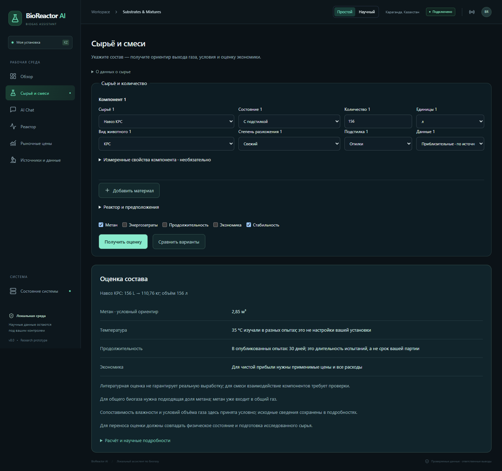
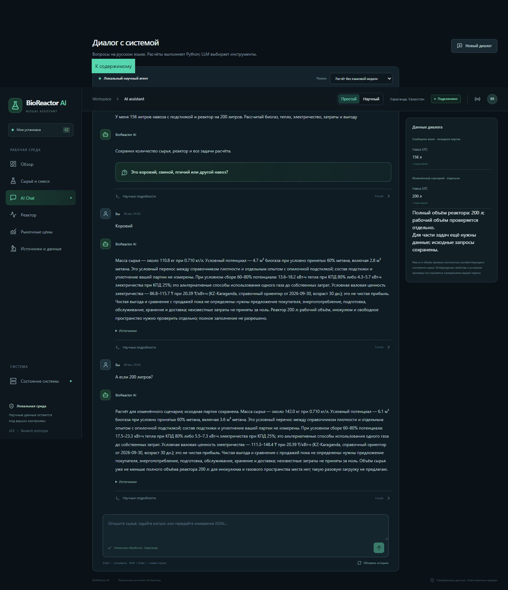

# BioReactor AI v8.0 — Advanced Conversational Intelligence

Дата отчёта: 30 октября 2026, Asia/Qyzylorda. Работа выполнена в существующем проекте. BMP-модели не переобучались; исходные цены и научные данные не заменялись демонстрационными.

## Результат и границы

Проблемный составной запрос теперь сохраняется до уточнения вида животного. Ответ «Коровий» автоматически запускает расчёт массы, лабораторного ориентира газа, альтернативных выходов энергии и доступной экономической справки. Для неизвестных расходов выводится конкретный список недостающих данных. Это расширение инженерной системы, а не доказательство универсального качества собеседника на произвольных формулировках.

Проверено: **372 backend-тестов, 56 frontend-тестов, 27 реальных HTTP/LLM/CLI-проверок и 16 проверок установленного Chrome**. Сборка TypeScript/Vite успешна. Основной сценарий, его вариант с уточнением вида и десять последовательных продолжений прошли с реальной локальной Qwen3 8B. Тесты проверяют значения, происхождение, ограничения и содержание ответа.

## Архитектура и память

Сохранены ConversationAgent, ToolRegistry, FastAPI, SQLite и все прежние сервисы расчёта. Расширенный маршрут находится в src/agent/advanced_conversation.py. Новый граф инструментов выбирается по требуемым результатам: пересчёт единиц, газ, энергия, экономика и изученные условия вызываются независимо. Вычисления принадлежат Python; LLM предлагает ограниченную интерпретацию намерения и не поставляет расчётные числа.

DialogueState.advanced отдельно хранит inventory, scenario, reactor, task/tasks, unfinished_tasks, history, assumptions, sources, results и preferences. Уточнение вида меняет только недостающий признак. Неразрешённая экономика остаётся незавершённой задачей после вопроса о температуре. Изменение количества по «А если…» не становится подтверждённым наличием. «Новая партия» очищает активную ветку, параметры реактора и структурированные переопределения. Сохранённый JSON состояния возобновляется между HTTP-запросами и в CLI.

Животное, физическая форма, разложение и подстилка — независимые типизированные поля Component. Для старого material_state действует адаптер. Свежесть не меняет сухость. Навоз КРС, свиней, птицы, лошадей, овец и коз различается; овцы и козы имеют отдельное поле animal при сохранении совместимого каталожного идентификатора. Хранившееся/перепревшее/компостированное сырьё не получает автоматически свежий BMP.

Кеш газа не зависит от цели использования энергии. При изменении КПД газ берётся из кеша, энергия пересчитывается. Для температуры количество не меняет биологическую справку; геометрия проверяется заново. Экономика разрешает сохранённые цены заново, включая их возраст. Повторный формат ответа использует готовый результат. Размер краткого контекста LLM ограничен; прежняя защита RAM и резервный провайдер сохранены.

## Научные профили и источники

До этапа было 3 численных профиля для 2 материалов. Теперь **6 профилей для 5 материалов**: КРС, пищевые отходы, свиньи, лошади и солома. Полный согласованный профиль с плотностью, TS, VS и BMP по-прежнему **один — RM1**. Другие профили не объявляются полными за счёт склейки публикаций. Дополнительно заведены 9 справочных записей плотности и частичные характеристики приоритетных категорий. Подтверждённые профили и условные переносы считаются отдельно.

| Источник | Проверенные данные и область |
|---|---|
| [Alberta, Manure Composting Manual, 2005](https://www1.agric.gov.ab.ca/$department/deptdocs.nsf/all/agdex8875/$file/400_27-1.pdf?OpenElement=), Table 3 | Подстилочный навоз КРС: 710 кг/м³ при влажности 68%; твёрдый молочного стада: 710 при 79%. Это справочные точки. Для конского навоза с подстилкой: 725–960 кг/м³ при влажности 59–79%; для общей соломы: 58–357 при 4–27%. Плотность зависит от упаковки, подстилки и влажности. |
| [Alberta Nutrient Management Planning Guide, Table 6.1.2](https://www1.agriculture.alberta.ca/$department/deptdocs.nsf/all/epw11920/$FILE/6-1.pdf) | Классовые оценки твёрдого свиного навоза 772/796 кг/м³, овец и коз 497. Это частичные данные, без назначенного BMP. |
| [Mönch-Tegeder et al., 2013](https://cigrjournal.org/index.php/Ejounral/article/view/2445), Tables 2/3/7/8 | Парные данные barn A: конский навоз без подстилки — TS 23.19%, VS 20.51% влажной массы, наблюдённый CH₄ 176 мл/г VS; солома — 81.77%, 75.61%, 214. HBT, 37±0.5°C, 35 дней; высушенные и измельчённые до 1 мм пробы. Плотность отсутствует. |
| [Pham et al., 2013, DOI 10.5713/ajas.2012.12623](https://doi.org/10.5713/ajas.2012.12623), Tables 2/3 | Свиной навоз, конкретная проба Fangel, VDI: TS 3.18%, VS 22.75 г/кг влажной массы, измеренный BMP 207.84 NL/kg VS, опубликованный SD 1.97. SD сохранён отдельно, не превращён в предсказательный интервал. 37°C, 1 л бутылки; окончание по малой скорости газообразования, без придуманного срока. |
| [Baek et al., 2020](https://www.mdpi.com/1660-4601/17/13/4737), прежняя проверенная база | Сохранены отдельные профили подготовленной пищевой пульпы и выдержанного опилочного подстилочного навоза КРС. Для последнего TS 31%, VS 23.53% влажной массы, измеренный mono BMP 109.2 мл/г VS; 35°C, 30 дней, разбавленная лабораторная проба. Это не согласованный свежий/соломенный/сухой профиль. Чистая свиная вершина RSM остаётся исключённой как fitted prediction. |

Новые данные: data/research/advanced_profiles.json. Предыдущие reviewed_evidence.json, substrate_advisor.json и decision_references.json неизменны. Локально сохранены три доступных PDF с SHA-256 и снимками таблиц; [журнал доступа](stage8_0/sources/access.json). PDF Alberta и открытый первичный PDF Pham доступны с кодом 200. Заголовок поискового зеркала Pham ошибочен: название сверено по самому PDF и DOI. CIGR прочитан через веб-извлечение первичной статьи; отдельный requests-download завершился обрывом соединения. MDPI 2026 вернул 429, PMC — CAPTCHA; они не обходились и не использованы для новых чисел.

## Единицы и допущения

Поддерживаются g/kg/t и mL/L/m3 в обе стороны. Между единицами одной размерности применяется SI-коэффициент. Между массой и объёмом: m=Vρ, V=m/ρ; обратный диапазон [m_low/ρ_high, m_high/ρ_low]. Режимы плотности: MEASURED — предоставленное измерение с USER_REPORTED/MEASURED происхождением; LITERATURE_ESTIMATE — применимый справочник; ILLUSTRATIVE_ASSUMPTION — явно выбранная условная плотность. Плотность не генерируется LLM. Отсутствующая плотность сухого навоза не заменяется единицей или жижей.

У 156 л подстилочного навоза плотность 0.710 кг/л — одна справочная точка. Интервал вокруг неё не выдуман. Совмещение этой плотности с Baek обозначается как условный перенос между разными образцами и странами, даже при близкой влажности. Для соломенной подстилки перенос опилочного профиля возможен только как отдельная иллюстрация, без объявления его измеренным соломенным BMP.

Для сухого навоза предусмотрен явно условный пример: TS=80% выбрано для иллюстрации, VS/TS и B0 переносятся из недосушенного опилочного образца. Эффект сушки, хранения и состава не подтверждён. Этот пример не добавлен в число научно полных профилей. Пищевой профиль относится к измельчённой пульпе. Сумма отдельных метановых ориентиров смеси не является измеренной синергией или нижней границей реального выхода.

## Основной проблемный сценарий: фактический результат

Ввод: «У меня 156 литров навоза с подстилкой и реактор на 200 литров. Рассчитай биогаз, тепло, электричество, затраты и выгоду» → уточнение вида → «Коровий». Задачи gas, heat, electricity, economics сохранены. Вызваны только три нужных инструмента: газ, энергия и экономика; get_model_info и обучение не вызываются.

| Показатель | Реальный вывод Python |
|---|---|
| Объём исходного сырья | 156 л |
| Плотность справочного подстилочного образца | 0.710 кг/л · опубликованная точка, без выдуманного диапазона |
| Масса | 110.7600 кг |
| TS | 34.3356 кг |
| VS | 26.0618 кг |
| Лабораторный ориентир CH₄ | 2.8465 м³ · условно общая сухая база |
| Общий биогаз при выбранных 60% CH₄ | 4.7441 м³ · иллюстрация состава |
| Полезное тепло при сборе 60–80%, КПД 80% | 13.6221–18.1628 кВт·ч |
| Электричество при сборе 60–80%, КПД 25% | 4.2569–5.6759 кВт·ч |
| Условная валовая ценность электричества | 86.7982–115.7309 ₸ |
| Чистая прибыль / стоимость эксплуатации | Не определены: отсутствуют применимые предложения и полный баланс затрат |

CH₄ нормирован по явно выбранной общей сухой базе (273.2 K, 101325 Pa); влажность Baek неизвестна и её совместимость принята условно. 60% CH₄ — выбранная иллюстрация состава, не опубликованная характеристика этой партии. Тепло и электричество — альтернативы одного потока топлива до вычета собственных затрат. Их нельзя складывать как два независимых дохода. Прежний CHP-расчёт и правила распределения энергии сохранены.

Денежная величина использует сохранённую справочную цену электроэнергии 20.39 ₸/кВт·ч с датой 2026-09-30; возраст и статус присутствуют в ответе. Это статистическая справка, не индивидуальный тариф и не договор продажи. Регион по умолчанию — Караганда, предварительное предположение. Цена природного газа не назначается сырому биогазу. У неизвестных затрат нет значения ноль. Реактор 200 л не объявляется пригодным по одному полному объёму: неизвестны рабочий объём, инокулюм, свободное пространство и тип процесса. При изменении на 200 л прямо сообщается об отсутствии места для инокулюма/газового пространства.

До исправления, на двух последовательных репликах:

> Состав обновлён. Полный выход пока не рассчитан: не хватает подходящих характеристик сырья. Следующий шаг — измерить состав или провести лабораторное испытание неподтверждённого компонента. Пока нельзя обоснованно выбрать продажу или переработку: нужны применимая цена покупателя и полные расходы установки.

> Полный выход пока не рассчитан: не хватает подходящих характеристик сырья. Следующий шаг — измерить состав или провести лабораторное испытание неподтверждённого компонента. Пока нельзя обоснованно выбрать продажу или переработку: нужны применимая цена покупателя и полные расходы установки.

После уточнения вида, из настоящего HTTP-ответа:

> Масса сырья — около 110.8 кг при 0.710 кг/л. Условный потенциал — 4.7 м³ биогаза при условно принятых 60% метана, включая 2.8 м³ метана. Это условный перенос между справочником плотности и отдельным опытом с опилочной подстилкой; состав подстилки и уплотнение вашей партии не измерены. При условном сборе 60–80% потенциала: 13.6–18.2 кВт·ч тепла при КПД 80% либо 4.3–5.7 кВт·ч электричества при КПД 25%; это альтернативные способы использования одного газа до собственных затрат. Условная валовая ценность электричества — 86.8–115.7 ₸ при 20.39 ₸/кВт·ч (KZ-Karaganda, справочный ориентир от 2026-09-30, возраст 30 дн.); это не чистая прибыль. Чистая выгода и сравнение с продажей пока не определены: нужны предложение покупателя, энергопотребление, подготовка, обслуживание, хранение и доставка; неизвестные затраты не приняты за ноль. Реактор 200 л: рабочий объём, инокулюм и свободное пространство нужно проверить отдельно; полное заполнение не разрешено.

## Диалоги, производительность и интерфейс

В [полном журнале](stage8_0/http_results.json) сохранены ответы, планы, результаты инструментов, память и метрики провайдера. В текущем прогоне зарегистрировано **3 настоящих успешных генерации Qwen3 8B**; ответ «Коровий» и известные продолжения обрабатываются без новой генерации. Более слабая модель ради скорости не назначалась. Прежняя резервная модель доступна при нехватке ресурсов; отсутствие фактического вызова LLM не маркируется как её генерация.

| Реплика | HTTP, с |
|---|---:|
| У меня 156 литров навоза с подстилкой и реактор на 200 литров. Рассчитай биогаз, тепло, электричество, затраты и выгоду | 2.842 |
| Коровий | 0.096 |
| У меня 156 литров коровьего навоза с подстилкой и реактор на 200 литров. Рассчитай биогаз, тепло, электричество, затраты и выгоду | 2.773 |
| У меня 50 кг сухого коровьего навоза | 1.812 |
| А если он свежий? | 0.059 |
| Добавь 20 кг пищевых отходов | 0.078 |
| Переведи всё в литры | 0.059 |
| Какая температура лучше? | 0.079 |
| Сколько дней потребуется? | 0.079 |
| Что выгоднее — продать или переработать? | 0.074 |
| Объясни простыми словами | 0.065 |
| Ответь одним предложением | 0.085 |
| Почему ты использовал такую плотность? | 0.078 |

Медиана 9 коротких продолжений: 0.078 с. Старый исходный запрос занял 9.640 с, ответ на вид — 2.224 с. Это наблюдения отдельных запусков, а не контролируемое статистическое доказательство ускорения: отличаются прогрев, кеши и фоновая нагрузка. Точность выполнения задач проверена отдельно от задержки.

На странице сырья добавлены независимые оси, все шесть единиц, измеренный/литературный/условный режимы, пересчёт массы и объёма, применимые условия опыта. В панели памяти исходная партия показывается отдельно от сценария. Технические трассы закрыты по умолчанию; в обычном ответе отсутствуют MAE, CatBoost, Nested CV и JSON инструментов. Тёмная тема сохранена.

[Мобильная проверка](stage8_0/substrates_390.png) пройдена без горизонтального переполнения.

## Проверки и сохранность

Полный backend: 372 passed ([лог](stage8_0/backend.log)); frontend: 56 passed ([лог](stage8_0/frontend.log)); [сборка](stage8_0/build.log). Проверены восстановление задач из сериализованного состояния, раздельные свежесть/сухость, гипотетическая ветка, новая партия, типизированный JSON состава, шесть единиц, обратные границы, измеренная/условная плотность, несовместимость состояний, старение, запрет скрытого переноса жижи, зависимость от КПД и отсутствие выдуманной прибыли.

Настоящий локальный сервер проверен на порту 8780 с отдельной копией SQLite; Chrome работает с реальным API. Проверены /api/advisor/convert, прежние advisor/process/experiments/reactor маршруты, CLI и неизменный RM1-расчёт 142 л. [Результаты браузера](stage8_0/browser_results.json) и [HTTP/LLM/CLI](stage8_0/http_results.json) подтверждают успешный прогон. Четыре старых ожидания обновлены под расширенную доказательную базу; запреты на подмену профилей и двойной учёт не ослаблялись.

Проверка SHA-256: **371 прежних файлов неизменны**, включая модели, raw/processed данные, базу знаний, старые научные источники и отчёты. [Полная проверка](stage8_0/preservation.json) подтверждает сохранность всех исходных строк: 28 цен, 2 сессии, 15 реплик, 5 экономических сценариев, 23 научных записи. На этапе разработки добавилась одна условная расчётная научная запись от контрольного запроса; это не новое экспериментальное измерение. Старые строки не удалялись и не переписывались. Исходный SQLite-снимок хранится отдельно.

## Ограничения и следующие данные

Нет десяти полных согласованных профилей: свежий твёрдый, соломенный, сухой навоз КРС, птица, овцы/козы и разнородные растительные остатки всё ещё требуют подходящих измерений или явно условного переноса. Опубликованные точки и сценарные границы не являются интервалами с проверенным покрытием. Лабораторный BMP не гарантирует сбор в установке; сроки опыта не становятся HRT/временем завершения партии. Изученные температуры не являются доказанным оптимумом сухого процесса. Автоматического управления нагревателем, насосами, давлением и клапанами нет.

Новые тексты v8.0 в первую очередь проверены на русском; общие прежние RU/EN/KK-маршруты сохранены, но полная локализация новых составных ответов и широкое испытание свободных формулировок требуют отдельного набора диалогов. Реакции на опечатки ограничены проверяемой нормализацией и интерпретацией локальной модели; универсальное понимание любой опечатки не заявляется.

Приоритет дальнейших данных: насыпная плотность при известной влажности/уплотнении/доле и типе подстилки, TS/VS и BMP одной и той же пробы; отдельные свежие и хранившиеся партии; фактическая доля CH₄ и условия измерения объёма; рабочий объём, инокулюм, режим сухого/жидкого сбраживания, реальные собственные энергозатраты; предложения покупателей и все расходы по каждой альтернативе. Это важнее искусственного роста метрик или назначения отсутствующих значений.

[Инструкция запуска и API](../docs/advanced_conversation.md). Рабочий адрес: http://127.0.0.1:8765/dashboard/#/chat. Публикация в интернете и переобучение не выполнялись.

## Проверка рабочего сервера

Локальный сервер обновлён до 8.0, PID 53952; Dashboard отвечает HTTP 200, API пересчёта проверен реальным POST. Рабочая база сохранена: data/market/market.sqlite3. Планировщик оставлен выключенным, как в предыдущем запуске. Открыто отдельное окно Chrome. [Запись проверки](stage8_0/production_server.json).
