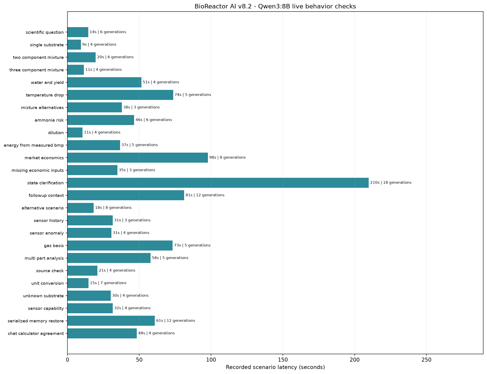

# BioReactor AI v8.2 — автономный научный агент

Дата проверки: 2 ноября 2026 г.  
Статус: локальный исследовательский прототип; не система управления промышленным реактором.

## Итог

В существующий проект добавлен ограниченный цикл выбора инструментов локальной языковой моделью. Агент использует Qwen3:8B через локальный Ollama (`127.0.0.1`), сохраняет подтверждённые данные диалога и передаёт модели результаты проверенных инструментов. При проверке `ollama ps` показывал 5,3 GB, выполнение на GPU и контекст 2048 токенов. Исполняется не более одного инструмента за шаг; цикл ограничен пятью вызовами на сообщение. Набор доступных функций не включает управление оборудованием. Интернет-исследование при оценке было выключено: поиск выполнялся только по локальному проверенному каталогу.

Модель BMP не переобучалась. Артефакты этапов 1 и 1.5 сохранены без изменений. Результаты этапа 8.2 показывают работу маршрутизации, проверки ввода и числовой привязки, но не подтверждают биологическую точность прогнозов.

## Реальная локальная оценка Qwen

Прогнаны 25 фиксированных естественно-языковых сценариев, всего 30 пользовательских ходов. Сценарии выполнялись 30 октября — 2 ноября 2026 г. Результаты объединены из сохраняемых пакетов: прогон можно было продолжить после неполного сеанса, поэтому это не один непрерывный запуск. В сводный файл включены наиболее поздние трассы после соответствующих исправлений; промежуточные и неудачные результаты оставлены отдельно.

| Показатель выбранных финальных трасс | Результат |
|---|---:|
| Сценарии / ходы | 25 / 30 |
| Вызовы генерации Ollama | 148 |
| Вызовы инструментов | 65: 41 `ok`, 20 `needs_input`, 4 `insufficient_evidence` |
| Ходы без ошибок валидации | 30 из 30 |
| Финальные ответы, прошедшие числовой guard | 30 из 30 |
| Черновые числовые/объёмные утверждения, отклонённые guard | 3 |
| Совпадение с прямым контрольным расчётом | Да: 0,5 м³ CH₄ в чате и калькуляторе |
| Медианная записанная длительность сценария | 34,75 с |

Прохождение numeric guard означает только, что финальный текст не содержит неподтверждённых числовых значений или что в нём нет числовых утверждений. Это не оценка фактической научной точности текста. Статус `needs_input` обычно означает, что сценарий намеренно не содержал BMP, газовую базу, свойства сырья или цену, необходимые инструменту.

В контрольном расчёте использованы измеренные 250 мл CH₄/г VS и 2 кг VS: `250 × 2 000 = 500 000 мл = 0,5 м³`. Чат вызвал `calculate_methane`, получил те же 0,5 м³ и воспроизвёл значение в ответе. Указанная база газа: 273,2 K и 1,01325 bar; влажность не задана.

В сценарии с 12 кг cattle slurry, 2 кг пищевых отходов и измеренными 3 кг VS агент сохранил контекст при восстановлении сериализованной памяти. Литературный диапазон для навоза не был представлен как полный выход смеси: для пищевых отходов не хватало TS, VS и BMP сопоставимого образца, а синергия не предполагалась. Это литературный ориентир по отдельному исследованию, а не измерение пользовательской партии.

В сценарии разбавления — 10 кг сырья, измеренные 2 кг VS и 5 л добавленной воды — вызван новый инструмент `calculate_vs_concentration`. Он сообщил 13,33% VS по влажной массе при явном приближении плотности воды 1 кг/л; объёмная концентрация оставлена неопределённой без объёма или плотности сырья.

Полные ответы и трассы: [сводный JSON](../evaluations/stage8_2_qwen3_8b_results.json). Неполный исходный прогон и отдельные повторные проверки сохранены в `evaluations/stage8_2_qwen*`; сводка содержит список входных файлов и сценариев, заменённых поздними трассами. Для воспроизведения вызовов используется [evaluation harness](../evaluations/evaluate_stage8_2_qwen.py).

## Изменения и найденные ограничения

- Добавлены автономный read-only цикл и отдельный расчёт массовой концентрации VS после разбавления. Инструмент сообщает плотностное допущение и не подменяет массовую долю объёмной: [dilution.py](../src/agent/dilution.py), [autonomous.py](../src/agent/autonomous.py), [providers.py](../src/agent/providers.py), [conversation.py](../src/agent/conversation.py).
- Распознавание `cattle slurry` теперь связывает массу с материалом cattle manure и жидкой формой. Масса VS из формулировки «3 kg VS in the combined sample» больше не разбирается как неизвестная масса отдельного компонента. Литературный поиск по материалу не предлагается, если материал не распознан: [nlu.py](../src/agent/nlu.py), [mixture_parser.py](../src/agent/mixture_parser.py).
- Проверка чисел учитывает корректное округление показанного значения. Для неполной смеси fallback явно маркирует сумму как относящуюся только к компонентам с сопоставимыми данными; это предотвращает выдачу частичной суммы за полный прогноз.
- В живых трассах Qwen иногда достигал лимита инструментов или выдавал черновик с неверной областью применимости числа; такие случаи фиксировались и заменялись ограниченным ответом. Итоговые трассы содержат 7 завершений по лимиту инструментов, 3 fallback после числовой проверки и 5 ошибок выбора действия провайдером. Поэтому успешная проверка числового guard не означает, что каждый сценарий получил содержательный расчёт.
- В экономическом сценарии для Караганды агент не получил достаточных применимых проверенных цен и затрат, поэтому не сделал вывод о прибыльности. Свежие цены и свежие публикации в этой оценке не запрашивались.
- Ввод 4 литров навозной жижи без измеренной плотности не был автоматически превращён в массу. Неуточнённая форма навоза вызвала запрос уточнения до выбора профиля.

Для регрессий добавлены проверки кода агента: [test_autonomous_agent.py](../tests/test_autonomous_agent.py). Также скорректированы два старых ожидания в тестах диалога: при неизвестной физической форме навоза агент сначала спрашивает форму, а не подставляет профиль и рассчитывает выход.

## Совместимость и сохранение BMP-моделей

Обе сохранённые модели загрузились через существующий CLI:

| Проверка | Результат |
|---|---|
| `python main.py --help` | код 0 |
| `python main.py predict --input examples/wheat_straw.json --model stage1` | код 0; 332,0977 мл CH₄/г substrate VS |
| `python main.py predict --input examples/stage1_5_measured.json --model stage1_5` | код 0; 279,4 мл CH₄/г substrate VS |
| `python main.py chat --no-llm --json --message "What is the live reactor sensor status?"` | код 0; сообщено, что датчики не подключены |

SHA-256 артефактов совпадает с зафиксированными до этапа 8.2 значениями:

- `models/bmp.joblib`: `dbbf33f0eca5a4f43fa00feafe6fab9fd76778a0f1804e0bea66d363879b9c4f`
- `models/stage1_5/bmp.joblib`: `eb1d88854c7b5a98410ee4ae8e6513ca17ee2aceb6f250ba9e9536aab90e793e`

Ориентиры предыдущего отчёта этапа 1 (внешний тест пяти лабораторий, 109 измерений): MAE 80,38, RMSE 131,99, R² 0,173. Это ранее просмотренный тест; он не использовался здесь для выбора модели или признаков. Этап 1.5 сообщал training-only nested grouped CV macro-lab MAE 53,92 на единственном исследовании с шестью общими субстратами. Эта оценка не является независимой проверкой переноса между исследованиями.

Интервалы неопределённости не стали сильнее: у этапа 1 90%-й групповой интервал недоступен из-за недостаточного числа калибровочных лабораторий. У этапа 1.5 90%-й интервал также отсутствует; прежняя исследовательская 80%-я полоса и наблюдавшееся покрытие на пяти ранее просмотренных лабораториях не устанавливают популяционное покрытие. Детектор OOD остаётся эвристикой.

## Тесты и локальный интерфейс

Полный набор после последних изменений: **406 passed, 0 failed**, 2 предупреждения сторонних компонентов/существующих тестов: устаревающее использование `httpx` в `starlette.testclient` и тест, возвращающий словарь вместо `None`.

FastAPI поднят на `127.0.0.1:8766` командой `python main.py dashboard --port 8766 --no-browser --no-scheduler`. Проверены реальные HTTP-запросы: `/health`, `/api/dashboard/status`, `/api/dashboard/reactor` и `/dashboard/` — все вернули 200; создание чат-сессии — 201, отправка сообщения — 200. Страница открыта в отдельном окне Edge. Сервер запущен без планировщика обновлений. `/api/dashboard/reactor` возвращает режим без live-сенсоров; команды оборудованию отключены.

## Ограничения достоверности и необходимые данные

Оценка проверяет программный путь и корректное воздержание от расчёта при нехватке входов. Она не является независимым тестом Qwen, BMP, реакторного прогноза, рыночной выгоды или безопасности процесса. Защита чисел не доказывает семантическую корректность объяснения и не может отсеять все ошибочные научные утверждения. Литературные профили не заменяют анализ конкретной партии. Поиск источников использовал локальный каталог; его наличие не означает, что источник применим к условиям конкретного пользователя.

Для дальнейшей научной проверки нужны: независимые BMP серии из нескольких лабораторий с повторами и полным протоколом (инокулюм, ISR, температура, время, подготовка и газовая база); измеренные TS/VS/BMP каждого субстрата и смесей на нескольких долях; локальные данные по ингибиторам, pH и загрузке; телеметрия с калибровкой датчиков; проверенные ряды тарифов и коммерческих предложений Казахстана; характеристики установки, энергопотребление, обслуживание, транспорт, очистка газа и обращение с дигестатом. До появления таких данных агент должен продолжать показывать недостающие входы и границы переноса, а не выдавать численный вывод как универсальную рекомендацию.
