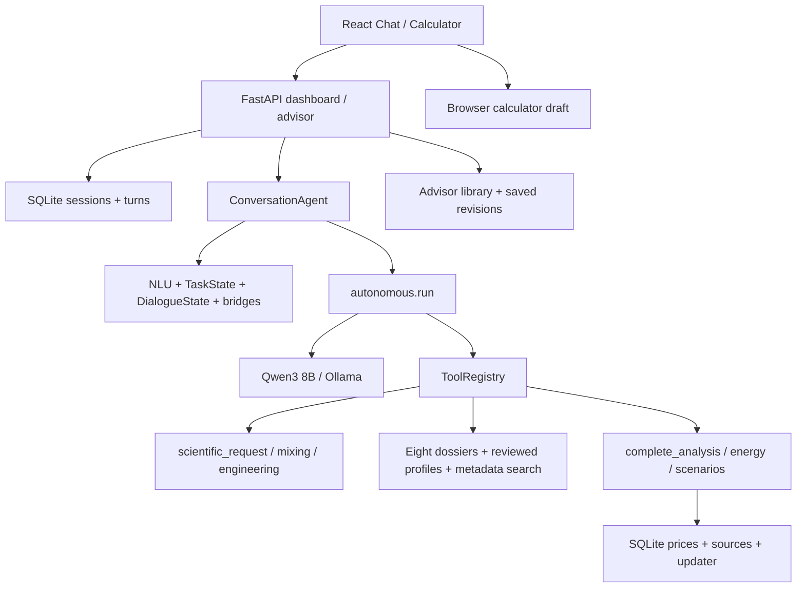
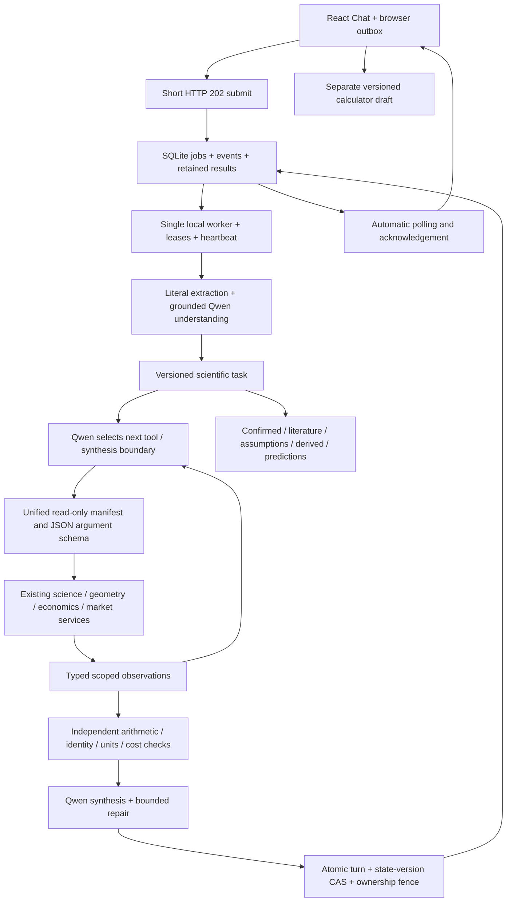

# BioReactor AI v9.0 — аудит и реализация

Статус: **в работе; приёмка v9.0 не пройдена**. Предыдущие модели, базы и отчёты сохраняются.

## Phase 0: зафиксированные воспроизведения

До изменения приложения выполнен `evaluations/stage9_audit.py` на временной базе.
Результат: [audit_before.json](stage9/audit_before.json).

1. Искусственно прервано создание провайдера после записи сообщения в БД.
   Первый HTTP-запрос вернул 500, повтор того же request_id — 409, а запись
   навсегда осталась `running` без результата. Это контролируемая инъекция отказа,
   не реальная ошибка Qwen. Аналогичный разрыв возможен при остановке процесса.
2. После контекста «47 л коровьего навоза / 114 л» сообщение «470 л свежей травы /
   840 л» не извлекло материал на первой стадии. Менеджер задачи сохранил
   `cattle_manure` перед научным мостом. Поздний парсер способен распознать траву,
   но ранний контекст модели и граница задачи уже неверны.
3. В рабочей базе на момент аудита было 37 завершённых сообщений и **не было**
   незавершённых строк. Наличие потери ответа в текущей рабочей базе не заявляется.
4. В предыдущей реальной серии A–H все восемь вычислительных ответов завершались
   `numeric_grounding_fallback` около 120 секунд. Это подтверждает проблему
   бюджета синтеза, а не самостоятельное успешное написание ответов моделью.

## Карта зависимостей до изменения

Работающие компоненты для сохранения: научные формулы, измерительные единицы,
инженерная геометрия, восемь досье, независимая проверка VS×BMP, сохранённые ML
артефакты, экономические альтернативы без сложения доходов, история цен,
планировщик источников, библиотека смесей и прежние API/CLI.

## Причины потери ответа и смешения состояния

- POST сообщений синхронно держит соединение до конца анализа. Frontend ждёт
  до 125 с; после разрыва не восстанавливает запрос автоматически.
- В SQLite есть только `running/complete/error`, отсутствуют heartbeat,
  попытки, терминальный timeout, очередь, подтверждение получения и reaper.
- Создание агента расположено вне обработчика ошибок результата. Исключение
  оставляет уже записанное `running`; повтор того же request_id заблокирован.
- После перезагрузки Chat загружает историю один раз, но не опрашивает активные
  запросы. Placeholder предлагает ручное обновление вместо восстановления.
- Панель фактов выбирает память последнего завершённого ответа, даже когда
  более новая задача уже изменилась. Нет версии для защиты от позднего ответа.
- Часть материалов распознаётся поздним парсером, но отсутствует в раннем NLU.
- Conversation History, активные факты и сценарные настройки ещё лежат в одном
  сериализованном DialogueState. Черновик Calculator хранится отдельно в браузере,
  но без связанной версии задачи.

## Места серверной генерации ответов

Найдены и сохранены для совместимости: `dialogue_response.answer`,
`advisor_bridge.response_text`, `research_bridge.render`, `smart_bridge.respond`,
`advanced_conversation.reply`, `analytical.render/render_international`,
`autonomous._fallback_answer/provider_failure` и принудительная проекция после
проверки чисел в `autonomous.run`. В исследовательском режиме Qwen участвует
в выборе инструментов, но не всегда успевает синтезировать итог. Эти режимы
должны быть честно отделены от проверенного модельного синтеза.

## Выбор инфраструктуры

Реализована долговечная SQLite-очередь с отдельным локальным worker и надёжным
polling. Такой подход подходит существующим FastAPI/SQLite и Windows, восстанавливает
результат после потери соединения и не требует брокера или отдельной службы.
Polling читает сохранённое состояние; результат не зависит от живого HTTP-канала.
Долгие прежние endpoints сохраняются для совместимости, новый Chat использует
короткую постановку задания и автоматическое получение результата.

## Приёмка

Инфраструктура, версия научного состояния и новый модельный цикл реализованы.
Реальные браузерные испытания восстановления пройдены. **Серия из минимум 50
независимых сценариев ещё не завершена; held-out пока не запускался.**
Отдельный прошедший ответ или успешные unit-тесты не означают приёмку v9.

## Архитектура после изменения

`COMPLETED` означает, что исполнение закончено. Самостоятельный модельный
синтез отличает `final_author=qwen_verified`; `verified_engine_partial` означает
явно обозначенный частичный результат инструментов. Он не засчитывается как
успех самостоятельного ответа Qwen. Название `qwen_verified` относится к
перечисленным формальным проверкам и не является экспертной сертификацией
каждого предложения.

### Надёжность выполнения

- SQLite хранит идентификаторы, этап, попытки, heartbeat, ошибки, preview,
  частичные tool results, финальный ответ, ссылку на результат и подтверждение.
- Повтор одного UUID не повторяет задачу; другой текст с тем же UUID — 409.
  Результат сохраняется и после подтверждения получения.
- Heartbeat каждые три секунды, восстановление после 45 секунд без heartbeat,
  максимум две попытки. Уже записанный финальный turn повторно не вычисляется.
- Timeout и отмена закрывают возможность позднего commit. Утративший lease
  worker не может завершить исполнение другого владельца. Версия научного
  состояния изменяется атомарно с результатом сообщения.
- Старые прерванные синхронные запросы без execution-state получают явную
  терминальную диагностику; старое сообщение не воспроизводится поверх нового
  состояния. В исходной рабочей базе таких строк при аудите не было.
- Polling автоматически восстанавливает результат после reload/разрыва связи;
  отдельный browser outbox повторяет доставку с исходным request_id.

### Научное состояние и калькулятор

История диалога, активная задача, неизменяемые снимки её версий, подтверждённые
пользователем факты, литературные сведения, допущения, производные величины,
прогнозы, сохранённые смеси и черновик калькулятора разделены. Черновик имеет
base_state_version и собственную revision; конфликт не перезаписывает измерения.
В браузере сохраняются все поля формы, включая ёмкости, регион и экономические
параметры. Состояние панели Chat берётся из актуальной сессии/preview, а не из
последнего старого ответа.

Ранний NLU теперь использует общий реестр материалов. Unit-регрессия проверяет
переход с 47 л навоза / 114 л на 470 л травы / 840 л до обращения к LLM, без
обязательной фразы «новая партия». Реальные многотуровые испытания памяти входят
в development-набор; их исходы будут оценены отдельно.

### Модельный цикл и проверки

Новый async Chat использует `runtime9`, прежний синхронный `/messages` сохранён.
Qwen выбирает инструменты по manifest с более чем пятнадцатью возможностями.
Параметры инструментов не принимают выдуманную массу, BMP, цены или команды:
численные входы поступают из валидированного состояния.

Контроллер проверяет обязательный просмотр основной научной/экономической
информации перед финальным выводом. Модель указывает, завершит ли выбранный
инструмент исследование; эта граница принимается только после проверки
результата и обязательных данных. При ошибке остаётся возможность выбрать
альтернативный путь. Бюджеты числа вызовов и времени ограничены; время синтеза
резервируется отдельно.

Независимо проверяются VS×BMP, сумма сопоставимых компонентов, конечность и
неотрицательность границ, соответствие материала/формы/источника утверждённому
профилю, масса VS относительно влажной массы, явные нарушения ёмкости,
альтернативные выходы энергии и полнота затрат перед net result.
Числа в прозе проверяются по выбранным типизированным результатам и введённым
пользователем величинам; округление допускается в пределах отображаемой точности
и не более одного процента. Неверная единица не проходит проверку даже при
совпадающей цифре. Основные численные строки выводятся непосредственно из
результатов инструментов, со сценарием и уровнем происхождения.

Это не проверка биологической переносимости, полного смысла каждой фразы,
причинного эффекта температуры, технической безопасности, юридической
допустимости продажи или вероятностного покрытия интервала. Покрытие не
калибровалось, доверительные/предсказательные 90% интервалы не заявляются.
Исходные восемь досье и несовместимость опубликованных образцов сохраняются.

## Реальные проверки на текущем этапе

| Проверка | Фактический результат |
|---|---|
| Полный Python-прогон после основной интеграции | 507 passed; два прежних предупреждения pytest/Starlette |
| Целевые проверки цикла и чисел после сокращения цикла | 14 passed |
| Frontend unit/component tests | 66 passed, 11 файлов |
| TypeScript / production build | Успешно |
| CLI сохранённой stage1 модели | CatBoost, BMP 392.65616634852415 |
| CLI сохранённой stage1.5 модели | SubstrateMedian, BMP 279.4 |
| Реальный Chrome: reload во время Qwen | 14/14 проверок |
| Реальный Chrome: остановка backend во время Qwen | 16/16 проверок; попытка повторена, событие recovery записано |
| Минимум 50 независимых real-Qwen сценариев | Ещё не завершено |
| Held-out | Ещё не запускался |

Браузерные проверки выполнены без подмены HTTP или ответов модели. Проверены
автоматическое появление результата, отсутствие дубликата, передача массы и
номинального объёма в калькулятор, основные страницы и отсутствие JS exceptions.
Артефакты: [browser_live.json](stage9/browser_live.json),
[backend_crash_live.json](stage9/backend_crash_live.json),
[chat_restored.png](stage9/chat_restored.png).
Остановка backend была контролируемой инъекцией отказа на отдельной базе и
порту 8770; рабочая история не использовалась для разрушительного испытания.

Сохранённые модели проверены на `examples/stage1_5_measured.json`. Числа BMP
не являются прогнозами выхода реактора. Предупреждения о единственном
исследовании, ранее просмотренной валидации и недоступном 90% интервале
сохраняются. Модели не переобучались. SHA256 шести сохранённых model/metadata
артефактов записаны в [rc3_snapshot.json](stage9/rc3_snapshot.json).

### Наблюдения development и реальные исправления

Предыдущие попытки не удаляются. Начальные фактические срывы нового цикла:
повтор чисел при чрезмерном запрете цифр в прозе; отсечение локального синтеза
старым request-timeout; некорректное поведение кириллического декодирования с
добавленным regex pattern в данной конфигурации; избыточный запрет раздельного
показа нескольких литературных сценариев. Они не засчитывались как успешные
модельные ответы.

В одном реальном ответе о свином навозе Qwen предложила значения около
0.299–0.327 м³, тогда как инструменты для введённой партии вычислили отдельные
сценарии около 0.02078 и 0.03785 м³ CH₄. Независимая проверка отклонила эти
числа; пользователю сохранены вычисления движка. Это пример реально
предотвращённого неверного численного ответа, а не улучшения самих данных.
В повторную модельную проверку теперь передаются конкретные различия величин
и единиц. Доставленный частичный результат не считается успешным синтезом.

Первый запрос в редакции rc3 прошёл автоматические контрактные проверки.
Для 5 кг пищевых отходов получен условный потенциал около 0.31814 м³ CH₄.
Условное замещение электронагрева даёт валовой ориентир 31.044–41.392 KZT,
альтернативное получение электричества — 9.7011–12.935 KZT. Использован
сохранённый статистический ориентир KZ-Karaganda: публикация 2026-10-09,
возраст ценового периода на проверке 36 дней; он устарел и не является
подтверждённым текущим индивидуальным тарифом. Полное потребление полезной
энергии и эффективность условны. Доходы альтернатив не складываются.
Прибыль/окупаемость без полного баланса затрат не установлены.

## Набор оценки и открытые ограничения

В `evaluations/stage9_cases.json` определены 31 development и 20 held-out
независимых диалогов; часть содержит несколько последовательных сообщений,
в том числе длинный диалог. Реальные вызовы, первые попытки, статусы,
проверки, время и SHA256 исходного кода сохраняются после каждого сценария.
Редакции development хранятся раздельно; неудачные попытки не заменяются
успешными. Для held-out предусмотрена проверка неизменности исходников и
набора вопросов. До заморозки разработки held-out не запускается.

Автоматические проверки измеряют выполнение контрактов, покрытие обязательных
инструментов, корректность сохранённых чисел и часть инвариантов состояния.
Это не исчерпывающие scientific correctness, usefulness или hallucination rate.
Отклонённые черновики и фактический финальный текст должны оцениваться отдельно.
Timeout провайдера с частичным ответом отличается от TIMED_OUT самой задачи.
Формально успешный COMPLETED не должен маскировать незавершённую научную задачу.

Во время испытаний видеокарта достигала 87–90 °C, запуск новых запросов
ограничивался паузами; количество GPU-слоёв уменьшено с 24 до 16 без замены
Qwen3 8B. Скорость и результаты не экстраполируются на другое оборудование.
Проверки источников здесь используют локальную утверждённую базу и сохранённые
рыночные наблюдения; новое live-подтверждение внешних источников не заявляется.

## Основные изменённые файлы

| Область | Файлы |
|---|---|
| Очередь и API | `src/dashboard/jobs.py`, `job_api.py`, `api.py`, `scientific_state.py`, `src/market/api.py` |
| Модельный цикл | `src/agent/runtime9.py`, `conversation.py`, `providers.py`, `tools.py`, `tool_manifest.py` |
| Научная проверка и данные ответа | `src/agent/verification9.py`, `quantities9.py`, `evidence9.py`, `scientific_tools.py`, `nlu.py` |
| Интерфейс | `frontend/src/useChatSession.ts`, `pages/ChatV9.tsx`, `pages/Chat.tsx`, `pages/SubstrateAdvisorV81.tsx`, `api.ts`, `types.ts`, `ConversationReply.tsx` |
| Unit-регрессии | `tests/test_stage9_jobs.py`, `test_stage9_runtime.py`, `test_stage9_verification.py`, `frontend/tests/jobs.test.tsx` |
| Реальные испытания | `evaluations/stage9_audit.py`, `stage9_server.py`, `stage9_smoke.py`, `validate_stage9.py`, `snapshot_stage9.py`, `stage9_cases.json`, `stage9_fault_server.py`, `validate_stage9_fault.py`, `frontend/tests/stage9_browser.mjs` |
| Инструкция | [docs/autonomous_v9.md](../docs/autonomous_v9.md) |
